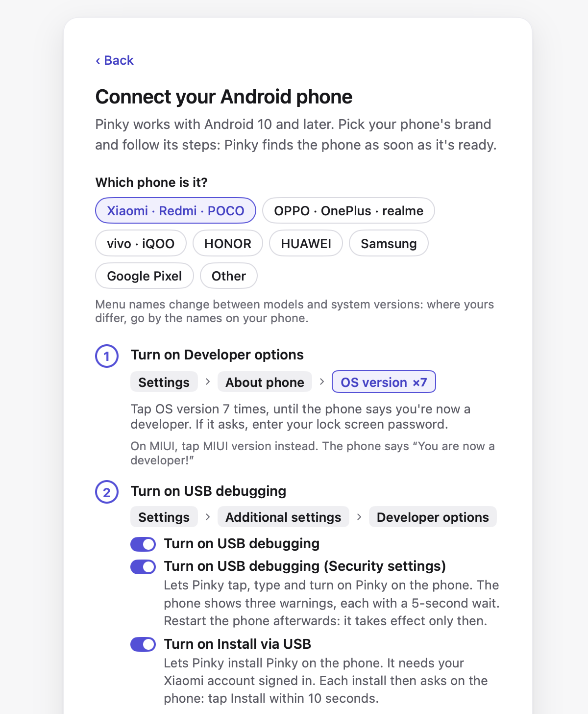
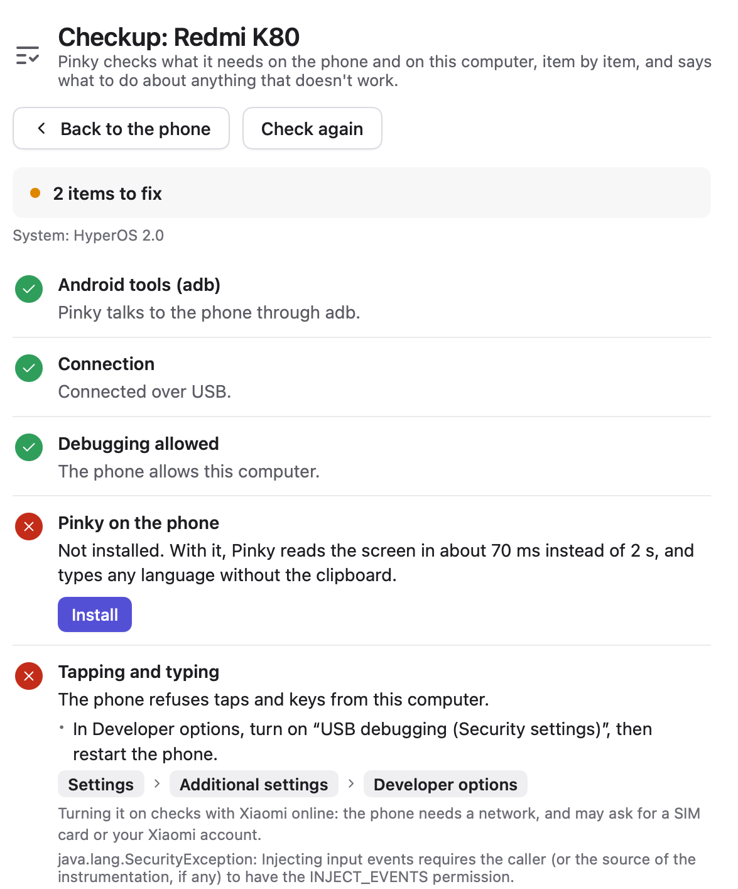

<p align="center"></p>
<h1 align="center">Pinky</h1>
<p align="center"><b>Yapay zekâ iPhone’unuzu ya da Android telefonunuzu kullansın, siz de sürecin içinde olun: macOS, Windows ya da Linux’tan herhangi bir ajan veya doğrudan telefonda Pinky’nin kendisi.</b></p>
<p align="center"><a href="https://github.com/DIYgod/pinky/releases/latest">İndir</a> · <a href="#başlarken">Başlarken</a> · <a href="#sss">SSS</a> · <a href="https://discord.gg/S27b7SHjng">Discord</a></p>
<p align="center"><a href="README.md">English</a> · <a href="README.zh-CN.md">简体中文</a> · <a href="README.ja.md">日本語</a> · Türkçe</p>
<p align="center"><sub>Bu README bir topluluk çevirisidir. En güncel içerik için İngilizce <a href="README.md">README.md</a> dosyasına bakın.</sub></p>
<p align="center"><br><sub>Bir Android 16 emülatöründe Claude Code’un gerçek bir çalışması. Pinky varsayılan olarak ödemelerden önce sorar; bu çalışmada mesajlardan önce de soruyor.</sub></p>

Pinky, herhangi bir ajanın (Claude Code, Claude Desktop, Codex, Cursor ya da bir betik) MCP üzerinden gerçek bir iPhone’u veya Android telefonu kullanmasını sağlar; siz de bilgisayarınızdan izler, riskli adımları onaylar, kontrolü devralır ve olanları gözden geçirirsiniz. Pinky görevleri seçtiğiniz bir yapay zekâ modeliyle kendisi de yapabilir: bilgisayarınızdan ya da hiç bilgisayar olmadan, doğrudan telefondaki Pinky uygulamasından. Görevi kim yaparsa yapsın, onaylar ajana verilen talimatlarla değil, Pinky’nin ağ geçidi (gateway) tarafından uygulanır.

- **Her platform.** macOS (Apple silicon ve Intel), Windows ve Linux için tek uygulama. Android telefonları (Android 10–17) ve iOS 17.4 ya da üstündeki iPhone’ları yönetir: iOS 27 ve sonrasında hiçbir şey kurmanız gerekmez; iOS 17.4–26 arasında Xcode yüklü bir Mac’ten bir kez Pinky’nin iPhone uygulaması Pinky on the iPhone kurulur, bunu iOS 27’de de seçebilirsiniz (orada, daha eski bir telefonda ve Simulator’larda denendi; [ayrıntılar](#telefonlar)).
- **Küçük ve yerel.** Pencere, Electron ve webview olmadan GPU üzerinde [MyGo](https://github.com/egoist/mygo) ile çizilir: 16–22 MB’lık bir indirme; bir Mac’te boştayken yaklaşık 70 MB bellek ve %0 CPU kullanır.
- **Her ajan, tek tık.** Settings › Agents; Claude Code, Claude Desktop, Codex, Cursor ve daha fazlasını bağlar. MCP sunucularını kullanabilen her ajan, aynı bilgisayarda ya da HTTP üzerinden çalışır.
- **Telefonda Pinky, bilgisayar gerekmez.** Android ve iPhone’daki Pinky uygulaması, görevleri seçtiğiniz bir modelle kendisi yapar: DeepSeek, Qwen, Kimi ve GLM’den Claude, GPT, Gemini’ye ve Ollama ya da LM Studio’daki yerel modellere kadar. Bir görevi yazın, söyleyin ya da ona bir şey paylaşın; Android’de ekranda görünenle ilgili yüzen bir düğmeden soru sorun ve siz telefonu kullanmaya devam ederken gizli bir arka plan ekranında çalışmasına izin verin ([nasıl](#telefonda-pinky)).
- **Zamanlanmış görevler ve hafıza.** Pinky bir görevi belirlenen zamanlarda çalıştırabilir ya da bir koşul gerçekleştiğinde size haber verebilir; bilgisayarda ve Android’de. Bir görevden sonra, örneğin söylediğiniz bir tercihi, hatırlamak için bir not önerebilir ve yalnızca siz evet derseniz saklar ([daha fazlası](#ask-pinky)).
- **Telefon kilitli mi? Bilgisayarınızdan açın.** Telefonun PIN’ini Pinky’ye bir kez kaydedin, sonra her kilit açmayı Touch ID, Windows Hello ya da anahtarlığınızın parolasıyla onaylayın. Ajanlar PIN’i hiçbir zaman görmez.
- **Ücretsiz ve açık kaynak**, Apache-2.0 lisansıyla; hesap açmanız gerekmez.

<table>
<tr>
<td width="50%" valign="top"><br><b>Riskli adımları siz onaylarsınız.</b> Ödemeler, alım satımlar ve para transferleri sizin tıklamanızı bekler; Settings › Safety’de gönderimlerin, siparişlerin, silmelerin, aramaların, yüklemelerin, uygulamadan çıkan bağlantıların ve ayar değişikliklerinin ya da her adımın da beklemesini sağlayabilirsiniz. Pinky bu düğmeleri 10 dilde tanır. Kurallar Pinky’nin ağ geçidinde çalışır; bu yüzden ekrandaki bir metin onu ikna etmeye çalışsa bile bir ajan kendini onaylayamaz.</td>
<td width="50%" valign="top"><br><b>Varsayılan olarak yasak.</b> Bankacılık, cüzdan ve parola yöneticisi uygulamaları ajanlara görünmez; ajanlar parola ya da tek kullanımlık kod alanlarına yazamaz. Bir ajanın bir görev için bankacılık ya da cüzdan uygulamasına ihtiyacı olduğunda size sorar ve o uygulamaya yalnızca o görev için izin verebilirsiniz. Her yeni ajan sizin onayınızı gerektirir ve yalnızca ona verdiğiniz yetki kapsamını alır.</td>
</tr>
<tr>
<td width="50%" valign="top"><br><b>Telefonunuz sizin kalır.</b> Android 13 ve sonrasında ajanlar gizli bir ikinci ekranda çalışır; böylece telefonun kendi ekranı sizin kalır ya da kapalı ve kilitli durur. Daha eski Android telefonlarda ve iPhone’larda ana ekranı kullanırlar.</td>
<td width="50%" valign="top"><br><b>İstediğiniz an devralın.</b> Yansıtılan ekrana tıklayın, ajan siz geri verene kadar duraklar; Android’de telefona kendiniz dokunmanız da onu duraklatır. Her şeyi durdurmak için her yerden ⌥⌘. (Windows ve Linux’ta Ctrl+Alt+.) kısayolunu kullanın.</td>
</tr>
<tr>
<td width="50%" valign="top"><br><b>Her çalışma kayıt altında.</b> Her adım sade bir dille, ekran görüntüleri ve her adım için işaret konmuş bir ekran kaydıyla tutulur; HTML rapor olarak dışa aktarılabilir. Hepsi bilgisayarınızda kalır.</td>
<td width="50%" valign="top"><br><b>iPhone’larda da.</b> Aynı ağ geçidi, onaylar ve kayıtlar iOS 17.4 ve sonrasında da çalışır (<a href="#telefonlar">neler çalışıyor</a>). Burada iOS Simulator’da, silmeler sorulacak şekilde ayarlanmış olarak gösteriliyor.</td>
</tr>
</table>

**Durum:** pre-alpha. Claude Code, gerçek telefonları baştan sona bu yolla kullandı (USB üzerinden bir Android telefon, iOS 27’de bir iPhone ve iOS 18.7.11’de, Pinky on the iPhone’un yerini aldığı uygulama Pinky Helper aracılığıyla bir iPhone XS Max); ajanlar stdio ya da HTTP üzerinden bağlanabilir. Telefondaki Pinky, gerçek bir modelle bir Mi 10 Pro (Android 17) ve bir iPhone 13 mini (iOS 27.0.1) üzerinde görevler yaptı. Bilgisayardan kilit açma, Android’de arka planda çalışma, kayıtlar, dışa aktarma, Wi-Fi ile eşleştirme ve telefonun dosyaları hazır; bunların bir kısmı hâlâ bir insanın denemesini bekliyor. Bugün neyin çalıştığını ve nasıl deneneceğini görmek için [docs/ACCEPTANCE.md](docs/ACCEPTANCE.md) dosyasına bakın.

## Başlarken

Pinky’yi kurun, telefonunuzu bağlayın ve Pinky’yi ajanınıza ekleyin. Sonra ajandan telefonda bir şey yapmasını isteyin ve Pinky’nin penceresinde çalışmasını izleyin.

### Gerekenler

| | Gereken |
| --- | --- |
| **Mac** | macOS 13 ya da üstü, Apple silicon ya da Intel |
| **Windows** | Windows 10 ya da 11, 64 bit (x64) |
| **Linux** | Ubuntu 20.04, Debian 11 ya da daha yeni bir sisteme (glibc 2.29 ya da üstü) ve GTK 3’e sahip 64 bit bir PC (x86-64) |
| **Android telefon** | Android 10–17 ve bir USB kablosu. Pinky kendi adb’sini getirir; Windows’ta bazı telefonlar bir USB sürücüsüne, Linux’ta ise USB erişimine ihtiyaç duyar ([aşağıda](#windows-ve-linux-üzerinde-usb)) |
| **iPhone ya da iPad** | iOS 17.4 ya da üstü ve kurulum için bir USB kablosu; sonrasında Wi-Fi üzerinden de çalışır ([aşağıda](#wi-fi-üzerinden-iphone-ve-ipad)). Pinky onu Apple’ın Xcode ile gelen ya da siz istediğinizde Pinky’nin üçüncü taraf bir yansıdan indirebildiği geliştirici disk görüntüsüyle (developer disk image) kendisi hazırlar ([aşağıda](#iphone)). iOS 17.4–26 arasında ayrıca Pinky’nin uygulaması Pinky on the iPhone gerekir ([aşağıda](#ios-174-ile-26-arasındaki-iphone-modelleri)) |
| **Simulator’lar ve emülatörler** | İsteğe bağlı, telefonun yerine ya da yanında: Xcode yüklü bir Mac’te iOS Simulator veya Android Studio’dan bir Android emülatörü. Onları orada oluşturursunuz; Pinky başlatır ([aşağıda](#telefonlar)) |
| **Ajan** | Claude Code, Claude Desktop, Codex ya da Cursor gibi MCP sunucularını kullanabilen herhangi bir ajan |

### 1. Pinky uygulamasını indirip kurun

Pinky’yi [son sürümden](https://github.com/DIYgod/pinky/releases/latest) edinin:

- **Mac:** Apple silicon’lı (M1 ya da sonrası) bir Mac için `pinky-<version>-arm64.dmg`, Intel bir Mac için `pinky-<version>-amd64.dmg` dosyasını indirin. Açın ve Pinky’yi Applications klasörüne sürükleyin. [Homebrew](https://brew.sh) ile `brew install --cask diygod/tap/pinky` aynı işi yapar.
- **Windows:** `pinky-setup-<version>-amd64.exe` dosyasını indirip çalıştırın. Pinky’yi yönetici hakları olmadan, hesabınız için kurar. Yükleyici henüz imzalı olmadığından SmartScreen, Windows’un bilgisayarınızı koruduğunu söyleyebilir: **More info**’yu, ardından **Run anyway**’i seçin (Türkçe Windows’ta **Ek bilgi** ve **Yine de çalıştır**). Pinky’yi kurmadan kullanmak için `pinky-<version>-windows-amd64.zip` dosyasını açın ve `Pinky.exe`’yi çalıştırın.
- **Linux:** Debian ve Ubuntu’da `pinky_<version>_amd64.deb` dosyasını indirip `sudo apt install ./pinky_<version>_amd64.deb` ile kurun. Diğer sistemlerde `pinky-<version>-linux-amd64.tar.gz` arşivini kendine ait bir klasöre açın ve içindeki `pinky`’yi çalıştırın.

Pinky yeni sürümleri kendisi arar; bir Mac’te, Windows yükleyicisiyle kurulduğunda ve Linux `.tar.gz` arşivinden açıldığında bunları kurar da ([Güncellemeler](#güncellemeler)).

### 2. Telefonunuzu bağlayın

Pinky’yi açın ve **Add phone**’u seçin. Hazır olan bir telefon Pinky’nin penceresinde görünür; bir şey eksikse Pinky’deki telefon sayfası neyin eksik olduğunu söyler.

#### Android

**Add phone › Android**, bu adımları telefonunuzun markasına göre, markanın kendi menü adları ve ek anahtarlarıyla gösterir: Xiaomi, OPPO, vivo, HONOR, HUAWEI, Samsung ve Pixel için; diğerleri için genel adımlar.

1. Telefonda USB hata ayıklamayı açın: Ayarlar › Telefon hakkında’da **Yapım numarası**’na 7 kez dokunun, sonra Ayarlar › Sistem › Geliştirici seçenekleri’nde **USB hata ayıklama**’yı açın. Bazı markalar bu menüleri biraz farklı adlandırır.
2. Telefonu bilgisayara takın. Telefon USB hata ayıklamaya izin verilip verilmeyeceğini sorduğunda **İzin ver**’e dokunun. Android 11 ve sonrasında bunun yerine **Add phone**’dan Wi-Fi üzerinden eşleştirebilirsiniz ([başarısız olursa](#wi-fi-ile-eşleştirme-başarısız-olursa)). Android 10’da Kablosuz hata ayıklama yoktur: telefon takıldıktan sonra **Use Wi-Fi instead…** onu Wi-Fi’a taşır ([aşağıda](#telefonlar)).
3. Pinky, telefon için kendi uygulamasını, Pinky on the phone’u (telefonda Pinky adıyla görünür) kurmayı önerir; bu, ekranı okumayı kat kat hızlandırır ve Pinky’nin her dilde yazabilmesini sağlar. Telefon kuruluma bir kez izin vermenizi isteyebilir.

Her telefonun, yansıtılan ekranın altındaki ··· menüsünde bir **Checkup**’ı vardır; neyin çalıştığını ve çalışmayanın nasıl düzeltileceğini listeler, örneğin bir Xiaomi’nin USB hata ayıklama (Güvenlik ayarları) anahtarı.

Wi-Fi üzerinden Pinky, yanıt veren telefonun sizin telefonunuz olduğundan emin olur: kurduğu her telefona yalnızca telefonun hata ayıklama bağlantısının okuyabildiği bir işaret bırakır ve adb telefona her bağlandığında bunu denetler; böylece ağdaki başka bir cihaz onun yerine yanıt veremez. Kablosuz hata ayıklama ile bağlı olup Pinky’nin kullanmadığı bir telefon (örneğin başka bir araçla bağlanmış) Wi-Fi’da bulunmuş olarak görünür ve siz **Use**’u seçene kadar Pinky ona dokunmaz. Telefonu sıfırladıktan ya da kendiniz yeniden kurduktan sonra telefonun sayfası **This may not be …** diyorsa, orada **Trust this phone…**’u seçin ya da telefonu bir kez kabloyla takın.

Telefonu dışarı mı çıkarıyorsunuz? Tailscale ile Pinky ona evden uzaktayken de ulaşır ([nasıl](#evden-uzaktaki-telefonlar)).

<table>
<tr>
<td width="50%" valign="top"><br><sub>Xiaomi seçiliyken <b>Add phone › Android</b>.</sub></td>
<td width="50%" valign="top"><br><sub>Bir Redmi’nin <b>Checkup</b>’ı; düzeltilecek iki şeyle.</sub></td>
</tr>
</table>

#### Android araçları

Pinky, Android telefonlara ulaşmak için kullandığı aracı, adb’yi, Android’in kaynak kodundan derlenmiş olarak kendisi getirir; bu yüzden başka bir şey kurmanız gerekmez. Bilgisayarda Android Studio’dan, Homebrew’dan ya da sistem paketlerinden gelen Android platform araçları zaten varsa Pinky onları kullanır ve adb sunucusunu Android Studio ve diğer araçlarla paylaşır. Pinky kapanırken, Android Studio gibi başka bir uygulama kullanmıyorsa getirdiği adb’yi durdurur; Settings › Advanced › **Stop adb when Pinky quits** bunu kapatır. Sizin kurduğunuz bir adb çalışmaya devam eder.

#### Windows ve Linux üzerinde USB

- **Windows:** telefonun USB hata ayıklaması bir sürücü gerektirir. Windows birçok telefon için bunu kendisi kurar; kuramadığında Pinky telefonu kurulum gerektiren olarak listeler ve hangi sürücünün kurulacağını söyler: Pixel’ler için [Google USB Driver](https://developer.android.com/studio/run/win-usb), Samsung telefonlar için [Samsung’unki](https://developer.samsung.com/android-usb-driver), diğerleri için [telefon üreticisininki](https://developer.android.com/studio/run/oem-usb). Ardından telefonu çıkarıp yeniden takın.
- **Linux:** bilgisayar, Pinky’nin telefonun USB cihazını açmasına izin vermelidir; bu, Android telefonlar için udev kuralları gerektirir: Debian ve Ubuntu’da `sudo apt install android-sdk-platform-tools-common`, Arch’ta `android-udev`, Fedora’da `android-tools`. `plugdev` grubunda olmanız da gerekebilir. Sonra telefonu yeniden takın. Bunlar eksikse Pinky söyler.

#### Wi-Fi ile eşleştirme başarısız olursa

Bir telefon kabloyla çalışıyor ama **Pair over Wi-Fi** tamamlanmıyorsa, eşleştirme sayfası yarım dakika içinde Pinky’nin ne gördüğünü söyler:

- **The phone hasn't shown up on the network yet:** Kablosuz hata ayıklamanın açık olduğunu ve telefonun bilgisayarla aynı Wi-Fi’da olduğunu denetleyin. Misafir Wi-Fi’ları, AP (istemci) yalıtımı olan yönlendiriciler ve birçok ofis ağı, cihazların birbirini bulmasını engeller. Böyle bir ağda **Pair with a code instead**’i seçin: telefonda **Eşleme kodu ile cihaz eşle**’ye dokunun ve gösterdiği IP adresini, bağlantı noktasını ve altı haneli kodu girin; bunlar o pencere her açıldığında değişir. Pinky’nin eşleştirmek için artık arama yapması gerekmez; sonrasında telefonu yine bulamazsa, Kablosuz hata ayıklama ekranının en üstündeki (eşleme penceresindekini değil) IP adresini ve bağlantı noktasını ister ve oradan bağlanır. Telefona bu adreslerden de ulaşamıyorsa ağ cihazlarını birbirinden ayırıyordur: cihazların birbirine ulaşabildiği bir Wi-Fi kullanın (örneğin misafir ağı yerine ev ağınızı) ya da kabloyu.
- **Pinky isn't allowed to look for phones on this network:** bir Mac’te Pinky’nin Yerel Ağ erişimine ihtiyacı vardır ve macOS bu erişim olmadan hata vermez: arama yalnızca hiçbir şey bulmaz. **Open Local Network settings**’i seçin, Sistem Ayarları › Gizlilik ve Güvenlik › Yerel Ağ altında Pinky’yi açın ve yeniden deneyin (macOS, Pinky’nin yerel ağınızdaki cihazları bulup bulamayacağını sorarsa **İzin Ver**’e tıklayın). Bir Mac’te telefonun **Checkup**’ı da bunu **Local network** altında gösterir. Windows ve Linux’ta bir güvenlik duvarı aramayı aynı şekilde engelleyebilir: Pinky’nin yerel ağı kullanmasına izin verin ya da kodla eşleştirin.
- **Pinky can't look for phones on this network:** bilgisayarın Wi-Fi’a ya da Ethernet’e bağlı olduğunu denetleyin.
- **The phone showed up, but pairing hasn't finished:** telefon bir hata gösteriyorsa ya da Kablosuz hata ayıklama ekranına döndüyse kodu yeniden tarayın ya da kodla eşleştirin.

Eşleştirme bir hatayla durduğunda sayfa adb’nin ne bildirdiğini söyler:

- **The phone ended the pairing before it finished** (QR kod): telefon tarama ekranından çıktı, Wi-Fi değiştirdi ya da telefonla bilgisayar arasındaki bir şey bağlantıyı kesti; adb hangisi olduğunu ayırt edemez. Telefonu tarama ekranında tutup yeniden deneyin ya da mesajın yanındaki **Pair with a code instead**’i seçin.
- **The phone didn't accept the pairing** (eşleme kodu): yanlış bir kod ya da eşleme penceresine ait olmayan bir bağlantı noktası. Kablosuz hata ayıklama ekranının en üstündeki adres eşleştirme için değil, bağlanmak içindir ve adb iki hataya da aynı yanıtı verir.
- **Nothing at that address is waiting to pair** ya da **The phone stopped waiting to pair:** eşleme penceresi ya da tarama ekranı kapandı veya bağlantı noktası yanlış. Pencereyi yeniden açın ve şimdi gösterdiğini kullanın.
- **Couldn't reach the phone at that address** ya da **Pinky couldn't connect to it:** yukarıdaki gibi ağ, bilgisayarı ve telefonu birbirinden ayırıyor; bilgisayardaki bir VPN ya da güvenlik duvarı da buna yol açabilir.
- **The adb server running on this computer is too old:** başka bir program, platform-tools 30’dan eski bir adb başlattı. Onu kapatın ya da güncelleyin; Pinky kendi adb’sini başlatır.

Pinky, adb’nin kendi sözlerini günlüğüne yazar; **Help › Send Feedback…** bunu tanılama bilgileriyle birlikte ekler.

Wi-Fi üzerinden eşleştirme Android 11 ya da sonrasını gerektirir; Android 10’lu bir telefon bunun yerine kablodan Wi-Fi’a geçer (**Use Wi-Fi instead…**, [aşağıda](#telefonlar)). Android 16’ya kadar Kablosuz hata ayıklama, telefon Wi-Fi ağından ayrıldığında (aynı ağın başka bir erişim noktasına geçse bile) ya da yeniden başladığında kendiliğinden kapanır: yeniden açın ya da **Add phone**’dan yeniden eşleştirin.

#### iPhone

Pinky bir iPhone’u kendisi hazırlar; **Add phone › iPhone** sizi adım adım yönlendirir.

1. iPhone’u bilgisayara takın, kilidini açın, **Güven**’e dokunun ve parolasını girin. Windows’ta önce Microsoft Store’dan Apple Devices’ı (ya da iTunes’u) kurun; Linux’ta `usbmuxd` paketini. Bunlar eksikse Add phone söyler.
2. iPhone’da Ayarlar › Gizlilik ve Güvenlik’te **Geliştirici Modu**’nu açın: anahtarın orada görünmesini Pinky sağlar. iPhone yeniden başlar; kilidini açın, **Aç**’a dokunun ve parolayı girin.
3. Pinky, Apple’ın geliştirici disk görüntüsünü iPhone’a bağlar (mount) ve onu hazır olarak listeler. iOS 27’deki bir iPhone yeniden başladığında görüntüyü korur; iOS 27’nin altında Pinky, her yeniden başlatmadan sonra siz iPhone’un kilidini açtığınızda görüntüyü yeniden bağlar.

Geliştirici disk görüntüsü, Apple’ın geliştiriciler için ücretsiz uygulaması [Xcode](https://apps.apple.com/app/xcode/id497799835) ile gelir ve Pinky onu kendisiyle birlikte dağıtmaz. Bir Mac’te Xcode’u bir kez kurup açın: Pinky, Xcode’un kurduğu görüntüyü kullanır ve Xcode’un bir daha çalışması gerekmez. iOS 27 ya da sonrasındaki bir iPhone, Xcode 27 ya da sonrasının görüntüsünü gerektirir: Apple’ın imzalama sunucusu artık eskilerini imzalamaz ve Add phone bu durumda Pinky’nin hangi görüntüyü kullandığını ve daha yenisinin nasıl edinileceğini söyler. Windows ve Linux’ta böyle bir Mac’teki `/Library/Developer/DeveloperDiskImages/iOS_DDI` klasörünü Pinky’nin klasörüne kopyalayın ([nereye](docs/notes/ios.md#preparing-a-phone-without-xcode)). İkisi de yoksa ya da Apple, Pinky’nin bulduğu görüntüyü (Xcode’unkini ya da Pinky’nin klasörüne kopyalananı) reddederse, Add phone görüntüyü üçüncü taraf bir yansıdan, github.com/doronz88/DeveloperDiskImage’den (Xcode 27.0 beta 4, 32 MB; Apple değil, pymobiledevice3’ün yazarı tarafından tutuluyor) indirmeyi önerir; bu yalnızca siz Download’a tıkladığınızda olur. Pinky her dosyayı beklediği sağlama toplamına (checksum) göre denetler ve o andan itibaren Apple’ın reddettiği görüntünün yerine bunu kullanır. iOS 27 ve sonrasında iPhone’a hiçbir uygulama kurulmaz.

iPhone 13 mini’de (iOS 27.0.1) denetlendi: Pinky’nin Xcode’un görüntüsünü kendisi bağlaması (görüntü kaldırıldıktan sonra yaklaşık 1,5 sn’de), telefonda zaten olan görüntüyü koruması ve iPhone’un yeniden başladığında görüntüyü koruması. Henüz bir telefonda denenmedi: indirilen görüntü, Geliştirici Modu anahtarı, iOS 27’nin altındaki iPhone’lar ve Windows’ta bir iPhone’u eşleştirme. Katkıda bulunanlar, görüntü zaten üzerlerindeyken, Linux’ta (Arch Linux) iOS 27.2’deki bir iPhone ve bir iPad’i, Windows 11’de de iOS 27.2’deki bir iPhone’u kabloyla ve Wi-Fi üzerinden kullandı.

#### Wi-Fi üzerinden iPhone ve iPad

Pinky, bir iPhone’u ya da iPad’i bilgisayarla aynı Wi-Fi’dayken ve bilgisayar onu orada listelerken Wi-Fi üzerinden de kullanır; bilgisayar, telefon için Wi-Fi bağlantıları açıldığında onu listeler. Pinky, telefonu taktığınızda ve telefon bilgisayara güvendiğinde bunları açar: bu, Finder’daki **Wi-Fi’dayken bu iPhone’u göster** ayarının aynısıdır; bu yüzden zaten böyle ayarlanmış bir telefon olduğu gibi kalır. Varsayılan olarak açıktır; **Settings › Phones › Use iPhones and iPads over Wi-Fi** bunu kapatır ve telefonların ayarına dokunmaz. Bir telefon kablosunu çıkardığınızda Wi-Fi’da görünmüyorsa, **Checkup**’ı **Wi-Fi** altında durumunu söyler: Wi-Fi bağlantısının açık olup olmadığını ve onu Pinky’nin açıp açmadığını, Pinky’nin neden açamadığını ve bu bilgisayarın telefonu Wi-Fi’da görüp görmediğini.

- Pinky’nin kullandığı bir iPhone ya da iPad, kablosunu çıkardığınızda ayarlarıyla aynı telefon olarak çalışmaya devam eder: Pinky onu kendiliğinden Wi-Fi’a, taktığınızda yeniden kabloya taşır ve bir ajanın görevi sürer; bu sırada çağrıları birkaç saniye bekler.
- Pinky’nin kullanmadığı bir cihaz, örneğin bu bilgisayarla eşleştirilmiş bir aile üyesinin iPad’i, **Found on Wi-Fi** olarak görünür. Pinky adını, modelini ve iOS sürümünü okur, başka hiçbir şey yapmaz ve ajanlar onu görmez; ta ki siz onu Wi-Fi üzerinden kuran **Use**’u ya da siz takana kadar listeden uzak tutan **Ignore**’u seçene kadar.
- Wi-Fi’daki kilitli bir iPhone ya da iPad **Locked on Wi-Fi** olarak görünür ve kilidini açtığınızda Pinky ona bağlanır: uykudayken yaklaşık her dakika ağdan düşer ve o sırada ona bağlanmak ekranını yakar.
- Wi-Fi üzerinden kurulum: bilgisayara güvenmek kablo gerektirir; Geliştirici Modu anahtarı gizliyken onu görünür yapmak da öyle (Xcode ile kullanılmış bir telefonda zaten görünür). Geliştirici Modu’nu açmak telefonda yapılır ve Pinky geliştirici disk görüntüsünü Wi-Fi üzerinden de bağlar; 1,5 sn yerine yaklaşık 9 sn’de. **Add phone › iPhone**, hangi adımın kablo gerektirdiğini söyler.
- Wi-Fi üzerinden Pinky yalnızca eşleştiği telefonla konuşur: telefonun bu bilgisayara ilk güvendiğinde aldığı sertifikayı denetler; böylece ağdaki başka bir cihaz onun yerine yanıt veremez. iOS 27’nin altında Pinky on the iPhone’daki WebDriverAgent bağlantısı şifrelenmez; orada yalnızca Wi-Fi kadar güvenlidir.

Wi-Fi üzerinden her adım kabloya göre daha yavaştır, en çok da ekran görüntüleri. Bir iPad Pro 11 inç (3. nesil, iPadOS 27.0.1) üzerinde ölçülen Wi-Fi ve (parantez içinde) kablo değerleri: bir kaydırma 80–210 ms sonra ekranda görünür (60–90 ms), ana ekran 0,6–2,6 sn’de okunur (0,5–0,6 sn), bir ekran görüntüsü 5 sn sürer (1 sn) ve videonun paketlerinin %0,2’si kayboldu (hiçbiri). Kabloyu çıkarmak çalışan bir görevi yaklaşık 5 sn’de Wi-Fi’a taşıdı, takmak da 2–6 sn’de geri taşıdı ([ayrıntılar](docs/notes/ios.md#wi-fi)).

Bir Mac’te sistemin cihaz hizmeti usbmuxd, bağlantısı bir kez koptuktan sonra (örneğin Wi-Fi’ı kapanıp açıldığında) Wi-Fi’daki bir iPhone’u kaybedebilir ve onu yaklaşık bir saate kadar yeniden aramayabilir; Finder da onu kaybeder. Pinky, kullandığınız bir telefonun ağda olduğu hâlde artık listelenmediğini fark eder, onu **Lost on Wi-Fi** olarak gösterir ve sayfasında **Restart device service…** önerir: onayladıktan sonra macOS bir yönetici parolası ister ve kablodakiler de dâhil her iPhone ve iPad bir iki saniyeliğine bağlantıyı keser. Terminal’de `sudo killall usbmuxd` aynı işi yapar. Bir telefonun kablosunu çıkardıktan hemen sonra bunu yaklaşık 10 saniye içinde söyler; aksi hâlde bir dakika bekler, çünkü uyanan bir telefon kendiliğinden geri gelir. Kablosunu çıkardığınız ve bu bilgisayarın Wi-Fi’da hiç görmediği bir telefon, onu neyin gizliyor olabileceğiyle birlikte **Not seen on Wi-Fi** olarak görünür: uykuda, başka bir ağda ya da cihazları ayıran bir ağda (misafir ağları, bazı yönlendiriciler), bir VPN veya Pinky’nin yerel ağa izni yok.

Linux ve Windows’ta sistemin cihaz hizmeti Wi-Fi’daki iPhone ve iPad’leri kendiliğinden listelemez: Linux’ta (`usbmuxd` paketi) onları yalnızca kablodayken, Windows’ta da (Apple Devices ya da iTunes) yine yalnızca kablodayken listeler. Bu yüzden orada Pinky, telefonları Wi-Fi üzerinden kullanırken sistemin hizmetinin önünde kendine ait küçük bir cihaz hizmeti çalıştırır: bu bilgisayarla eşleştirilmiş telefonları ağda bulur, onlara doğrudan bağlanır ve kablodaki telefonlarla ilgili her şeyi sistemin hizmetine aktarır. Bu durumda Pinky’nin iPhone ve iPad’lere olan tüm bağlantıları, kablodakiler de dâhil, ondan geçer. Bunun için sistemin kendi hizmetinin (Linux’ta `usbmuxd`, Windows’ta Apple Devices) ötesinde kurulacak ya da ayarlanacak bir şey yoktur. Telefonları Wi-Fi’da kendisi listeleyen netmuxd gibi bir cihaz hizmeti çalıştırıyor ve Pinky’yi ona işaret eden `USBMUXD_SOCKET_ADDRESS` ile (`unix:///path/to/socket` ya da `tcp://127.0.0.1:port`) başlatıyorsanız, Pinky onu kullanır ve kendi hizmetini çalıştırmaz.

Pinky bir telefonu açarken ya da kabloyla Wi-Fi arasında taşırken onu çevrimdışı yerine **Connecting** ya da **Moving to Wi-Fi** olarak gösterir. Wi-Fi üzerinden Pinky metni, orada yaklaşık 5 sn süren ekran görüntülerinden değil canlı görüntüden okur. Parolası olmayan bir iPhone ya da iPad hiçbir zaman kilitli görünmez; bu yüzden uyumak için ağdan düştükten sonra Pinky ona ancak 30 saniye boyunca geri geldiğinde bağlanır.

#### iOS 17.4 ile 26 arasındaki iPhone modelleri

iOS 27’nin altında bir iPhone, bilgisayardan dokunma ve yazmayı yalnızca telefonda WebDriverAgent’ı barındıran bir uygulama aracılığıyla kabul eder: Pinky’nin kendi uygulaması Pinky on the iPhone; bunu Xcode yüklü bir Mac’ten Apple kimliğinizle imzalanmış olarak bir kez kurarsınız: iPhone’u takın ve Pinky’deki sayfasında (ya da Add phone › Try an older iPhone’da) **Install Pinky on the iPhone**’a tıklayın veya Terminal’de `pinkyctl helper install` komutunu çalıştırın. İkisi de uygulamayı derler, imzalar ve kurar; Pinky’nin penceresi her adımı gösterir ve Xcode beklediğinde telefonun kilidini açmanızı ister ([nasıl](docs/notes/ios.md#installing-pinky-on-the-iphone)). Bilgisayardaki Pinky telefonu kullanırken uygulama bunu iPhone’da söyler. Pinky’nin bu iş için Kasım 2026’dan önce kurduğu uygulama Pinky Helper çalışmaya devam eder ve Pinky on the iPhone derlenemediğinde Pinky onu hâlâ kurar (`pinkyctl helper install --helper-only` onu ister). Ücretsiz bir Apple kimliğiyle her 7 günde bir yeniden kurulması gerekir: iki gün önceden telefonun sayfası ve Checkup’ı **Install again** ile size hatırlatır; süresi dolduğunda telefon kurulum gerektiren olarak görünür ve nedenini söyler ([nasıl yeniden kurulur](docs/notes/ios.md#when-the-signature-of-pinky-on-the-iphone-runs-out)). Pinky Helper, Windows’ta iOS 18.7.11’deki bir iPhone XS Max üzerinde kabloyla ve Wi-Fi üzerinden denendi; onun yerine geçen Pinky on the iPhone, iOS 27.0.1’deki bir iPhone 13 mini’de Pinky Helper’ın üzerine kuruldu ve bilgisayar orada test hizmetini başlatıp durdurdu; iOS 17.4–26’da henüz denenmedi. Bu uygulama olmadan Pinky yalnızca ekranı gösterip okuyabilir (bir Mac’te) ve uygulamaları açabilir: dokunma, kaydırma ya da yazma yoktur. iOS 17.3 ve öncesi desteklenmez.

### 3. Pinky uygulamasını ajanınıza ekleyin

Pinky’de **Settings › Agents**’ı açın ve ajanınızın yanındaki **Connect**’e tıklayın. Pinky, bilgisayarınızda Claude Code, Claude Desktop, Codex, Cursor, VS Code, Copilot CLI, Windsurf (Devin Desktop) ve Gemini CLI’ı bulur ve kendini uygulamanın kendi yoluyla ajanın MCP sunucularına ekler: varsa ajanın kendi komutuyla (örneğin `claude mcp add`) ya da ayar dosyasında; Pinky bu dosyayı önce kopyalar ve yalnızca Pinky’nin girdisini değiştirir. Ayrıca Pinky’nin ajan rehberi [SKILL.md](docs/SKILL.md) dosyasını ajanın becerileri (skills) okuduğu yere kurar ve güncel tutar: Pinky güncellendiğinde kurduğu rehberi yeni sürümünkiyle yeniden yazar. Bir ajan bağlanana kadar Pinky’nin kenar çubuğundaki bir kart bunu yapmayı önerir ya da nereden ajan edinebileceğinizi söyler.

<p align="center"></p>

- **Claude Desktop:** Connect, Pinky’nin Claude Desktop’taki uzantısını açar; orada **Install**’a tıklayın. [Sürüm sayfasındaki](https://github.com/DIYgod/pinky/releases/latest) `pinky-<version>.mcpb` dosyasına çift tıklamak da aynı işi yapar.
- **Diğer ajanlar:** **Settings › Agents › Add an agent by hand**, Pinky kopyanız için komutu, onu kopyalayan düğmelerle birlikte gösterir. Onu çalıştıran bir MCP sunucusu (stdio) ekleyin. Homebrew cask’i ya da bir Linux paketiyle, bir JSON yapılandırmasında:

  ```json
  { "mcpServers": { "pinky": { "command": "pinkyctl", "args": ["mcp"] } } }
  ```

  Terminaldeki Claude Code için: `claude mcp add --scope user pinky -- pinkyctl mcp`. Çoğu ajan rehberi `~/.agents/skills/pinky/SKILL.md` konumundan, Claude Code ise `~/.claude/skills/pinky/SKILL.md` konumundan okur.

Komut `pinky` değil, `pinkyctl`’dir: birçok bilgisayarda zaten `pinky` adlı başka bir program vardır. Başka bir bilgisayardaki ya da bir konteynerdeki ajan bunun yerine HTTP üzerinden bağlanabilir ([nasıl](docs/mcp.md#over-http)). [docs/mcp.md](docs/mcp.md#connecting-an-agent), Connect’in her ajan için neyi değiştirdiğini söyler.

### 4. Deneyin

Ajandan telefonunuzda bir şey yapmasını isteyin; örneğin “Telefonumda Mesajlar’ı aç ve Sam’e geç kalacağımı söyle.” Bir ajan ilk kez bağlandığında Pinky ona izin verilip verilmeyeceğini ve neler yapabileceğini sorar. Ödemeler Pinky’nin penceresinde sizin tıklamanızı bekler; Settings › Safety’de gönderimlerin, silmelerin ve daha fazlasının da beklemesini sağlayabilirsiniz.

Elinizde telefon yok mu? **Add phone › Virtual phone**’da bir iOS Simulator ya da Android emülatörü başlatın ([aşağıda](#telefonlar)). Ya da Pinky’den çıkıp onu iki betikli demo telefonla (onaylanacak bir ödeme, engellenmiş bir bankacılık uygulaması, bir parola alanı) başlatın: bir Mac’te `/Applications/Pinky.app/Contents/MacOS/Pinky --fake`, Linux’ta `pinkyctl --fake` ya da Windows’ta PowerShell’de `& "$env:LOCALAPPDATA\Programs\Pinky\Pinky.exe" --fake`.

## Pinky kullanımı

### Telefonlar

- **Android:** USB ya da Wi-Fi üzerinden bağlanır ([yukarıda](#android)). Pinky, adb ve birlikte gelen bir scrcpy sunucusu üzerinden çalışır. Pinky ile birlikte gelen Android uygulaması Pinky on the phone, ekranı 2 sn yerine yaklaşık 70 ms’de okur ve pano kullanmadan her dilde yazar: telefonun sayfası onu kurmayı önerir (telefon bir kez izin vermenizi isteyebilir). Erişilebilirlik hizmeti yalnızca bir ajan telefonda çalışırken açıktır, çünkü bankacılık uygulamaları yanında böyle bir hizmet varken çalışmayı reddeder ([neden](#sss)). Android 13 ve sonrasında ajanlar bir arka plan ekranında çalışır; böylece telefonun kendi ekranı kapalı ve kilitli kalabilir. Bir uygulamanın erişilebilirlik ağacına tanımlamadan çizdiği metin (süper uygulamaların içindeki mini programlar ve diğer web sayfaları, oyunlar ve haritalar gibi), macOS ve Windows’ta ekranın piksellerinden (OCR) okunur; böylece ajanlar onu okuyup ona dokunabilir. Pinky engellenmiş bir uygulamayı bu yolla yalnızca siz o görev için izin verdiğinizde okur, kilitli bir telefonu asla okumaz ve hiçbir görüntü saklamaz.
- **Android 10’da Wi-Fi:** Android 10’da Kablosuz hata ayıklama yoktur. Telefonu takın ve görüntüsünün altındaki ⋯ menüsünde (ya da Settings › Phones’ta) **Use Wi-Fi instead…**’i seçin: Pinky, telefonun adb’sinin ağı dinlemesini sağlar (`adb tcpip`, 5555 numaralı bağlantı noktası), Wi-Fi adresinden ona bağlanır ve kabloyu ne zaman çıkarabileceğinizi söyler. Telefon ağa geri döndüğünde, yeni bir adreste bile, kendiliğinden yeniden bağlanır. Bu açıkken aynı ağdaki herhangi bir bilgisayar telefona bağlanmayı deneyebilir: siz bağlanmıyorken telefon **USB hata ayıklamaya izin verilsin mi?** diye sorarsa **İptal**’e dokunun ve bunu yalnızca güvendiğiniz Wi-Fi’larda kullanın. Telefon yeniden başlayana kadar sürer; sonra telefonu bir kez takın ve **Use Wi-Fi again**’i seçin. Aynı menüdeki **Stop the Wi-Fi connection** bunu kapatır ([ayrıntılar](docs/away-from-home.md#wi-fi-without-wireless-debugging)).
- **iPhone:** USB ya da Wi-Fi üzerinden bağlanır ([yukarıda](#wi-fi-üzerinden-iphone-ve-ipad)) ve Pinky tarafından hazırlanır ([yukarıda](#iphone)); iPad’ler de aynı şekilde çalışır. Pinky’nin neler yapabileceği iOS sürümüne ve Pinky’nin nasıl bağlandığına bağlıdır; bunu her iPhone için Settings › Phones’ta seçebilirsiniz (Automatic, aşağıdaki gibi sürüme göre seçer):

  | iOS | Nasıl | Neler çalışıyor | Denendiği yer |
  | --- | --- | --- | --- |
  | 27 ve sonrası | Xcode’un Device Hub protokolü; telefona hiçbir şey kurulmaz | Kıstırma (pinch) dışında her şey. Yazma, metni yapıştırır ve panonuzu eski hâline getirir | iPhone 13 mini, iOS 27.0.1 |
  | 17.4 ve sonrası, Pinky on the iPhone ile | Pinky on the iPhone: içinde WebDriverAgent bulunan Pinky uygulaması (ya da daha önce kurulmuş Pinky Helper); Xcode yüklü bir Mac’te, Pinky’nin penceresinden ya da `pinkyctl helper install` ile bir kez kurulur ([nasıl](docs/notes/ios.md#installing-pinky-on-the-iphone)): iOS 17.4–26’da otomatik, 27’de sizin seçiminiz | Her şey; telefon ekran paylaşmadığı için ekran paylaşımını reddeden bankacılık uygulamaları çalışmaya devam eder (testlerde DBS digibank ve China Merchants Bank). Device Hub’dan yavaştır: ana ekran 0,5 sn’nin altı yerine yaklaşık 7 sn’de okunur, bir dokunma 0,5–0,8 sn sürer. Ara sıra iOS, başlamadan önce telefonda parolayı ister. Canlı görüntü macOS ve Windows’ta çalışır | Pinky on the iPhone ile: bir iPhone 13 mini’ye (iOS 27.0.1) kuruldu, test hizmeti bilgisayardan başlatılıp durduruldu. Pinky Helper ile: iPhone 13 mini, iOS 27.0.1, seçili olarak; iPhone XS Max, iOS 18.7.11, Windows’ta: kablo ve Wi-Fi üzerinden canlı görüntü, tuşları ve kaydırmaları; iOS 18.5 ve 26.5 Simulator’ları |
  | 17.4–26, onsuz | Yalnızca geliştirici hizmetleri; hiçbir şey kurulmaz | İzleme (saniyede birkaç kare, macOS ve Windows), ekranı okuma (OCR ile konumlandırılmış, yalnızca macOS) ve uygulama ile bağlantı açma. Dokunma, kaydırma, yazma ya da Ana ekran yok: telefon Pinky on the iPhone olmadan girdi kabul etmez | Aynı hizmetler iOS 27.0.1’de; iOS 27’nin altındaki bir telefonda henüz denenmedi |
  | 17.3 ve öncesi | | Desteklenmez: 17.4’ten önce bağlantı yönetici hakları gerektirir; iOS 16 ve öncesi ise güncel Xcode’un artık içermediği bir geliştirici disk görüntüsü ister | |

  Pinky on the iPhone, Appium’un WebDriverAgent’ını taşır ve kendi Apple kimliğinizle imzalanır. İmza ücretsiz bir Apple kimliğiyle 7 gün, ücretli bir geliştirici hesabıyla bir yıl geçerlidir. Pinky, iPhone’da imzanın ne zaman dolacağını okur: iki gün önceden telefonun sayfası ve Checkup’ı onu yeniden kurmanızı hatırlatır (Xcode yüklü bir Mac’te Pinky’deki **Install again** ya da `pinkyctl helper install`); süresi dolduğunda ise telefon, uygulamayı başlatamamak yerine kurulum gerektiren olarak görünür ve nedenini söyler ([nasıl](docs/notes/ios.md#when-the-signature-of-pinky-on-the-iphone-runs-out)).
- **iPhone’da ekran paylaşımı:** Pinky bir iPhone’un ekranını aktarırken iOS, uygulamalara ekranın paylaşıldığını bildirir ve bazı bankacılık uygulamaları (aralarında DBS digibank ve China Merchants Bank) çalışmayı reddeder ya da sizi uyarır. iOS o sırada kamerayı ve mikrofonu da uygulamalardan esirger; bu yüzden kamera siyah görünür ve kod taramak başarısız olur. Tersi de geçerlidir: bir uygulama kamerayı ya da mikrofonu kullanırken (bir arama ya da FaceTime, Kamera, Ses Kayıtları), iOS 27, Pinky’nin iPhone’u Device Hub üzerinden göstermesine izin vermez. Telefonun sayfası bu durumda **Camera or microphone in use** der ve ne yapılacağını söyler; arama bittiğinde ya da uygulama kapandığında Pinky kendiliğinden bağlanır. Pinky ekranı, telefonun sayfası ya da kutucuğu Pinky’de açıkken, bir ajan üzerinde çalışırken ve sonrasında 30 saniye boyunca aktarır; ardından bu uygulamalar yeniden çalışır. CoreDevice üzerinden ajanlar bu uygulamaları kullanamaz. Pinky on the iPhone’u da kurun ve telefonu Automatic’te bırakın (Settings › Phones): görevler CoreDevice’ı kullanır; Pinky, DBS digibank ya da China Merchants Bank açıldığında veya ajan istediğinde görevi ekran paylaşmayan Pinky on the iPhone’a taşır; görevden sonra telefon CoreDevice’a döner. Ya da iPhone’u her görev için Pinky on the iPhone üzerinden bağlayın.
- **Simulator’lar ve emülatörler:** bir iOS Simulator (Xcode yüklü bir Mac’te) ya da bir Android emülatörü (Android Studio’dan) de telefon olabilir. **Add phone › Virtual phone** bilgisayardakileri listeler: **Start** birini başlatır ve çalıştığında Simulator ya da Emulator olarak işaretlenmiş bir telefon olarak görünür; **Shut down** onu durdurur. Pinky’nin başlattığı bir Android emülatörünün sesi yoktur; bu yüzden bir Bluetooth kulaklığı asla kendi mikrofonuna geçirmez. Onları yalnızca siz başlatırsınız: ajanların bunun için bir aracı yoktur. Canlı görüntü, kayıtlar, onaylar ve kurallar bir telefondaki gibi çalışır. Pinky, Android SDK’yı Android Studio’nun bulduğu şekilde bulur (`ANDROID_HOME`, sonra `ANDROID_SDK_ROOT`, sonra Android Studio’nun kurduğu yer) ve bir emülatör bu durumda kabloya takılı bir Android telefon gibi çalışır. Simulator’lar için Pinky, Appium’un WebDriverAgent’ını ilk seferde sizin Xcode’unuzla derler: bir sürümün kaynak kodundan, derlemeden önce dosyalarını denetleyerek, imzasız ve Apple kimliği olmadan. Bu 20 saniye ile birkaç dakika sürer ve derleme Xcode değişene kadar saklanır. Pinky Simulator ya da emülatör oluşturmaz ve sistem görüntüsü indirmez: onları Xcode’da (Window › Devices and Simulators) ya da Android Studio’nun Device Manager’ında oluşturun ([ayrıntılar](docs/notes/ios.md#ios-simulators)).
- **Kilitli telefonlar:** Pinky bir telefonu asla uyanık tutmaz. Bir adımdan önce ekranı uyandırır; telefonun kilidini bilgisayardan Touch ID ile açmak için telefonun PIN’ini Settings › Phones’ta kaydedin. Ajanlar PIN’i hiçbir zaman görmez. Android’de bu, AOSP tarzı kilit ekranlarında denetlendi (bir Mi 10 Pro’da LineageOS, Android 10, 16 ve 17 emülatörleri); Xiaomi, Samsung, OPPO, OnePlus, vivo, Honor ve Huawei’nin kilit ekranları yalnızca onlar hakkında bilinenlerden yazılmış testlerle kapsanır ve Pinky PIN tuş takımını güvenle okuyamadığı yerde hiçbir şey girmez ([ayrıntılar](docs/notes/integration.md#unlocking-other-android-phones)).
- **Kıstırma:** ajanlar haritaları, fotoğrafları ve sayfaları yakınlaştırıp uzaklaştırmak için kıstırır ve onları iki parmakla döndürür. Siz de Pinky’deki telefon görüntüsü üzerinde yapabilirsiniz: dokunmatik yüzeyde kıstırın (Linux’ta yalnızca Wayland altında) ya da Xcode’un Simulator’ındaki gibi Option’ı (Windows ve Linux’ta Alt) basılı tutarak sürükleyin; ikinci bir parmak, ekranın merkezine göre işaretçinin tersine hareket eder. Sizin her dokunuşunuz gibi bu da ajanı duraklatır. iPhone’lar Pinky on the iPhone üzerinden kıstırır. Automatic’te bırakılmış iOS 27’de Pinky, bir ajanın ya da sizin kıstırmanız için ona geçer (ilk kıstırmanız yalnızca birkaç saniye süren geçişi başlatır) ve sonra geri döner; o olmadan kıstırma yapılamaz ve ajanlara bu söylenir.
- **Sürükleme:** ajanlar `phone_drag` ile sürükler: bir şeyi tutmak için basılı tutar, belirttikleri noktalardan geçirir, gerektiğinde bekler ve bırakır. Uygulama simgelerini başka bir ana ekran sayfasına (ekranın kenarında beklemek sayfayı çevirir) ya da bir klasöre taşır, listeleri yeniden sıralar ve kaydırıcıları hareket ettirirler. Kurallar ve onaylar bir sürüklemeyi kaydırma gibi ele alır, parmağın değdiği her noktanın altında ne olduğunu denetler ve onayın ekran görüntüsü tüm yolu çizer. Android’de ve Device Hub ya da Pinky on the iPhone üzerinden iPhone’larda çalışır. Bir Android emülatöründe ve bir iOS Simulator’da denendi, henüz bir telefonda denenmedi.
- **Dosyalar:** Android’de ajanlar, telefonun Pinky klasörü (`/sdcard/Pinky`, telefonda ulaşabilecekleri tek yer) ile bilgisayardaki bir klasör arasında dosya kopyalar; telefona kopyalamak önce size sorar. Oraya kopyalanan resimler telefonun galerisinde ve fotoğraf seçicilerinde görünür; böylece bir ajan onları bir sohbet uygulamasında ekleyebilir. Başka bir bilgisayardaki ajan o klasöre ulaşamaz; bu yüzden dosyayı önce Pinky’ye gönderir: küçük dosyaları çağrının içinde, büyükleri Pinky’nin ona verdiği tek kullanımlık bir bağlantıya. Dosyayı telefona kopyalamak her zamanki gibi size sorar ([ayrıntılar](docs/mcp.md#uploading-a-file)). iPhone’larda yok.
- **Hata raporları için ekran görüntüleri ve raporlar:** bir uygulamayı test eden ajan, bir hata raporuna ya da bir pull request’e koymak için bir ekran görüntüsünü dosya olarak ve görev bittiğinde görevin raporunu (ekran görüntüleriyle adımları, HTML ve JSON olarak) kaydedebilir. Bunlar bilgisayardaki telefon klasörüne gider, iPhone’larda da; kaydetmek hiçbir şey sormaz, çünkü telefonda hiçbir şey değişmez. Yalnızca ajanın görebileceklerini gösterirler: kodlar örtülü, kilitli bir telefondan ya da engellenmiş bir uygulamadan (siz o görev için izin vermiş olsanız bile) hiçbir şey yok. Görevin ekran kaydı ne kodları ne de engellenmiş uygulamaları örter; bu yüzden ajana yalnızca siz izin verdiğinizde gider: ajan kaydedilmiş bir görevi dışa aktardığında Pinky, kaydı da (raporun yanında bir MP4) alıp almayacağını her seferinde size sorar ve hiçbir ön ayar ya da Always allow bunu sizin yerinize yanıtlamaz. Reddederseniz ya da yanıt vermezseniz ajan yalnızca raporu alır. Başka bir bilgisayardaki ajan her dosya için tek kullanımlık bir bağlantı alır ([ayrıntılar](docs/mcp.md#saving-screenshots-and-reports)).
- **Bağlantılar:** ajanlar bağlantıları `phone_launch` ile açar: web sayfaları, bir uygulamanın kendi bağlantıları (`myapp://…`) ve arama, SMS ve e-posta bağlantıları. Herhangi bir şey açılmadan önce Pinky, telefonun bağlantıyı hangi uygulamada açacağını bulur ve bağlantıyı o uygulamayı açmak ve temsil ettiği şeye dokunmak olarak ele alır: engellenmiş bir uygulamanın bağlantıları engelli kalır, görevin dışındaki uygulamalara giden bağlantılar reddedilir ve bir ödeme bağlantısı bir Öde düğmesi gibi sizi bekler. Telefondaki dosyaları okuyan, kod çalıştıran ya da kestirme çalıştıran bağlantılar (`file:`, `content:`, `intent:`, `javascript:`, `data:`, Kestirmeler) her zaman reddedilir; telefonun sizden uygulama seçmenizi isteyeceği bir bağlantı da öyle. Onay ve Activity bağlantıyı ve uygulamayı adlandırır. Bir iPhone’da web bağlantısı Safari’de açılır; Pinky on the iPhone üzerinden bağlantılar WebDriverAgent 4.11 ya da sonrasını gerektirir ([ayrıntılar](docs/mcp.md#opening-a-link)).
- **Geliştirdiğiniz uygulamalar:** ajanlar bilgisayardaki telefon klasöründen bir uygulama kurabilir (Android’de bir APK ya da bir uygulamanın bölünmüş APK’ları; iPhone’da o iPhone için geliştirme imzalı bir `.ipa` ya da `.app`), onu güncelleyebilir, kaldırabilir ve zorla kapatabilir; böylece bir kodlama ajanı derlemesini telefona koyup açabilir ve denetleyebilir. Kurma ve kaldırma, uygulamanın adı, kimliği, sürümü ve kimin imzaladığıyla birlikte size sorar; **Allow for this task**, ajanın aynı uygulamanın aynı şekilde imzalanmış sonraki derlemelerini yeniden sormadan kurmasına izin verir; **More options › Always allow** ise siz Settings › Safety’de geri alana kadar o ajan ve telefon için sonraki görevlerde de bunu yapar. Başkası tarafından imzalanmış bir derleme ya da başka bir uygulama yine sorar; kaldırma her seferinde sorar. Pinky’nin kendi uygulamaları, sistem uygulamaları, finans uygulamaları, parola yöneticileri ve engellediğiniz uygulamalar üzerine kurulamaz, kaldırılamaz ya da durdurulamaz ([ayrıntılar](docs/mcp.md#phone_app)).
- **Uygulama günlükleri:** bir uygulamayı test eden ajan, neden başarısız olduğunu görmek için o uygulamanın kendi günlük satırlarını ve çökme raporlarını okuyabilir. Bir görevde ilk seferinde Pinky size sorar (**Allow for this task** görevin geri kalanını kapsar; **More options › Always allow** ise siz Settings › Safety’de geri alana kadar o ajan, telefon ve uygulama için sormayı bırakır); uygulama bir geliştirme derlemesiyse (Android’de debug derlemesi, iPhone’da Xcode’un kurduğu bir uygulama) sormaz. Ajanlar yalnızca o uygulamanın satırlarını alır; asla diğer uygulamaların ya da sistemin satırlarını, asla engellenmiş, bankacılık, cüzdan ya da parola yöneticisi uygulamalarının, telefonun kendi uygulamalarının ya da Pinky’nin günlüklerini almaz. Geçmiş, satırları değil kaç satır okunduğunu saklar. Bir iPhone, Pinky’nin okuyabileceği bir günlük geçmişi tutmaz; bu yüzden orada Pinky, ajanın ilk okumasından görev bitene kadar dinler ([ayrıntılar](docs/mcp.md#phone_logs)).
- **Uygulama test etme:** ajanlar geliştiricilerin test ederken kullandığı anahtarları değiştirebilir: ekranı döndürmek, açık ve koyu görünüm arasında geçiş yapmak, konum simüle etmek ve bir uygulamayı başka bir dil ve bölgeyle açmak. Bunlar telefonun ayarlarını değiştirir; bu yüzden gerçek bir telefonda önce siz onaylarsınız (**Allow for this task** görevin geri kalanını kapsar; **More options › Always allow** ise siz Settings › Safety’de geri alana kadar o telefondaki o ajan için sormayı bırakır); emülatörlerde ve Simulator’larda, ödemelerden fazlasını onaylamayı seçmediyseniz hemen geçerler. Pinky görev bittiğinde her şeyi eski hâline getirir ve bu sırada sizin kendinizin değiştirdiklerine dokunmaz. Döndürme ve görünüm Android’de ve Pinky on the iPhone’lu iPhone’larda; simüle edilmiş konum Android emülatörlerinde, iOS Simulator’larında ve Pinky on the iPhone’lu iPhone’larda; başka bir dil ise Android 13 ve sonrasında ve iPhone’larda çalışır ([ayrıntılar](docs/mcp.md#phone_device)). Ekranı görüntüsünün altındaki ⋯ menüsündeki **Rotate** ile kendiniz de döndürebilirsiniz (bir iPhone ya da iPad’de Pinky on the iPhone kuruluyken: iOS 27’de Pinky döndürme için ona geçer, ajanların döndürmeleri ve kıstırmaları da görevlerini ona taşır): görüntüye dokunmak gibi, telefonun ekranında çalışan bir ajanı duraklatır ama arka plan ekranında çalışanı duraklatmaz. Döndürme bir Samsung Galaxy A12 (Android 13), bir Pixel 9a (Android 17), bir iPhone 12 Pro Max (iOS 18), bir iPhone Air (iOS 27) ve bir iPad mini (iPadOS 27) üzerinde denendi; geri kalanı bir Android emülatöründe ve bir iOS Simulator’da, henüz bir telefonda değil.
- **Kendi penceresinde bir telefon:** telefonun görüntüsünün altındaki ⋯ menüsündeki **Open in a window** (kenar çubuğundaki sağ tık menüsünde ve All phones’taki kutucuğunda da var), yalnızca telefonun canlı ekranını ve tuşlarını (Ana ekran; Android’de Geri ve Son kullanılanlar) içeren bir pencere açar; macOS’in iPhone Yansıtma’sı gibi diğer işlerinizin yanında tutmak için; iPhone, iPad ve Android telefonlar için aynı şekilde. Onu telefon sayfasındaki görüntü gibi kullanırsınız: oradaki bir tıklama, yazma ya da kaydırma kontrolü devralır ve ajanı duraklatır; ekranın altındaki çubuk bu durumda **Hand back** gösterir. Pencere, boyutunu değiştirdikçe ekranın biçimini korur ve telefonla birlikte döner; telefonun tek akışını Pinky’nin ana penceresiyle, o kapalıyken de, paylaşır. Telefon çevrimdışı, duraklatılmış ya da bağlanıyor olduğunda pencere bunu **Show in Pinky** ile birlikte söyler; telefonu kaldırdığınızda kapanır. Yeniden açıldığında öne gelir. Çubuğundaki raptiye, **Keep on top**, onu diğer uygulamaların pencerelerinin üstünde tutar; başlangıçta kapalıdır.
- **Bir telefonu kaldırma:** telefonun ⋯ menüsündeki **Remove this phone…** (ayrıca çevrimdışıyken sayfasında, All phones’taki kutucuğunda, kenar çubuğundaki sağ tık menüsünde ve Settings › Phones’ta) onu listeden çıkarır, kayıtlı PIN’ini ve ayarlarını siler. Görevleri, ekran görüntüleri ve kayıtları, siz onları da silmek için kutuyu işaretlemezseniz Activity’de kalır; üzerinde çalışan bir görev durur. Kabloya takılı bir telefon, siz çıkarana kadar hemen yeni bir telefon olarak geri gelir. Wi-Fi’daki bir telefonun bağlantısı kesilir ve adb onu kendiliğinden yeniden bağlasa bile listede yer almaz; geri eklemek için Add phone’da yeniden eşleştirin ya da takın. Wi-Fi’daki bir iPhone ya da iPad, siz takana kadar listede yer almaz. Pinky telefonun bilgisayarınızla eşleşmesini kaldırmaz: USB ya da kablosuz hata ayıklama eşleşmesi veya iPhone’un güveni diğer uygulamalar için kalır ([ayrıntılar](docs/notes/gateway.md#removing-a-phone)).
- **Bir telefonu duraklatma:** telefonun ⋯ menüsündeki **Pause connection** (kenar çubuğundaki sağ tık menüsünde ve All phones’taki kutucuğunda da var) telefonu Pinky’de tutar ama ekran akışını ve Pinky’nin ona bağlantısını durdurur: bir iPhone’un tüneli ve WebDriverAgent’ı, bir Android telefonun scrcpy’si ve Pinky on the phone bağlantısı. Üzerindeki görev biter, ajanlara duraklatıldığı söylenir ve Pinky onu Wi-Fi üzerinden yeniden bağlamaz. Pinky yeniden başladığında da duraklatılmış kalır. Sayfasındaki **Resume** ya da sağ tık menüsündeki **Resume connection** ile sürdürün veya kabloyla takın. Takılıyken duraklatılan bir telefon, siz çıkarıp yeniden takana kadar duraklatılmış kalır; böylece şarj olan bir telefonu duraklatmak kendiliğinden geri alınmaz. Telefon sayfasının başlığı, telefonun ekranını Pinky’ye ne zaman aktardığını söyler; bir iPhone, ona son baktığınızdan ya da onu son kullandığınızdan 30 saniye sonra durur. All phones, üzerinde görev çalışmayan bir iPhone’u canlı değil son görüntüsüyle gösterir; böylece Pinky’yi orada bırakmak iPhone’u uyanık tutmaz ya da ekranını paylaşmaz ([ayrıntılar](docs/notes/gateway.md#pausing-a-phone)).
- **Bilgisayardan uzaktayken onaylar:** web yansısı Tailscale üzerinden sunulurken (Settings › Phones › Web mirror) **Answer approvals in the browser**’ı açın, **Add a phone**’un yanındaki **Make a link**’e tıklayın ve bağlantıyı kendi telefonunuzda açın. Telefon bu bilgisayar için bir geçiş anahtarı (passkey) oluşturur ve bir kod gösterir; Settings aynı kodu gösterdiğinde tarayıcının hangi telefonda olduğunu söyleyin ve **Allow**’a tıklayın. Bir ajan o telefonu kullanırken ve sonrasında 30 saniye boyunca oradaki sayfa hiçbir şeyi yanıtlamaz: telefonu kim yönetiyorsa Allow’a dokunabilir. Sayfa daha sonra sizi bekleyen adımları ekran görüntüsü ve ajanın neye dokunmak istediğiyle birlikte listeler; orada **Allow** ya da **Deny**’a iki kez dokunursunuz; ikinci dokunuş Face ID, parmak izi ya da telefonun parolasını ister. Bir ödemeyi, bir gönderimi ya da bir ajanın sorusunu **Allow** (yalnızca bu adım) ya da **Deny** ile yanıtlar; yeni bir ajan, engellenmiş bir uygulama ve devirler Pinky’nin penceresinde kalır. 60 saniye içinde yanıt verilmemesi yine hayır demektir ve bilgisayarda ya da telefonda verilen ilk yanıt geçerlidir. Pinky, kapandığında eklediğiniz telefonları unutur ([ayrıntılar](docs/notes/remote-approvals.md)). Sahte telefonlarla denendi, henüz bir iPhone’daki Safari’de denenmedi.

### Evden uzaktaki telefonlar

Bir Android telefonun bilgisayarın ağında olması gerekmez. Bilgisayarda ve telefonda aynı hesapla oturum açılmış [Tailscale](https://tailscale.com) ile Pinky telefona onun üzerinden ulaşır: bilgisayarı evde bırakıp telefonu mobil veriyle ya da başka bir Wi-Fi’da dışarı çıkarın. Android aynı anda tek bir VPN çalıştırır; bu yüzden telefonda diğer VPN ve proxy uygulamalarını kapalı tutun: onlar Tailscale’i kapatır.

1. Telefonu bilgisayarın yakınındayken, kabloyla ya da aynı Wi-Fi’da bir kez kurun: **Settings › Phones › Use away from home › Turn on…**. **Add phone › Android › Phone not on this network? Use Tailscale**, iki taraftaki Tailscale kurulumunda sizi yönlendirir ve tailnet’inizdeki telefonları listeler.
2. Pinky, telefonun adb’sinin ağı dinlemesini sağlar (`adb tcpip`, 5555 numaralı bağlantı noktası) ve telefona Tailscale adresinden bağlanır. Telefonun bilgisayarın ağında bağlantısı olmadığında her zaman bu bağlantıyı kullanır; böylece siz ayrılırken telefon listede kalır.
3. Bunun ardından telefonun adb’si, telefonun katıldığı her ağda, zaten güvendiği bilgisayarlardan bağlantı kabul eder; başka herhangi bir bilgisayar telefonun size sormasına yol açar. Yalnızca Tailscale üzerinden geçen yol şifrelidir. Telefon yeniden başlayana kadar sürer ve **Turn off** onu hemen durdurur. Pinky yalnızca Tailscale’in durumunu okur ve ayarlarını asla değiştirmez.
4. **Keep this computer awake for phones away** (Settings › Phones, varsayılan olarak açık), bir telefon Tailscale üzerinden bağlıyken bilgisayarın boştayken uykuya geçmesini engeller. Bir MacBook kapağı kapandığında yine uyur.

Evde Tailscale, Wi-Fi kadar hızlıdır; uzaktayken görüntüyü telefonun yükleme hızı taşır; bu yüzden Pinky Tailscale üzerinden daha hafif bir akış gönderir (1 Mbit/sn) ve zayıf bir 4G erişim noktasında her adım saniyeler sürer. Ayrıntılar, ölçümler, veri kullanımı ve bağlanmadığında ne yapılacağı: [docs/away-from-home.md](docs/away-from-home.md). Bir ajan da bilgisayardan uzakta olabilir: [Uzak ajanlar](docs/mcp.md#over-http).

### Ask Pinky

Kendi ajanınız yok mu? Pinky bir telefonda bir görevi kendisi yapabilir. **Settings › Agents**’ta, **Ask Pinky** altında bir hizmet seçin ve API anahtarını ekleyin. Hazır ayarlar DeepSeek, Qwen, Kimi, Zhipu GLM, SiliconFlow, Volcengine Ark, OpenRouter, Anthropic, OpenAI, Gemini, Ollama ve LM Studio’yu kapsar; Anthropic’in ya da OpenAI’ın API’siyle uyumlu başka her hizmet, adresi ve modelin adıyla çalışır. Kaydetmek modeli hemen denetler ve neyin yanlış gittiğini açıkça söyler. Anahtar, telefonların PIN’leri gibi Mac’in Anahtar Zinciri’nde, Windows Kimlik Bilgisi Yöneticisi’nde ya da anahtarlığınızda saklanır ve yalnızca o hizmete gider. **Usage**, Pinky’nin kendi ajanının bugün ve son 7 ve 30 günde kaç token kullandığını hizmete ve modele göre, fiyatı bilinen yerlerde maliyetiyle gösterir; bu bilgi bilgisayarınızda kalır.

Ardından görevi telefonun sayfasındaki **Tasks**’ın en üstüne yazın, örneğin “7:00’ye alarm kur”, ve **Start**’a basın (ya da ⌘↩, Windows ve Linux’ta Ctrl+Enter); **All phones**’ta önce telefonu seçin. **About the screen**, telefonun şu anda gösterdiğiyle ilgili bir görev başlatır. Pinky, her ajanla aynı giriş yolundan **Pinky** ajanı olarak adım adım çalışır: kurallarınız, onaylarınız, engellenmiş uygulamalar, **Take over**, **Stop all** ve kayıtlar ona da uygulanır ve görevleri Activity’de görünür. Parolaları ya da tek kullanımlık kodları asla yazmaz (bir sanal telefonda buna izin verdiyseniz ve görev onları içeriyorsa bu durum hariç); bunun yerine telefonu size devreder. **Stop** görevi hemen bitirir. O çalışırken kutudan ona mesaj gönderebilir, Pinky okuyana kadar mesajı düzenleyebilir ya da geri çekebilirsiniz; görev bittikten sonra **Continue** onu yeni bir mesajla sürdürür.

Bir görev, hangisi önce gelirse, 100 adımda, 20 dakikada ya da 2 ABD dolarında durur; bunları Settings › Agents’ta değiştirebilirsiniz ve sizi beklerken geçen süre sayılmaz. Maliyet Anthropic’in fiyatlarıyla hesaplanır; Pinky’nin fiyatını bilmediği bir model için bir milyon token 1 ABD doları sayılır. Ask Pinky aynı anda bir telefonda çalışır: daha büyük işler için bir ajan bağlayın ([ayrıntılar](docs/notes/builtin-agent.md)).

**Hafıza:** bir görevden sonra Pinky, sonraki görevler için bir not önerebilir; örneğin söylediğiniz bir tercih ya da bir uygulamada daha hızlı bir yol; ve yalnızca siz **Remember**’ı seçerseniz saklar. Notları Settings › Agents › Memory’de görün, düzenleyin ya da silin veya hafızayı kapatın. Notlar asla parola, kod, kart, hesap, kimlik ya da telefon numarası veya adres tutmaz ve her cihaz kendi notlarını saklar. Pinky ayrıca WeChat, Alipay, Meituan, Taobao, Xiaohongshu, Amap, Google Haritalar, Apple Haritalar, Saat, Hesap Makinesi ve Ayarlar’ı tanır: bunlardan birini açtığında kısa bir rehber okur ([ayrıntılar](docs/notes/builtin-agent.md#memory-and-app-guides)).

**Zamanlanmış görevler:** telefonun sayfasında **Scheduled** altındaki **New schedule…**, bir görevi bir kez, her gün, hafta içi, her hafta ya da birkaç saatte bir çalıştırır veya yalnızca bir koşul gerçekleştiğinde size haber verir. Zamanlanmış görevler bilgisayarda ve Android’de çalışır (iPhone’da değil). Kimse izlemiyorken asla ödeme yapmazlar, onayları bildirimle isterler ve telefon kilitli, kullanımda ya da kapalıyken bir notla atlanırlar.

Ajanınız, telefonu adım adım yönetmek yerine Ask Pinky’ye bütün bir görevi de devredebilir: `phone_task_run` onu burada belirlediğiniz model ve sınırlarla başlatır, `phone_task_wait`, `phone_task_status` ve `phone_task_list` onu izler, `phone_task_steer` onu düzeltir ya da sürdürür ve `phone_task_cancel` onu durdurur. Böyle bir görev Pinky olarak değil, o ajan olarak çalışır: ilk bağlantısı size sorar, Settings › Agents’taki erişimi ve kurallarınız uygulanır ve onaylarını yalnızca siz yanıtlarsınız. **Tasks**’ın en üstündeki kutu onu ajanın adıyla gösterir: ona yazabilir ve orada kendi görevinizmiş gibi **Continue** diyebilirsiniz; yine o ajan olarak çalışır; **Stop** onu bitirir ve ardından ajan onu sürdüremez. Pinky’nin penceresi açıkken çalışır, `pinky daemon`’da değil ([ayrıntılar](docs/mcp.md#phone_task_run)). Betikler aynısını bir kabuktan yapabilir: `pinkyctl task run "Set an alarm for 7:00"` görevi bekler ve nasıl gittiğini "Pinky CLI" adlı bir ajan olarak (ya da `-as "Nightly tests"`) yazdırır; `pinkyctl task status|steer|cancel|list` onu izler ([ayrıntılar](docs/mcp.md#from-a-shell-pinkyctl-task)).

<a id="pinky-on-the-phone"></a>

### Telefonda Pinky

Pinky’nin telefondaki uygulaması (orada adı Pinky’dir) o telefonda basit bir görevi bilgisayar olmadan kendisi de yapabilir. Ask Pinky gibi, seçtiğiniz bir yapay zekâ modeli ve API anahtarıyla çalışır: görevi telefondaki Pinky’ye yazar ve **Start**’a dokunursunuz; Pinky kendi ekranından çıkar ve siz izlerken diğer uygulamalarda çalışır. Pinky’nin kuralları orada da geçerlidir: riskli adımlardan önce size sorar (Settings › When should Pinky ask you?), parolalar ve kodlar için telefonu size devreder, sınırlarına ulaştığında ve siz **Stop**’a dokunduğunuzda durur ve görevleri kendi Activity’sinde saklar. Anahtar telefonda kalır ve yalnızca o hizmete gider. Telefondaki Pinky, bilgisayardaki Pinky ile aynı model hizmetlerini, kaydederken yapılan denetimi ve kullanım bilgisini sunar. Bir görevi yazmak yerine söyleyebilir, Pinky çalışırken ona mesaj gönderebilir ve biten bir görevi **Continue** ile sürdürebilirsiniz; sakladığınız notları kendi Settings › Memory’sinde hatırlar. Bir bilgisayardaki Pinky telefonu kullanırken uygulama bunu söyler ve o iş bittiğinde orada bir görev başlatabilirsiniz. Masaüstü Pinky bunu telefonun sayfasında bir kez ve Settings › Phones’ta **Tasks on the phone** altında, nasıl kurulacağıyla birlikte söyler.

- **Android:** Pinky’nin uygulamasını Pinky’deki telefon sayfasından (**Install**) ya da bilgisayarsız kurun: son sürümün [`pinky-android.apk`](https://github.com/DIYgod/pinky/releases/latest/download/pinky-android.apk) dosyasını telefonda açın ve kurun ([daha fazlası](#install-companion-by-hand)). Telefonda Pinky’yi açın ve adımlarını izleyin: Android’in Erişilebilirlik ayarlarında Pinky’yi açın (Android 13’ten itibaren Android önce Pinky’nin Uygulama bilgileri’nde kısıtlanmış ayarlara izin vermenizi isteyebilir; uygulama nasıl yapılacağını gösterir), ardından yapay zekâ modelini seçin ve API anahtarını ekleyin. Pinky daha sonra çalışmaya devam etmeyi önerir, çünkü Android ve bazı telefon üreticileri arka plandaki uygulamaları durdurur. Bir görev çalışırken diğer uygulamaların üzerindeki küçük bir hap Pinky’nin ne yaptığını gösterir ve sizin gerektiğinizde bir kart size sorar. Android’deki Pinky ayrıca şunları yapabilir:
  - görevlerini gizli bir **Background screen**’de çalıştırıp küçük bir yüzen pencerede göstermek; böylece bu sırada telefonu kullanmaya devam edersiniz (Settings › Background screen; Android 13 ve sonrası, Kablosuz hata ayıklama ile);
  - diğer uygulamaların üzerinde, Pinky’ye ekranda görünenle ilgili soru soran bir **Floating button** göstermek: soru yazmak için iki kez dokunun, konuşmak için basılı tutun (Settings › This phone ya da Hızlı Ayarlar kutucuğu);
  - diğer uygulamalardan Pinky’ye paylaştığınız metin, bağlantı ve resimlerden bir görev ya da Hızlı Ayarlar kutucuğundan yeni bir görev başlatmak;
  - bilgisayardaki gibi zamanlanmış görevleri çalıştırmak (yukarıda).

  Gerçek bir modelle bir Mi 10 Pro’da (LineageOS, Android 17) denendi.
- **iPhone:** Pinky’nin uygulamasını Xcode yüklü bir Mac’ten kurun: telefonun sayfasındaki ya da Settings › Phones’taki **Install Pinky on the iPhone** veya `pinkyctl helper install` ([nasıl](docs/notes/ios.md#installing-pinky-on-the-iphone)). iPhone’da Pinky’yi açın ve adımlarını izleyin: onu iPhone ile eşleştirin (iOS 27’de iPhone’un Ayarlar’ında, Pinky’nin gösterdiği bir kodla; iOS 27’nin altında Pinky yüklü bir Mac’ten, bir kez), telefona olan bağlantısını telefonun kendisinde tutan Pinky’nin VPN’ini açın, ardından yapay zekâ modelini seçin ve API anahtarını ekleyin. Onaylar Pinky’de ve bildirim olarak bekler; Canlı Etkinlik görevi **Stop** ile birlikte gösterir. **New task in Pinky** kestirmesi Pinky’yi bir görevle, paylaşım sayfasından gelen bir metin ya da bağlantıyla, başlamaya hazır şekilde açar. Kendi VPN’i olan uygulama ücretli bir Apple geliştirici hesabı gerektirir; ücretsiz bir Apple kimliğiyle Pinky, App Store’daki LocalDevVPN’e ihtiyaç duyan daha hafif bir uygulama derler ([ayrıntılar](docs/notes/iphone-app.md)). Gerçek bir modelle bir iPhone 13 mini’de (iOS 27.0.1), bir debug derlemesinden başlatılan kısa bir görevde denendi ([çalışma](docs/notes/iphone-app.md#a-real-model-on-the-phone-run)).

### Güncellemeler

Pinky açılışta ve birkaç saatte bir yeni sürüm arar ve neyin değiştiğini, **Update now** ve **Later** seçenekleriyle bir kartta gösterir. Settings › Advanced › **Update automatically** (varsayılan olarak açık) ile, hiçbir ajan çalışmıyorken ve on dakikadır kimse Pinky’yi kullanmamışken güncellemeyi kendisi kurar ve boştaki telefonlardaki Pinky uygulamasını da günceller; erişilebilirlik hizmeti bir sonraki göreve kadar kapalı kalır. Telefondaki Pinky’nin, 8 Kasım 2026’ya kadarki derlemelerin taşıdığı genel anahtarla imzalanmış bir kopyası kaldırılır ve Pinky’nin özel anahtarıyla imzalanmış olarak yeniden kurulur; Pinky size bunu söyler. USB üzerinden uygulama kurmadan önce soran bir telefonda telefonun sayfası nedenini söyler ve sizin **Update**’inizi bekler; bir telefon bunları reddettiğinde kenar çubuğundaki bir kart her yeni sürüm için bir kez, elle kurmanız için size haber verir ([nasıl](#install-companion-by-hand)). Bir güncellemeden sonra **What's new**, sahip olduğunuz sürümden bu yana yapılan değişiklikleri listeler ([CHANGELOG.md](CHANGELOG.md)’den ya da Pinky Çinceyken Çince sürümü [CHANGELOG.zh-CN.md](CHANGELOG.zh-CN.md)’den).

- **macOS:** Pinky.app, indirilen dosyanın sağlama toplamını, Pinky’nin geliştiricisi tarafından imzalandığını ve Apple tarafından notarize edildiğini denetledikten sonra kendini değiştirir; yeni sürüm başlamazsa eski sürüme döner. Homebrew cask’inin kopyası kendini aynı şekilde günceller ve güncel olduğu sürece `brew upgrade` ona dokunmaz. Disk görüntüsünden ya da yazamadığınız bir klasörden çalıştırılan bir kopya bunun yerine nasıl güncelleneceğini söyler.
- **Windows:** yükleyicisiyle kurulmuş bir Pinky, sağlama toplamını denetledikten sonra yeni yükleyiciyi sessizce çalıştırır, yeni sürümü başlatır ve o başlamazsa eskisine döner. Taşınabilir kopya yükleyiciyi sizin için indirir.
- **Linux:** `.tar.gz` arşivinden kendine ait bir klasöre açılmış bir Pinky, sağlama toplamını denetledikten sonra dosyalarını yeni sürümünkilerle değiştirir, yeni sürümü başlatır ve o başlamazsa eskisine döner. `.deb` paketini paket yöneticiniz günceller; diğer kopyalar sürümü kurmanız için indirir.
- **Terminal:** `pinkyctl update`, Pinky çalışmıyorken bir güncelleme kurar; `pinkyctl daemon` yalnızca yeni bir sürüm çıktığını günlüğe yazar.

Ayrıntılar: [docs/notes/updates.md](docs/notes/updates.md).

### Kullanım istatistikleri, çökme raporları ve geri bildirim

Pinky anonim kullanım istatistiklerini (çalıştırılan görevler, çağrılan araçlar ve bağlanan telefonlar gibi sayaçlar; günde yaklaşık bir kez, rastgele bir kurulum kimliğiyle) ve çökme raporlarını paylaşır; ikisini de Settings › Privacy’de ya da `DO_NOT_TRACK=1` ile kapatın. Ekranlar, yazılan metinler, uygulama adları, telefon adları ve kimlikleri, PIN’ler ve dosya adları asla gönderilmez. Help › Send Feedback…, mesajınız ve tanılama bilgileri doldurulmuş bir GitHub issue’su açar; onu okuyup kendiniz gönderirsiniz. [docs/TELEMETRY.md](docs/TELEMETRY.md) her şeyi listeler.

## SSS

<details>
<summary><b>Pinky ile hangi ajanlar çalışır?</b></summary>

MCP sunucularını kullanabilen her ajan: stdio üzerinden `pinkyctl mcp` çalıştırarak ya da bir ajan belirteciyle (token) HTTP üzerinden ([nasıl](docs/mcp.md#over-http)). **Settings › Agents**, bilgisayarınızda bulduğu Claude Code, Claude Desktop, Codex, Cursor ve diğer ajanları tek tıkla bağlar. Şimdiye kadar gerçek telefonları baştan sona kullanan ajan Claude Code’dur. Düşünme işini ajanınız yapar; ajan olmadan basit görevler için [Ask Pinky](#ask-pinky), kendi API anahtarınızla bir model kullanır.

</details>

<details>
<summary><b>Pinky dosyalarını nerede tutar, onları taşıyabilir miyim?</b></summary>

Pinky ayarlarını, geçmişini ve ajanların ona ulaştığı soketi kullanıcı klasörlerinizde tutar: bir Mac’te `~/Library/Application Support/Pinky`; Windows’ta `%APPDATA%\Pinky` ve `%LOCALAPPDATA%\Pinky`; Linux’ta `~/.config/pinky`, `~/.local/share/pinky` ve `$XDG_RUNTIME_DIR/pinky`. Bunun yerine hepsini seçtiğiniz tek bir klasörde tutmak için `PINKY_HOME` ortam değişkenini o klasöre ayarlayın: Pinky bu durumda içindeki `config`, `data` ve `run` klasörlerini kullanır. Bunu hem Pinky’nin hem de ajanlarınızın göreceği bir yerde ayarlayın; örneğin Windows’ta bir kullanıcı ortam değişkeni olarak ya da ajanın MCP ayarlarında da (`"env": { "PINKY_HOME": "…" }`): bu değişken olmadan başlatılan bir Pinky olağan klasörleri kullanır ve diğerini görmez. macOS ve Linux’ta soketin yolu kısa kalmalıdır, yaklaşık 100 karakter; `PINKY_HOME` onu fazla uzatırsa Pinky bunu söyler.

Windows’ta ajanlar Pinky’ye adlandırılmış bir kanal (named pipe) üzerinden ulaşır; bu, Claude ve Codex masaüstü uygulamaları gibi paketlenmiş (MSIX) uygulamalardan da çalışır. Pinky’nin eski sürümleri AppData’daki, bu uygulamaların göremediği bir soket dosyasını dinliyordu; bunlardan birindeki bir ajan Pinky’ye ulaşamıyorsa Pinky’yi güncelleyin.

</details>

<details>
<summary><b>Bir ajan kendi riskli adımını onaylayabilir ya da buna ikna edilebilir mi?</b></summary>

Hayır. Kurallar, ajan ile telefon arasındaki Pinky’nin ağ geçidinde çalışır. Sizin onayınızı gerektiren bir adım ajana `approval_pending` olarak döner ve siz Pinky’de **Allow**’a tıklayana kadar telefonda hiçbir şey olmaz; ajanın onu onaylamak için gönderebileceği hiçbir şey yoktur. Harekete geçmeden önce Pinky düğmenin hâlâ aynı yerde olduğunu denetler ve 60 saniye içinde yanıt verilmemesi hayır demektir. Pinky bu düğmeleri 10 dildeki etiketlerinden bulur; bu yüzden alışılmadık bir düğme gözden kaçabilir: daha fazla denetim için Settings › Safety’de **Ask before every action** ve **Read-only mode** vardır.

</details>

<details>
<summary><b>Ajanlar neyi göremez?</b></summary>

Pinky ile gelen ve Settings › Safety’de telefonlarınızdaki uygulamalar arasından seçerek ekleyebileceğiniz bir listedeki bankacılık, cüzdan ve parola yöneticisi uygulamalarını: ajanlar bunlardan hiçbir ekran almaz ve bildirimleri, bildirim panelinde ve kilit ekranında da gizlenir. Başka bir ekran engellenmiş bir uygulamayı gösterdiğinde (paneldeki ya da bir bannerdaki bildirimi veya son uygulamalardaki kartı gibi), ajan yalnızca orada bir şeyin gizlendiğini okur; aldığı ekran görüntüleri ve Activity’dekiler onu gri bir kutuyla örter (ekran kayıtları onu olduğu gibi gösterir, bu yüzden bilgisayarınızda kalır: ajan ancak dışa aktarma sırasında siz izin verirseniz bir kayıt alır). Ajanlar parola ya da tek kullanımlık kod alanlarına yazamaz. Bir emülatörde ya da Simulator’da test hesaplarıyla oturum açmayı test etmek için onlara orada izin verebilirsiniz: Settings › Safety › **Allow passwords on virtual phones**, varsayılan olarak kapalı; telefonlarda bunu asla yapamazlar. Bir ajanın bir görev için bankacılık ya da cüzdan uygulamasına ihtiyacı olduğunda Pinky önce size sorar. İzin verirseniz ajan görevin geri kalanında o uygulamayı açıp okuyabilir; kurallarınızın orada sorduğu şeyler yine sorulur ve Pinky ondan ekran görüntüsü ya da kayıt saklamaz: yalnızca pikselleriyle görünen metni okumak için Pinky ekranına bellekte bakar ve ajana görüntüyü değil, yalnızca metni verir. Parola yöneticileri hiçbir zaman önerilmez.

Tek kullanımlık kodlar, bir ajan onları okumadan önce maskelenir: bir SMS’te, bir e-postada, bir bildirimde ya da ekranın başka herhangi bir yerinde “Kodunuz 482913” ajana “Kodunuz ••••••” olarak ulaşır; aldığı ekran görüntülerinde ve Activity’dekilerde kod gri bir kutuyla örtülür. Fiyatlar, telefon numaraları, tarihler ve bir kodla ilgili olmayan metindeki sayılar olduğu gibi kalır. Ekran kayıtları kodları olduğu gibi gösterir, bu yüzden bilgisayarınızda kalır: ajan ancak bir görevin raporunu her dışa aktardığında siz izin verirseniz bir kayıt alır. Bunu Settings › Safety › Hide codes from agents’ta kapatabilirsiniz.

</details>

<details>
<summary><b>Telefonumun ekranı buluta gider mi?</b></summary>

Pinky üzerinden gitmez. Ekran görüntüleri, kayıtlar ve geçmiş, Settings › Privacy’de değiştirmediğiniz sürece 30 gün boyunca bilgisayarınızda kalır; orada onları silebilirsiniz de. Ajanın okudukları, kaydettiği ekran görüntüleri ve raporlar ve dışa aktarma sırasında izin verdiğinizde bir ekran kaydı, ona verdiğiniz her araçta olduğu gibi seçtiğiniz ajana gider. Pinky’nin anonim kullanım istatistikleri asla ekran, yazılan metin ya da uygulama adı içermez ([yukarıda](#kullanım-istatistikleri-çökme-raporları-ve-geri-bildirim)).

</details>

<details>
<summary><b>Pinky telefonuma ne kurar?</b></summary>

Android’de, siz Install’a tıkladığınızda Pinky’nin uygulaması Pinky on the phone; telefonda Pinky olarak görünür (Kasım 2026’dan önce Pinky Companion). Pinky onu güncel tutar ve erişilebilirlik hizmetini yalnızca bir ajan çalışırken açar ([neden](#sss)). Bir iPhone’da, iOS 27 ve sonrasında hiçbir uygulama kurulmaz: Pinky, Xcode’un yaptığı gibi Apple’ın geliştirici disk görüntüsünü bağlar. iOS 17.4–26’da ise içinde WebDriverAgent bulunan Pinky uygulaması Pinky on the iPhone kurulur; onu Xcode yüklü bir Mac’ten bir kez kurarsınız (Pinky’de **Install Pinky on the iPhone** ya da `pinkyctl helper install`, [nasıl](docs/notes/ios.md#installing-pinky-on-the-iphone)) ve telefonda Pinky olarak görünür (Kasım 2026’dan önce Pinky Helper).

</details>

<a id="install-companion-by-hand"></a>
<details>
<summary><b>Pinky on the phone’u elle nasıl kurarım?</b></summary>

Bir telefon bilgisayarın USB üzerinden uygulama kurmasına izin vermediğinde (örneğin USB üzerinden yüklemeyi açamayan SIM kartsız bir Xiaomi), Pinky on the phone’u kendiniz kurabilirsiniz. APK’sı `pinky-android.apk`, Pinky ile birlikte gelir:

- **macOS:** uygulamanın içinde, `Pinky.app/Contents/Resources/pinky-android.apk` konumunda: Applications’da Pinky’ye sağ tıklayın ve **Paket İçeriğini Göster**’i seçin.
- **Windows:** Pinky’nin klasöründe `Pinky.exe`’nin yanında.
- **Linux:** `.tar.gz` arşivini açtığınız klasörde `pinky`’nin yanında ya da `.deb` paketini kurduysanız `/opt/pinky/` içinde.

USB üzerinden kurulum başarısız olduğunda telefonun sayfasındaki **Show pinky-android.apk** size dosyayı gösterir. Onu telefona kopyalayın (örneğin kabloyla ya da bir sohbet uygulamasıyla) ve orada açın; telefon önce, onu açtığınız uygulamanın uygulama kurmasına izin vermenizi isteyebilir. Pinky, kurduğunuz kopyayı aynı imzaya sahip aynı uygulama olduğu için tanır ve onu kurmayı önermeyi bırakır.

Bir Xiaomi, Redmi ya da POCO telefonda Pinky’nin dokunup yazabilmesi ve Pinky on the phone’un erişilebilirlik hizmetini açabilmesi için Geliştirici seçenekleri’nde **USB hata ayıklama (Güvenlik ayarları)** yine gereklidir; açtıktan sonra telefonu yeniden başlatın. USB üzerinden yükleme gibi bu anahtar da çevrimiçi olarak Xiaomi’ye danışır ve bir SIM kart isteyebilir. Bu anahtar olmadan Pinky on the phone kurulur ama açılamaz ve Pinky telefonda dokunamaz ya da yazamaz.

Pinky on the phone, her Pinky güncellemesinde değil, yalnızca kendi kodu değiştiğinde yeni bir sürüm alır. **Update automatically** açıkken Pinky yeni bir sürümü USB üzerinden bir kez kurmayı dener; telefon reddettiğinde kenar çubuğundaki bir kart **Show pinky-android.apk** ile birlikte size haber verir ve Pinky o sürümü bir daha denemez. Yeni `pinky-android.apk` dosyasını aynı şekilde kurun. **Update automatically** kapalıyken telefonun sayfası, onu açtığınızda yeni sürümü önerir.

</details>

<details>
<summary><b>Bankacılık ya da diğer uygulamalar telefondaki Pinky’yi fark eder mi?</b></summary>

Erişilebilirlik hizmeti açıkken fark edebilirler. Kötü amaçlı yazılımlar erişilebilirlik hizmetlerini kötüye kullanır; bu yüzden birçok bankacılık uygulaması, uygulama mağazası dışından gelen bir uygulamanın böyle bir hizmeti açıkken oturum açmayı reddeder: diğerlerinin yanı sıra Malezya’da (Maybank, CIMB, HSBC ve Malezya Bankalar Birliği’nin diğer üyeleri, 2024’ten beri) ve Singapur’da (DBS, OCBC ve UOB, 2023’ten beri). Pinky onu USB üzerinden kurduğu için Pinky on the phone da böyle bir uygulamadır. WeChat, Douyin ve Xiaohongshu gibi uygulamalar da hizmeti görebilir ve otomatik kullanımı izler; Pinky on the phone’u işaretlediklerine dair bildiğimiz bir rapor yok, ancak bir ajanın onları kullanmasına izin vermek kullanım koşullarına aykırı olabilir.

Uygulamalar, Pinky’nin her Android telefonda ihtiyaç duyduğu USB hata ayıklamanın ya da Kablosuz hata ayıklamanın açık olduğunu da görebilir; aralarında bankacılık uygulamalarının da bulunduğu bazı uygulamalar bu açıkken sizi uyarır ya da çalışmayı reddeder. Telefonu Pinky ile kullandığınız sürece açık kalır.

Bu yüzden Pinky hizmeti yalnızca bir ajan telefonda çalışırken açar: bir görev başlarken açar; görev bittikten ya da siz telefonu devraldıktan birkaç saniye sonra veya ajanın son adımından bir dakika sonra yeniden kapatır. Geri kalan zamanda kapalıdır ve bu uygulamalar her zamanki gibi çalışır. Bir ajan çalışırken, telefonun arka plan ekranında bile olsa, bunu görürler: o sırada bunlardan birini kullanmak için önce Pinky’de **Take over**’a tıklayın ya da görevi bitirin.

Pinky’nin hizmeti hiç açmamasını sağlamak için Pinky’yi telefondan kaldırın (Android’in Ayarlar › Uygulamalar › Pinky’si). Pinky onsuz da çalışır, yalnızca daha yavaş: bir ekranı 70 ms yerine yaklaşık 2 sn’de okur ve düz İngilizce dışındaki metinleri telefonun panosu aracılığıyla yazar. Telefonun sayfasındaki **Not now**, Pinky’nin onu yeniden kurma önerisini kaldırır.

</details>

<details>
<summary><b>Pinky, ajanlar için diğer telefon araçlarından nasıl farklı?</b></summary>

Onu geliştirmeden önce bir düzineden fazlasına baktık. Açık kaynaklı olanların hiçbiri iPhone ve Android’i kapsamayı, macOS, Windows ve Linux’ta çalışmayı, her ajanla çalışmayı ve bir insanı sürecin içinde tutmayı aynı anda yapmıyor. Çoğu önce sormayı ajana bırakıyor ya da bütün eylem türlerini engelliyor; Pinky ise o tek riskli dokunuşu ajanın dışında kendisi bekletir ve her çalışmayı kaydeder.

</details>

<details>
<summary><b>Komut çalıştırabilen bir ajana telefonumu vermek güvenli mi?</b></summary>

Sizin adınıza komut çalıştırabilen bir ajan, telefona Pinky olmadan, örneğin adb aracılığıyla ulaşabilir ve kurallarını atlayabilir. Bu tür ajanları telefona erişimi olmayan bir korumalı alanda (sandbox) çalıştırın ya da telefonu başka bir bilgisayara takıp ajanın oradaki Pinky’ye HTTP üzerinden bağlanmasına izin verin ([nasıl](docs/mcp.md#over-http)).

</details>

## Kaynaktan derleme

Pinky’yi kullanmak için bir sürüm kurun ([Başlarken](#başlarken)). Üzerinde çalışmak için kendiniz derlemek Go 1.27.3 ya da sonrasını, bir Mac’te ayrıca Xcode’un komut satırı araçlarını gerektirir.

Pinky, cgo kullanmayan tek bir Go ikili dosyasıdır; MyGo (`go tool mygo build`) onu her sistem için paketler. Canlı yansı ve kayıtlar, Pinky’nin çalışma anında yüklediği FFmpeg 9 paylaşımlı kütüphanelerini kullanır: `PINKY_FFMPEG_DIR`’den, uygulamanın içinden (macOS), çalıştırılabilir dosyanın yanından, ardından sistemin kütüphaneleri tuttuğu yerden. Her sürüm kendi asgari LGPL derlemesini taşır (`scripts/ffmpeg.sh`, H.264 ve HEVC kod çözücüleri): Pinky.app’in içinde, Windows yükleyicisinde ve zip’inde ve Linux `.tar.gz` ve `.deb` paketlerinde çalıştırılabilir dosyanın yanında ([docs/RELEASING.md](docs/RELEASING.md#ffmpeg)). Kendi derlemeniz de birine ihtiyaç duyar: `make app` onu Pinky.app’e ekler, `scripts/release.sh build` de her paketi onunla oluşturur. FFmpeg olmadan yansı dışında her şey çalışır ve Pinky neyin eksik olduğunu söyler.

### macOS

```sh
make companion   # optional: the APK of Pinky on the phone (Android SDK and JDK)
make app         # build/pinky/darwin-<arch>/Pinky.app and pinky-<version>-<arch>.dmg
```

`make app` ilk seferde kaynaktan asgari bir LGPL FFmpeg 9 derler (`make ffmpeg`, yaklaşık bir dakika: VideoToolbox ile H.264 ve HEVC kod çözücüleri) ve onu `Pinky.app/Contents/Frameworks` içine koyar; CMake kuruluysa (`brew install cmake`) Pinky’nin kendi adb’sini de (`make adb`) `Contents/Helpers` içine derler, derlenmişse Pinky on the phone’un APK’sını ekler (`COMPANION_APK=path` başka birini seçer), uygulamayı imzalar ve bitmiş uygulamadan `.dmg` dosyasını oluşturur. `.dmg` dosyasından Pinky’yi Applications’a sürükleyerek kurun. Uygulama, `cmd/pinky/mygo.json` içindeki `macos.signingIdentity` (ya da `make app MACOS_SIGN=…`) bir Developer ID belirtmedikçe ad hoc imzalanır; ad hoc imzalı bir uygulama onu derleyen Mac’te çalışır, başka bir Mac’in Gatekeeper’ı ise onu reddeder. `make app` notarize etmez. `make release`, `RELEASE_SIGN` içindeki Developer ID ile imzalar ve `.dmg` dosyasını notarize eder (`make notarize`: gönder, bekle, zımbala); bunu `NOTARY_PROFILE` (`pinky-notary`) içindeki notarytool profiliyle yapar; bu profili bir kez `xcrun notarytool store-credentials pinky-notary --apple-id <Apple ID> --team-id <team>` ile kaydedersiniz. Sürümlerin kendisi her iki Mac türü, Windows ve Linux için bir iş akışı (workflow) tarafından derlenir, imzalanır ve yayımlanır; bkz. [docs/RELEASING.md](docs/RELEASING.md).

Derlemenizi denemek için onu açın (`open build/pinky/darwin-arm64/Pinky.app`) ve ajanınızı, bu derlemenin yolunu kullanan Settings › Agents’taki Connect ile ya da Claude Code için depo kopyasından şöyle bağlayın:

```sh
claude mcp add --scope user pinky -- "$PWD/build/pinky/darwin-arm64/Pinky.app/Contents/MacOS/Pinky" mcp
mkdir -p ~/.claude/skills/pinky && cp docs/SKILL.md ~/.claude/skills/pinky/SKILL.md
```

`go run ./cmd/pinky` uygulamanın FFmpeg’ini görmez: FFmpeg 9’u Homebrew ile kurun (`brew install ffmpeg`) ya da derlemeyi gösterin: `PINKY_FFMPEG_DIR=build/ffmpeg/lib go run ./cmd/pinky`.

Bir telefonun kilidini bilgisayardan açmak, PIN’ini oturum açma anahtar zincirinde tutar ve her seferinde Touch ID ya da Mac’in parolasını ister.

### Windows

```sh
go tool mygo build -platform windows/amd64 cmd/pinky   # build/pinky/windows-amd64/Pinky.exe (and an installer where NSIS is installed)
go build -o pinky.exe ./cmd/pinky                      # a console build, for pinky devices and other commands in a terminal
```

Pinky.exe pencereli bir programdır: `Pinky.exe mcp` başlatan ajanlar onunla kanallar (pipe) üzerinden konuşur, ancak bir terminal onun yazdırdığı hiçbir şeyi göstermez; bu yüzden orada konsol derlemesini kullanın. Bir sürümün yükleyicisi ve zip’i, FFmpeg’i `Pinky.exe`’nin yanında (D3D11VA ile) taşır. Kendi derlemeniz için `scripts/ffmpeg.sh build/ffmpeg-windows windows-amd64`, DLL’leri `build/ffmpeg-windows/bin` içinde oluşturur (bir Docker konteynerinde); onları çalıştırılabilir dosyanın yanına koyun ya da `PINKY_FFMPEG_DIR`’i onların klasörüne ayarlayın ([FFmpeg-Builds](https://github.com/FFmpeg-Builds/FFmpeg-Builds/releases)’teki `ffmpeg-n9.0-…-win64-lgpl-shared` derlemeleri de çalışır). Kendi derlemeniz adb taşımaz; bu yüzden Android telefonlar Android platform araçlarındakine ihtiyaç duyar; `scripts/adb.sh build/adb-windows windows-amd64` Pinky’nin kendi adb’sini derler (bir Docker konteynerinde); onun `adb.exe` dosyası ve iki DLL’i çalıştırılabilir dosyanın yanına gider. iPhone’lar Windows’ta test edilmedi. PIN’ler Kimlik Bilgisi Yöneticisi’nde tutulur ve her kilit açma Windows Hello aracılığıyla ya da Hello ayarlanmamışsa hesabın parolasıyla sorar.

### Linux

```sh
go tool mygo build -platform linux/amd64 cmd/pinky   # build/pinky/linux-amd64/: pinky, a .deb, a .tar.gz with install.sh, a PKGBUILD
```

Pencere GTK 3 ve EGL gerektirir (`libgtk-3-0`, `libegl1`; GPU olmayan yerde Mesa onu yazılımla çizer). Bir sürümün `.tar.gz` ve `.deb` paketleri FFmpeg’i `pinky`’nin yanında taşır; bu glibc 2.29 ya da sonrasını (Ubuntu 20.04, Debian 11 ve daha yenileri) gerektirir ve yazılımla kod çözer. Kendi derlemeniz için `scripts/ffmpeg.sh build/ffmpeg-linux linux-amd64`, kütüphaneleri `build/ffmpeg-linux/lib` içinde oluşturur (bir Docker konteynerinde); onları çalıştırılabilir dosyanın yanına koyun ya da `PINKY_FFMPEG_DIR`’i onların klasörüne ayarlayın. Donanımla kod çözme (VA-API) için `PINKY_FFMPEG_DIR`’i bunu destekleyen bir FFmpeg 9’a, örneğin dağıtımınkine ya da FFmpeg-Builds’in paylaşımlı derlemelerine (bunlar `libva2` ve `libva-drm2` gerektirir) yönlendirin; Pinky önce oraya bakar. iPhone’lar Linux’ta test edilmedi. PIN’ler Secret Service’te (GNOME Keyring, KWallet, KeePassXC), Pinky’ye ait bir anahtarlıkta tutulur; ilk kayıt sizden bu anahtarlık için bir parola belirlemenizi ister ve Pinky onu her kullanımdan sonra yeniden kilitler; bu yüzden her kilit açma o parolayı sorar.

## Derleme ve test

```sh
make check          # build (CGO_ENABLED=0), vet, test
make app            # Pinky.app with FFmpeg and Pinky on the phone, and a .dmg (macOS)
make ffmpeg         # FFmpeg 9 for Pinky.app, in build/ffmpeg
make adb            # Pinky's own adb for Pinky.app, in build/adb (needs CMake)
make companion      # the APK of Pinky on the phone (Android SDK and JDK needed)
make e2e            # a binary with MyGo's automation socket, for UI checks
scripts/smoke.sh    # the fake gateway, pinky devices and a task through pinky mcp
make dist           # a dry run of a release, in dist/<version>/ (docs/RELEASING.md)
```

`go run ./cmd/pinky --fake`, uygulamayı iki betikli telefonla (onaylanacak bir ödeme, engellenmiş bir bankacılık uygulaması, bir parola alanı) çalıştırır; bu yüzden telefon gerektirmez.

Gerçek bir telefon gerektiren testler `device` derleme etiketini kullanır; bkz. [docs/WORKING.md](docs/WORKING.md). `go run ./scripts/secretcheck`, kilit açmanın size sorduğunu (Touch ID, Windows Hello) elle denetler. `PINKY_FFMPEG_APP=build/pinky/darwin-arm64/Pinky.app go test -run TestPackagedFFmpeg ./internal/video/`, uygulamanın kendi FFmpeg’iyle kod çözdüğünü denetler; açılmış bir Windows ya da Linux paketinin klasörü verildiğinde o paketinkini denetler.

CI ([.github/workflows/ci.yml](.github/workflows/ci.yml)) Linux ve Windows’ta derler, vet çalıştırır ve test eder; macOS’ta derler ve vet çalıştırır; üçünde de `scripts/smoke.sh` çalıştırır; Linux ve Windows için paketler ve Linux’ta pencereyi Xvfb altında açıp otomasyon soketi aracılığıyla yakalar. `main`, pull request’ler, elle başlatma ve platform oturumunun `claude/platform-*` dalları için çalışır.

## Kod düzeni

```text
cmd/pinky/                    app, daemon and MCP shim in one binary
internal/screen/              the screen format agents read
internal/driver/              driver interfaces; android/ and ios/ implement them
internal/gateway/             sessions, leases, the action pipeline, the client API
internal/policy/, approval/   rules and approvals
internal/history/             task history (SQLite)
internal/mcp/                 the MCP server
internal/api/                 the local socket for agents and clients
internal/demo/                scripted fake phones
internal/update/              new versions: the feed, checks, the swap, What's new
internal/video/, ui/          the desktop client (MyGo native UI, FFmpeg decoding)
internal/telemetry/           usage statistics, crash reports and feedback
worker/                       the Cloudflare Worker that receives usage statistics and crash reports
android/companion/            Pinky on the phone, the app for the phone (Kotlin)
scripts/                      device locks and an MCP call script for checks
docs/                         design, agent guide, MCP reference and notes
```

## Belgeler

- [Kabul kontrol listesi](docs/ACCEPTANCE.md)
- [Tasarım](docs/DESIGN.md)
- [Ajan rehberi (SKILL.md)](docs/SKILL.md) ve [MCP başvurusu](docs/mcp.md)
- [Evden uzaktaki telefonlar](docs/away-from-home.md)
- [Pinky üzerinde çalışmak](docs/WORKING.md)
- [Kullanım istatistikleri, çökme raporları ve geri bildirim](docs/TELEMETRY.md)
- Notlar: [entegrasyon](docs/notes/integration.md), [ağ geçidi](docs/notes/gateway.md), [Android](docs/notes/android.md), [Pinky on the phone](docs/notes/companion.md), [iOS](docs/notes/ios.md), [istemci](docs/notes/client.md), [güncellemeler](docs/notes/updates.md), [telemetri](docs/notes/telemetry.md), [uygulama günlükleri](docs/notes/app-logs.md)
- [Değişiklik günlüğü](CHANGELOG.md)

## Topluluk

Soru sorun, ajanınızın telefonunuzda neler yaptığını paylaşın ve geliştirmeyi [Discord](https://discord.gg/S27b7SHjng)’da takip edin. Hatalar ve özellik istekleri GitHub issue’su olarak memnuniyetle karşılanır; Pinky’deki Help › Send Feedback… tanılama bilgileri doldurulmuş bir issue açar.

## Lisans

Apache-2.0
