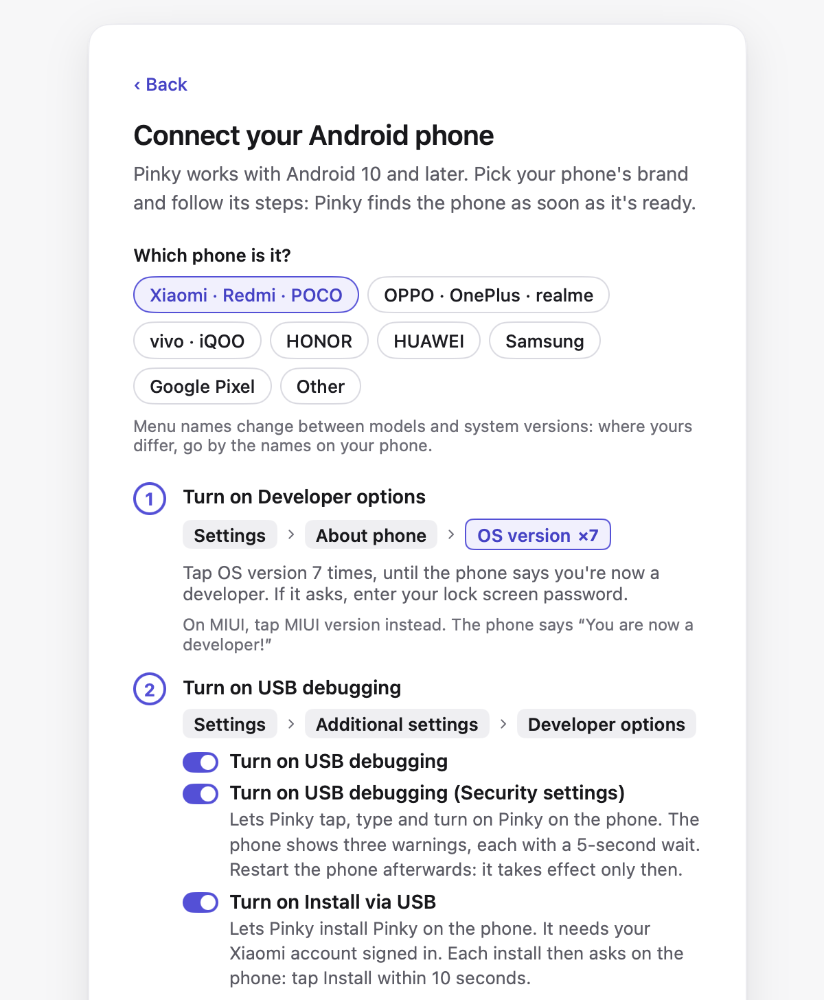
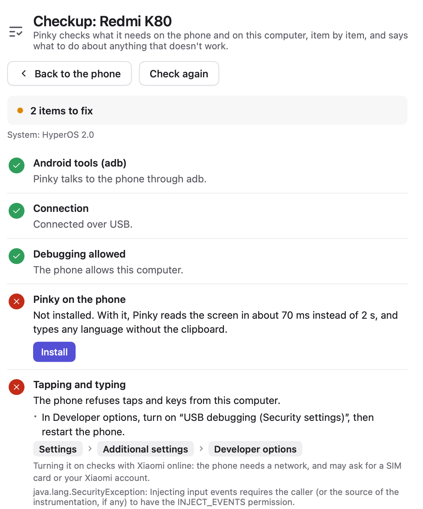

<p align="center"></p>
<h1 align="center">Pinky</h1>
<p align="center"><b>Để AI dùng iPhone hoặc điện thoại Android của bạn, với bạn luôn ở trong vòng kiểm soát: bất kỳ agent nào từ macOS, Windows hay Linux, hoặc chính Pinky, ngay trên điện thoại.</b></p>
<p align="center"><a href="https://github.com/DIYgod/pinky/releases/latest">Tải xuống</a> · <a href="#bắt-đầu">Bắt đầu</a> · <a href="#câu-hỏi-thường-gặp">Câu hỏi thường gặp</a> · <a href="https://discord.gg/S27b7SHjng">Discord</a></p>
<p align="center"><a href="README.md">English</a> · <a href="README.zh-CN.md">简体中文</a> · <a href="README.ja.md">日本語</a> · <a href="README.tr.md">Türkçe</a> · Tiếng Việt</p>
<p align="center"><sub>README này là bản dịch của cộng đồng. Nội dung mới nhất xem ở bản tiếng Anh <a href="README.md">README.md</a>.</sub></p>
<p align="center"><br><sub>Một lần chạy thật của Claude Code trên trình giả lập Android 16. Theo mặc định Pinky hỏi trước khi thanh toán; lần chạy này cũng hỏi trước khi gửi tin nhắn.</sub></p>

Pinky cho phép bất kỳ agent nào (Claude Code, Claude Desktop, Codex, Cursor hay một đoạn script) điều khiển một chiếc iPhone hoặc điện thoại Android thật qua MCP, trong khi bạn theo dõi trên máy tính, phê duyệt các bước rủi ro, tiếp quản và xem lại những gì đã xảy ra. Pinky cũng có thể tự làm việc bằng một mô hình AI do bạn chọn: từ máy tính của bạn, hoặc trong ứng dụng Pinky ngay trên điện thoại, không cần máy tính chút nào. Dù ai làm việc, các phê duyệt đều do gateway của Pinky thực thi, chứ không dựa vào chỉ dẫn dành cho agent.

- **Mọi nền tảng.** Một ứng dụng cho macOS (Apple silicon và Intel), Windows và Linux. Nó điều khiển điện thoại Android (Android 10 đến 17) và iPhone chạy iOS 17.4 trở lên: không cần cài gì trên iOS 27 trở lên, và Pinky trên iPhone, ứng dụng của Pinky, cài một lần từ máy Mac có Xcode trên iOS 17.4 đến 26, mà bạn cũng có thể chọn trên iOS 27 (đã thử ở đó, trên một điện thoại thấp hơn và trên Simulator; [chi tiết](#điện-thoại)).
- **Nhỏ gọn và native.** Cửa sổ được [MyGo](https://github.com/egoist/mygo) vẽ trên GPU, không Electron, không webview: bản tải về 16–22 MB, khi nhàn rỗi dùng khoảng 70 MB bộ nhớ và 0% CPU trên máy Mac.
- **Mọi agent, một cú nhấp.** Settings › Agents kết nối Claude Code, Claude Desktop, Codex, Cursor và nhiều nữa, và bất kỳ agent nào dùng được máy chủ MCP đều hoạt động, trên cùng một máy tính hoặc qua HTTP.
- **Pinky trên điện thoại, không cần máy tính.** Ứng dụng Pinky trên Android và iPhone tự làm việc bằng một mô hình bạn chọn, từ DeepSeek, Qwen, Kimi và GLM đến Claude, GPT, Gemini và các mô hình cục bộ trong Ollama hay LM Studio. Gõ hoặc nói một nhiệm vụ, hoặc chia sẻ nội dung tới nó; trên Android, hỏi về những gì màn hình đang hiển thị từ một nút nổi hoặc nút nguồn, và để nó làm việc trên một màn hình nền ẩn trong khi bạn vẫn dùng điện thoại ([cách làm](#pinky-on-the-phone)).
- **Nhiệm vụ theo lịch và bộ nhớ.** Pinky có thể chạy một nhiệm vụ vào những giờ cố định hoặc báo cho bạn khi một điều kiện thỏa mãn, trên máy tính và trên Android. Sau một nhiệm vụ, nó có thể đề xuất một ghi chú để ghi nhớ, chẳng hạn một tùy chọn bạn đã nói với nó, và chỉ giữ lại nếu bạn đồng ý ([thêm](#hỏi-pinky)).
- **Điện thoại bị khóa? Mở khóa từ máy tính.** Lưu mã PIN của điện thoại vào Pinky một lần, rồi xác nhận mỗi lần mở khóa bằng Touch ID, Windows Hello hoặc mật khẩu của keyring. Agent không bao giờ nhìn thấy mã PIN.
- **Miễn phí và mã nguồn mở** theo giấy phép Apache-2.0, không cần tạo tài khoản.

<table>
<tr>
<td width="50%" valign="top"><br><b>Bạn phê duyệt các bước rủi ro.</b> Thanh toán, giao dịch và chuyển tiền chờ cú nhấp của bạn; trong Settings › Safety, bạn cũng có thể bắt việc gửi, đặt hàng, xóa, gọi điện, cài đặt, các liên kết rời khỏi ứng dụng và thay đổi cài đặt phải chờ, hoặc mọi bước đều phải chờ. Pinky nhận diện các nút này trong 10 ngôn ngữ. Các quy tắc chạy trong gateway của Pinky, nên agent không thể tự phê duyệt cho mình, kể cả khi văn bản trên màn hình cố dụ nó làm vậy.</td>
<td width="50%" valign="top"><br><b>Mặc định bị cấm.</b> Các ứng dụng ngân hàng, ví và quản lý mật khẩu vô hình đối với agent, và agent không thể gõ vào các trường mật khẩu hay mã dùng một lần. Khi một agent cần ứng dụng ngân hàng hoặc ví cho một nhiệm vụ, nó sẽ hỏi, và bạn có thể cho phép ứng dụng đó chỉ cho nhiệm vụ đó. Mỗi agent mới đều cần bạn phê duyệt và chỉ nhận phạm vi bạn cấp.</td>
</tr>
<tr>
<td width="50%" valign="top"><br><b>Điện thoại vẫn là của bạn.</b> Trên Android 13 trở lên, agent làm việc trên một màn hình thứ hai ẩn, nên màn hình của điện thoại vẫn là của bạn, hoặc tắt và khóa. Trên điện thoại Android cũ hơn và trên iPhone, chúng dùng màn hình chính.</td>
<td width="50%" valign="top"><br><b>Tiếp quản bất cứ lúc nào.</b> Nhấp vào hình ảnh điện thoại và agent tạm dừng cho đến khi bạn giao lại; trên Android, bạn tự chạm vào điện thoại cũng làm nó tạm dừng. Dừng tất cả là ⌥⌘. (Ctrl+Alt+. trên Windows và Linux) từ bất cứ đâu.</td>
</tr>
<tr>
<td width="50%" valign="top"><br><b>Mọi lần chạy đều có ghi chép.</b> Mỗi bước bằng lời dễ hiểu, ảnh chụp màn hình và một bản ghi màn hình có đánh dấu từng bước, xuất được thành báo cáo HTML. Tất cả ở lại trên máy tính của bạn.</td>
<td width="50%" valign="top"><br><b>iPhone cũng vậy.</b> Cùng một gateway, cơ chế phê duyệt và ghi chép hoạt động trên iOS 17.4 trở lên (<a href="#điện-thoại">những gì hoạt động</a>). Hình ở đây là trên iOS Simulator, với việc xóa được đặt là phải hỏi.</td>
</tr>
</table>

**Trạng thái:** tiền alpha. Claude Code đã dùng điện thoại thật qua nó từ đầu đến cuối (một điện thoại Android qua USB, một iPhone chạy iOS 27, và một iPhone XS Max chạy iOS 18.7.11 qua Pinky Helper, ứng dụng mà Pinky trên iPhone thay thế), và agent có thể kết nối qua stdio hoặc HTTP. Pinky trên điện thoại đã làm việc với một mô hình thật trên Mi 10 Pro (Android 17) và iPhone 13 mini (iOS 27.0.1). Mở khóa từ máy tính, làm việc nền trên Android, ghi hình, xuất báo cáo, ghép nối Wi-Fi và tệp của điện thoại đều đã được xây dựng; một phần trong số đó vẫn chờ người dùng thử. Xem [docs/ACCEPTANCE.md](docs/ACCEPTANCE.md) để biết hôm nay những gì hoạt động và cách dùng thử.

## Bắt đầu

Cài Pinky, kết nối điện thoại và thêm Pinky vào agent của bạn. Sau đó bảo agent làm gì đó trên điện thoại, và xem nó làm việc trong cửa sổ của Pinky.

### Bạn cần những gì

| | Bạn cần |
| --- | --- |
| **Mac** | macOS 13 trở lên, với Apple silicon hoặc Intel |
| **Windows** | Windows 10 hoặc 11, 64-bit (x64) |
| **Linux** | Một PC 64-bit (x86-64) với Ubuntu 20.04, Debian 11 hoặc hệ thống mới hơn (glibc 2.29 trở lên), và GTK 3 |
| **Điện thoại Android** | Android 10 đến 17 và một cáp USB. Pinky mang theo adb của riêng nó; trên Windows một số điện thoại cần trình điều khiển USB, và trên Linux cần quyền truy cập USB ([bên dưới](#usb-trên-windows-và-linux)) |
| **iPhone hoặc iPad** | iOS 17.4 trở lên, và một cáp USB để thiết lập; sau đó nó cũng hoạt động qua Wi-Fi ([bên dưới](#iphone-và-ipad-qua-wi-fi)). Pinky tự chuẩn bị, với đĩa ảnh nhà phát triển của Apple, đi kèm Xcode hoặc Pinky có thể tải từ một bản sao bên thứ ba khi bạn yêu cầu ([bên dưới](#iphone)). Trên iOS 17.4 đến 26 còn cần Pinky trên iPhone, ứng dụng của Pinky ([bên dưới](#iphone-chạy-ios-174-đến-26)) |
| **Simulator và trình giả lập** | Tùy chọn, thay cho điện thoại hoặc bên cạnh điện thoại: một iOS Simulator trên máy Mac có Xcode, hoặc một trình giả lập Android từ Android Studio. Bạn tạo chúng ở đó; Pinky khởi động chúng ([bên dưới](#điện-thoại)) |
| **Agent** | Bất kỳ agent nào dùng được máy chủ MCP, chẳng hạn Claude Code, Claude Desktop, Codex hoặc Cursor |

### 1. Tải xuống và cài đặt Pinky

Lấy Pinky từ [bản phát hành mới nhất](https://github.com/DIYgod/pinky/releases/latest):

- **Mac:** tải `pinky-<version>-arm64.dmg` cho máy Mac dùng Apple silicon (M1 trở lên) hoặc `pinky-<version>-amd64.dmg` cho máy Mac Intel. Mở nó và kéo Pinky vào Applications. Với [Homebrew](https://brew.sh), `brew install --cask diygod/tap/pinky` cũng cho kết quả tương tự.
- **Windows:** tải `pinky-setup-<version>-amd64.exe` và chạy nó. Nó cài Pinky cho tài khoản của bạn, không cần quyền quản trị viên. Trình cài đặt chưa được ký, nên SmartScreen có thể nói rằng Windows đã bảo vệ PC của bạn: chọn **Thông tin thêm**, rồi **Vẫn chạy**. Để dùng Pinky mà không cài, giải nén `pinky-<version>-windows-amd64.zip` và mở `Pinky.exe`.
- **Linux:** trên Debian và Ubuntu, tải `pinky_<version>_amd64.deb` và cài bằng `sudo apt install ./pinky_<version>_amd64.deb`. Trên các hệ thống khác, giải nén `pinky-<version>-linux-amd64.tar.gz` vào một thư mục riêng và chạy `pinky` trong đó.

Pinky tự tìm phiên bản mới và, trên máy Mac, với trình cài đặt Windows và khi giải nén từ `.tar.gz` trên Linux, cũng tự cài chúng ([Cập nhật](#cập-nhật)).

### 2. Kết nối điện thoại

Mở Pinky và chọn **Add phone**. Một điện thoại đã sẵn sàng sẽ hiện trong cửa sổ của Pinky; khi còn thiếu gì, trang của điện thoại trong Pinky sẽ nói rõ.

#### Android

**Add phone › Android** hiển thị các bước này theo hãng điện thoại của bạn, với tên menu và các công tắc riêng: Xiaomi, OPPO, vivo, HONOR, HUAWEI, Samsung và Pixel, cùng các bước chung cho những hãng còn lại.

1. Trên điện thoại, bật Gỡ lỗi USB: trong Cài đặt › Giới thiệu về điện thoại, chạm **Số bản dựng** 7 lần, rồi bật **Gỡ lỗi USB** trong Cài đặt › Hệ thống › Tùy chọn cho nhà phát triển. Một số hãng đặt tên các menu này hơi khác.
2. Cắm điện thoại vào máy tính. Khi điện thoại hỏi có cho phép Gỡ lỗi USB không, chạm **Cho phép**. Trên Android 11 trở lên, bạn có thể ghép nối qua Wi-Fi thay thế, từ **Add phone** ([khi ghép nối thất bại](#khi-ghép-nối-qua-wi-fi-thất-bại)). Android 10 không có Gỡ lỗi không dây: sau khi cắm cáp, **Use Wi-Fi instead…** chuyển nó sang Wi-Fi ([bên dưới](#điện-thoại)).
3. Pinky đề nghị cài ứng dụng của nó cho điện thoại, Pinky trên điện thoại (hiện trên điện thoại với tên Pinky), giúp đọc màn hình nhanh hơn nhiều lần và cho phép Pinky gõ bằng bất kỳ ngôn ngữ nào. Điện thoại có thể yêu cầu bạn cho phép cài đặt một lần.

Mỗi điện thoại có một **Checkup**, trong menu ··· bên dưới hình ảnh của nó, liệt kê những gì hoạt động và cách sửa những gì chưa, chẳng hạn công tắc Gỡ lỗi USB (Cài đặt bảo mật) của Xiaomi.

Qua Wi-Fi, Pinky đảm bảo điện thoại trả lời đúng là của bạn: nó để lại một dấu trên mỗi điện thoại nó thiết lập, mà chỉ kết nối gỡ lỗi của điện thoại mới đọc được, và kiểm tra dấu đó mỗi khi adb kết nối điện thoại, nên một thiết bị khác trên mạng không thể trả lời thay. Một điện thoại kết nối qua Gỡ lỗi không dây mà Pinky chưa từng dùng, chẳng hạn do một công cụ khác, sẽ hiện là được tìm thấy trên Wi-Fi, và Pinky để yên cho đến khi bạn chọn **Use**. Nếu trang của điện thoại ghi **This may not be …** sau khi bạn đặt lại điện thoại hoặc tự thiết lập lại, hãy chọn **Trust this phone…** ở đó, hoặc cắm cáp một lần.

Mang điện thoại ra ngoài? Với Tailscale, Pinky cũng tới được nó khi xa nhà ([cách làm](#điện-thoại-khi-xa-nhà)).

<table>
<tr>
<td width="50%" valign="top"><br><sub><b>Add phone › Android</b>, với một máy Xiaomi được chọn.</sub></td>
<td width="50%" valign="top"><br><sub><b>Checkup</b> của một máy Redmi, với hai thứ cần sửa.</sub></td>
</tr>
</table>

#### Công cụ Android

Pinky mang theo adb của riêng nó, công cụ nó dùng để tới điện thoại Android, được biên dịch từ mã nguồn của Android, nên không cần cài thêm gì. Khi máy tính đã có platform tools của Android, từ Android Studio, Homebrew hoặc gói của hệ thống, Pinky dùng chúng, và dùng chung máy chủ adb của chúng với Android Studio và các công cụ khác. Khi Pinky thoát, nó dừng adb mà nó mang theo, trừ khi một ứng dụng khác như Android Studio đang dùng; Settings › Advanced › **Stop adb when Pinky quits** tắt việc đó. Một adb do bạn cài vẫn tiếp tục chạy.

#### USB trên Windows và Linux

- **Windows:** Gỡ lỗi USB của điện thoại cần một trình điều khiển. Windows tự cài cho nhiều điện thoại; khi không có, Pinky liệt kê điện thoại là cần thiết lập và nói rõ cần cài trình điều khiển nào: [Google USB Driver](https://developer.android.com/studio/run/win-usb) cho Pixel, của [Samsung](https://developer.samsung.com/android-usb-driver) cho điện thoại Samsung, của [hãng sản xuất điện thoại](https://developer.android.com/studio/run/oem-usb) cho các hãng khác. Sau đó rút điện thoại ra và cắm lại.
- **Linux:** máy tính phải cho phép Pinky mở thiết bị USB của điện thoại, việc này cần udev rules cho điện thoại Android: `sudo apt install android-sdk-platform-tools-common` trên Debian và Ubuntu, `android-udev` trên Arch, `android-tools` trên Fedora. Bạn cũng có thể cần thuộc nhóm `plugdev`. Sau đó cắm lại điện thoại. Pinky sẽ nói khi chúng bị thiếu.

#### Khi ghép nối qua Wi-Fi thất bại

Khi một điện thoại hoạt động trên cáp nhưng **Pair over Wi-Fi** không hoàn tất, trang ghép nối sẽ nói trong vòng nửa phút Pinky nhìn thấy gì:

- **Điện thoại chưa xuất hiện trên mạng:** kiểm tra Gỡ lỗi không dây đã bật chưa và điện thoại có cùng Wi-Fi với máy tính không. Wi-Fi khách, bộ định tuyến có cách ly AP (client) và nhiều mạng văn phòng khiến các thiết bị không tìm thấy nhau. Ở đó, hãy chọn **Pair with a code instead**: trên điện thoại, chạm **Ghép nối thiết bị bằng mã ghép nối** và nhập địa chỉ IP, cổng cùng mã sáu chữ số mà nó hiển thị, những thứ này thay đổi mỗi lần hộp thoại đó mở. Khi đó Pinky không cần tìm kiếm để ghép nối; nếu sau đó vẫn không tìm thấy điện thoại, nó sẽ hỏi địa chỉ IP và cổng ở đầu mục Gỡ lỗi không dây (không phải của hộp thoại ghép nối) và kết nối ở đó. Nếu cũng không tới được điện thoại ở những địa chỉ đó, mạng đang giữ các thiết bị tách rời nhau: hãy dùng một Wi-Fi mà chúng tới được nhau, chẳng hạn mạng nhà của bạn thay vì mạng khách của nó, hoặc dùng cáp.
- **Pinky không được phép tìm điện thoại trên mạng này:** trên máy Mac, Pinky cần quyền truy cập Mạng cục bộ, và macOS không báo lỗi khi thiếu nó: việc tìm kiếm chỉ đơn giản là không thấy gì. Chọn **Open Local Network settings**, bật Pinky trong Cài đặt hệ thống › Quyền riêng tư & Bảo mật › Mạng cục bộ và thử lại (nếu macOS hỏi Pinky có được tìm thiết bị trên mạng cục bộ của bạn không, nhấp **Cho phép**). Trên máy Mac, **Checkup** của điện thoại cũng cho thấy điều này, ở mục **Local network**. Trên Windows và Linux, tường lửa có thể chặn việc tìm kiếm theo cách tương tự: hãy cho phép Pinky dùng mạng cục bộ, hoặc ghép nối bằng mã.
- **Pinky không thể tìm điện thoại trên mạng này:** kiểm tra máy tính đã kết nối Wi-Fi hoặc Ethernet chưa.
- **Điện thoại đã xuất hiện, nhưng ghép nối chưa hoàn tất:** nếu điện thoại báo lỗi hoặc quay lại Gỡ lỗi không dây, hãy quét lại mã, hoặc ghép nối bằng mã.

Khi ghép nối dừng vì lỗi, trang sẽ nói adb đã báo gì:

- **Điện thoại kết thúc ghép nối trước khi hoàn tất** (mã QR): điện thoại rời khỏi màn hình quét, đổi Wi-Fi, hoặc thứ gì đó giữa nó và máy tính cắt kết nối; adb không thể biết là thứ nào. Giữ điện thoại ở màn hình quét và thử lại, hoặc chọn **Pair with a code instead** bên cạnh thông báo.
- **Điện thoại không chấp nhận ghép nối** (mã ghép nối): mã sai, hoặc cổng không phải của hộp thoại ghép nối. Địa chỉ ở đầu mục Gỡ lỗi không dây là để kết nối, không phải ghép nối, và adb trả lời giống nhau cho cả hai lỗi.
- **Không có gì ở địa chỉ đó đang chờ ghép nối** hoặc **Điện thoại đã ngừng chờ ghép nối:** hộp thoại ghép nối hoặc màn hình quét đã đóng, hoặc cổng sai. Mở lại và dùng những gì nó hiển thị lúc này.
- **Không tới được điện thoại ở địa chỉ đó** hoặc **Pinky không thể kết nối tới nó:** mạng giữ máy tính và điện thoại tách rời nhau, như trên; một VPN hoặc tường lửa trên máy tính cũng có thể gây ra.
- **Máy chủ adb đang chạy trên máy tính này quá cũ:** một chương trình khác đã khởi động một adb cũ hơn platform-tools 30. Thoát nó, hoặc cập nhật nó, và Pinky sẽ khởi động adb của riêng nó.

Pinky ghi lời của chính adb vào nhật ký của nó, mà **Help › Send Feedback…** đính kèm cùng thông tin chẩn đoán.

Ghép nối qua Wi-Fi cần Android 11 trở lên; điện thoại Android 10 chuyển sang Wi-Fi từ cáp thay thế (**Use Wi-Fi instead…**, [bên dưới](#điện-thoại)). Đến Android 16, Gỡ lỗi không dây tự tắt khi điện thoại rời mạng Wi-Fi, kể cả sang một điểm truy cập khác của cùng mạng, hoặc khởi động lại: hãy bật lại, hoặc ghép nối lại từ **Add phone**.

#### iPhone

Pinky tự chuẩn bị một chiếc iPhone; **Add phone › iPhone** hướng dẫn bạn qua từng bước.

1. Cắm iPhone vào máy tính, mở khóa, chạm **Tin cậy** và nhập mật mã. Trên Windows, trước hết cài Apple Devices từ Microsoft Store (hoặc iTunes); trên Linux, cài gói `usbmuxd`. Add phone sẽ nói khi chúng bị thiếu.
2. Trên iPhone, bật **Chế độ nhà phát triển** trong Cài đặt › Quyền riêng tư & Bảo mật: Pinky làm công tắc này xuất hiện ở đó. iPhone khởi động lại; mở khóa, chạm **Bật** và nhập mật mã.
3. Pinky gắn đĩa ảnh nhà phát triển của Apple lên iPhone và liệt kê nó là đã sẵn sàng. Một iPhone chạy iOS 27 giữ đĩa ảnh khi khởi động lại; dưới iOS 27, Pinky gắn lại sau mỗi lần khởi động lại, một khi bạn mở khóa iPhone.

Đĩa ảnh nhà phát triển đi kèm [Xcode](https://apps.apple.com/app/xcode/id497799835), ứng dụng miễn phí của Apple dành cho nhà phát triển, và Pinky không đóng gói nó. Trên máy Mac, cài Xcode một lần và mở nó: Pinky dùng đĩa ảnh mà nó cài, và Xcode không bao giờ phải chạy lại. Một iPhone chạy iOS 27 trở lên cần đĩa ảnh của Xcode 27 trở lên: máy chủ ký của Apple không còn ký các bản cũ hơn, và Add phone khi đó sẽ nói Pinky đã dùng đĩa ảnh nào và cách lấy bản mới hơn. Trên Windows và Linux, sao chép `/Library/Developer/DeveloperDiskImages/iOS_DDI` từ một máy Mac như vậy vào thư mục của Pinky ([nơi](docs/notes/ios.md#preparing-a-phone-without-xcode)). Khi không có cả hai, hoặc khi Apple từ chối đĩa ảnh Pinky tìm được (của Xcode, hoặc một bản sao chép vào thư mục của Pinky), Add phone đề nghị tải đĩa ảnh từ một bản sao bên thứ ba, github.com/doronz88/DeveloperDiskImage (Xcode 27.0 beta 4, 32 MB, do tác giả của pymobiledevice3 giữ, không phải Apple), chỉ khi bạn nhấp Download; Pinky kiểm tra mọi tệp theo tổng kiểm tra nó mong đợi, và từ đó dùng nó thay cho đĩa ảnh bị Apple từ chối. Trên iOS 27 trở lên, không có ứng dụng nào được cài lên iPhone.

Đã kiểm tra trên iPhone 13 mini (iOS 27.0.1): Pinky tự gắn đĩa ảnh của Xcode (trong khoảng 1,5 giây, sau khi đĩa ảnh đã bị gỡ), giữ đĩa ảnh đã có trên điện thoại, và việc iPhone giữ đĩa ảnh khi khởi động lại. Chưa thử trên điện thoại: đĩa ảnh tải về, công tắc Chế độ nhà phát triển, iPhone dưới iOS 27, và ghép nối iPhone trên Windows. Các cộng tác viên đã dùng một iPhone và một iPad chạy iOS 27.2 trên Linux (Arch Linux), và một iPhone chạy iOS 27.2 trên Windows 11, qua cáp và qua Wi-Fi, với đĩa ảnh đã có sẵn trên chúng.

#### iPhone và iPad qua Wi-Fi

Pinky cũng dùng iPhone hoặc iPad qua Wi-Fi khi nó cùng Wi-Fi với máy tính, và máy tính liệt kê nó ở đó, điều này xảy ra một khi kết nối Wi-Fi đã bật cho điện thoại. Pinky bật chúng khi bạn cắm điện thoại vào và nó tin cậy máy tính: đó là cùng một cài đặt như **Hiển thị iPhone này khi dùng Wi-Fi** của Finder, nên một điện thoại đã được thiết lập như vậy sẽ giữ nguyên. Nó bật theo mặc định; **Settings › Phones › Use iPhones and iPads over Wi-Fi** tắt nó, và việc đó để yên cài đặt của điện thoại. Nếu một điện thoại không xuất hiện trên Wi-Fi khi bạn rút cáp, **Checkup** của nó sẽ nói nó đang ở trạng thái nào ở mục **Wi-Fi**: kết nối Wi-Fi của nó có bật không và Pinky có bật nó không, vì sao Pinky không làm được, và máy tính này có nhìn thấy điện thoại trên Wi-Fi không.

- Một iPhone hoặc iPad mà Pinky đã dùng vẫn hoạt động khi bạn rút cáp, vẫn là cùng một điện thoại với các cài đặt của nó: Pinky tự chuyển nó sang Wi-Fi, và quay lại cáp khi bạn cắm vào, và nhiệm vụ của agent vẫn tiếp tục; các cuộc gọi của nó chờ vài giây trong lúc đó.
- Một chiếc Pinky chưa dùng, chẳng hạn iPad của người nhà đã ghép nối với máy tính này, hiện là **Found on Wi-Fi**. Pinky đọc tên, kiểu máy và phiên bản iOS của nó và không làm gì thêm, và agent không nhìn thấy nó, cho đến khi bạn chọn **Use**, để thiết lập nó qua Wi-Fi, hoặc **Ignore**, để giữ nó ngoài danh sách cho đến khi bạn cắm cáp.
- Một iPhone hoặc iPad bị khóa trên Wi-Fi hiện là **Locked on Wi-Fi**, và Pinky kết nối tới nó khi bạn mở khóa: khi nó ngủ, nó rời mạng khoảng mỗi phút một lần, và việc kết nối tới nó khi đó làm sáng màn hình.
- Thiết lập một chiếc qua Wi-Fi: việc tin cậy máy tính cần cáp, và việc làm công tắc Chế độ nhà phát triển xuất hiện khi nó đang ẩn cũng vậy (trên điện thoại đã dùng với Xcode, nó đã hiện sẵn). Bật Chế độ nhà phát triển diễn ra trên điện thoại, và Pinky cũng gắn đĩa ảnh nhà phát triển qua Wi-Fi, trong khoảng 9 giây thay vì 1,5 giây. **Add phone › iPhone** nói bước nào cần cáp.
- Qua Wi-Fi, Pinky chỉ nói chuyện với điện thoại nó đã ghép nối: nó kiểm tra chứng chỉ mà điện thoại nhận được khi lần đầu tin cậy máy tính này, nên một thiết bị khác trên mạng không thể trả lời thay. Dưới iOS 27, kết nối tới WebDriverAgent trong Pinky trên iPhone không được mã hóa, nên ở đó nó chỉ an toàn ngang mạng Wi-Fi.

Qua Wi-Fi, mỗi bước chậm hơn trên cáp, ảnh chụp màn hình chậm nhất. Đo trên iPad Pro 11 inch (thế hệ 3, iPadOS 27.0.1), Wi-Fi so với cáp: một lần vuốt hiện trên màn hình sau 80 đến 210 ms (60 đến 90 ms), màn hình chính đọc trong 0,6 đến 2,6 giây (0,5 đến 0,6 giây), một ảnh chụp màn hình mất 5 giây (1 giây), và 0,2% số gói của video bị mất (không gói nào). Rút cáp chuyển một nhiệm vụ đang chạy sang Wi-Fi trong khoảng 5 giây, và cắm vào chuyển nó trở lại trong 2 đến 6 giây ([chi tiết](docs/notes/ios.md#wi-fi)).

Trên máy Mac, dịch vụ thiết bị của hệ thống, usbmuxd, có thể làm mất một iPhone trên Wi-Fi sau khi kết nối của nó đứt một lần (chẳng hạn Wi-Fi của nó tắt rồi bật lại), và không tìm lại nó trong tối đa khoảng một giờ; Finder cũng làm mất nó. Pinky nhận thấy khi một điện thoại bạn dùng đang ở trên mạng nhưng không còn được liệt kê, hiển thị nó là **Lost on Wi-Fi**, và đề nghị **Restart device service…** trên trang của nó: sau khi bạn xác nhận, macOS hỏi mật khẩu của quản trị viên, và mọi iPhone và iPad, kể cả trên cáp, ngắt kết nối trong một hoặc hai giây. `sudo killall usbmuxd` trong Terminal cũng cho kết quả tương tự. Chỉ người ở máy tính mới làm được, nên khi nhiệm vụ của agent chờ một điện thoại như vậy, Pinky đưa việc khởi động lại vào **Needs you** và gửi một thông báo, và bảo agent đừng chờ nó khi không có ai ở đó. Ngay sau khi bạn rút cáp một điện thoại, nó nói vậy trong khoảng 10 giây; nếu không, nó chờ một phút, vì một điện thoại tự thức dậy sẽ tự quay lại. Một điện thoại bạn rút cáp mà máy tính này hoàn toàn không nhìn thấy trên Wi-Fi hiện là **Not seen on Wi-Fi**, kèm những gì có thể che khuất nó: nó đang ngủ, ở trên một mạng khác hoặc một mạng giữ các thiết bị tách rời (mạng khách, một số bộ định tuyến), một VPN, hoặc Pinky không được phép trên mạng cục bộ.

Để bỏ qua mật khẩu, bật **Restart device service without a password** trong **Settings › Phones** (nó hiện trên máy Mac khi Pinky dùng iPhone qua Wi-Fi). Pinky hỏi mật khẩu quản trị viên một lần, để thêm một quy tắc, `/etc/sudoers.d/pinky-usbmuxd`, cho phép tài khoản của bạn chạy đúng `/usr/bin/killall usbmuxd` với quyền root mà không cần mật khẩu và không gì khác; nó kiểm tra quy tắc bằng `visudo` trước khi đặt vào chỗ. Từ đó **Restart device service…** không hỏi mật khẩu, và khi usbmuxd làm mất một điện thoại mà nhiệm vụ của agent đang dùng, Pinky tự khởi động lại nó: tối đa một lần mỗi 5 phút, không khi một điện thoại đang giữa một thao tác, và nó cho agent biết nó đã làm. Tắt công tắc sẽ gỡ quy tắc, hỏi mật khẩu thêm một lần nữa.

Trên Linux và Windows, dịch vụ thiết bị của hệ thống không tự liệt kê iPhone và iPad trên Wi-Fi: trên Linux (gói `usbmuxd`) nó chỉ liệt kê chúng trên cáp, và trên Windows (Apple Devices hoặc iTunes) cũng chỉ khi chúng trên cáp. Nên ở đó Pinky chạy một dịch vụ thiết bị nhỏ của riêng nó phía trước của hệ thống, trong khi nó dùng điện thoại qua Wi-Fi: nó tìm các điện thoại đã ghép nối với máy tính này trên mạng và kết nối trực tiếp tới chúng, và chuyển mọi thứ về điện thoại trên cáp cho dịch vụ của hệ thống. Khi đó mọi kết nối của Pinky tới iPhone và iPad đều đi qua nó, kể cả trên cáp. Không có gì phải cài hay thiết lập cho nó ngoài của chính hệ thống (`usbmuxd` trên Linux, Apple Devices trên Windows). Nếu bạn chạy một dịch vụ thiết bị tự liệt kê điện thoại trên Wi-Fi, chẳng hạn netmuxd, và khởi động Pinky với `USBMUXD_SOCKET_ADDRESS` trỏ tới nó (`unix:///path/to/socket` hoặc `tcp://127.0.0.1:port`), Pinky dùng cái đó thay thế và không chạy cái nào của riêng nó.

Trong khi Pinky mở một điện thoại, hoặc chuyển nó giữa cáp và Wi-Fi, nó hiển thị **Connecting** hoặc **Moving to Wi-Fi** thay vì ngoại tuyến. Qua Wi-Fi, Pinky đọc văn bản từ hình ảnh trực tiếp thay vì từ ảnh chụp màn hình, vốn mất khoảng 5 giây ở đó. Một iPhone hoặc iPad không có mật mã không bao giờ được đọc là bị khóa, nên sau khi nó rời mạng để ngủ, Pinky chỉ kết nối tới nó khi nó đã quay lại được 30 giây.

#### iPhone chạy iOS 17.4 đến 26

Dưới iOS 27, một iPhone chỉ nhận thao tác chạm và gõ từ máy tính qua một ứng dụng trên điện thoại chứa WebDriverAgent: Pinky trên iPhone, ứng dụng của chính Pinky, mà bạn cài một lần từ máy Mac có Xcode, ký bằng Apple ID của bạn: cắm iPhone vào và nhấp **Install Pinky on the iPhone** trên trang của nó trong Pinky (hoặc trong Add phone › Try an older iPhone), hoặc chạy `pinkyctl helper install` trong Terminal. Cả hai cách đều biên dịch nó, ký nó và cài nó, và cửa sổ của Pinky hiển thị từng bước và yêu cầu bạn mở khóa điện thoại khi Xcode chờ nó ([cách làm](docs/notes/ios.md#installing-pinky-on-the-iphone)). Trong khi Pinky trên máy tính dùng điện thoại, ứng dụng nói vậy trên iPhone. Pinky Helper, ứng dụng Pinky cài cho việc này trước tháng 11 năm 2026, vẫn tiếp tục hoạt động, và Pinky vẫn cài nó khi không biên dịch được Pinky trên iPhone (`pinkyctl helper install --helper-only` yêu cầu nó). Với Apple ID miễn phí, nó phải được cài lại mỗi 7 ngày: trước đó hai ngày, trang của điện thoại và bản kiểm tra của nó nhắc bạn, với **Install again**, và một khi nó hết hạn, điện thoại hiện là cần thiết lập và nói lý do ([cách cài lại](docs/notes/ios.md#when-the-signature-of-pinky-on-the-iphone-runs-out)). Pinky Helper đã được thử trên iPhone XS Max chạy iOS 18.7.11, trên Windows, qua cáp và Wi-Fi của nó; Pinky trên iPhone thay thế nó đã được cài đè lên Pinky Helper trên iPhone 13 mini chạy iOS 27.0.1, nơi máy tính khởi động và dừng dịch vụ kiểm thử của nó; chưa thử trên iOS 17.4 đến 26. Không có nó, Pinky chỉ có thể hiển thị và đọc màn hình (trên máy Mac) và mở ứng dụng: không chạm, vuốt hay gõ. iOS 17.3 trở xuống không được hỗ trợ.

### 3. Thêm Pinky vào agent của bạn

Trong Pinky, mở **Settings › Agents** và nhấp **Connect** bên cạnh agent của bạn. Pinky tìm Claude Code, Claude Desktop, Codex, Cursor, VS Code, Copilot CLI, Windsurf (Devin Desktop) và Gemini CLI trên máy tính của bạn và tự thêm nó vào các máy chủ MCP của agent, theo cách riêng của ứng dụng: bằng lệnh riêng của agent khi nó có, chẳng hạn `claude mcp add`, hoặc trong tệp cài đặt của nó, mà Pinky sao chép trước và chỉ thay đổi mục của Pinky. Nó cũng cài hướng dẫn agent của Pinky, [SKILL.md](docs/SKILL.md), ở nơi agent đọc các kỹ năng, và giữ nó luôn mới: khi Pinky cập nhật, nó viết lại hướng dẫn nó đã cài thành của phiên bản mới. Cho đến khi một agent được kết nối, một thẻ trong thanh bên của Pinky đề nghị làm việc đó, hoặc nói lấy agent ở đâu.

<p align="center"></p>

- **Claude Desktop:** Connect mở tiện ích mở rộng của Pinky trong Claude Desktop; nhấp **Install** ở đó. Nhấp đúp `pinky-<version>.mcpb` từ [trang phát hành](https://github.com/DIYgod/pinky/releases/latest) cũng cho kết quả tương tự.
- **Các agent khác:** **Settings › Agents › Add an agent by hand** hiển thị lệnh cho bản sao Pinky của bạn, với các nút sao chép nó. Thêm một máy chủ MCP (stdio) chạy nó. Trong cấu hình JSON, với bản cài Homebrew cask hoặc gói Linux:

  ```json
  { "mcpServers": { "pinky": { "command": "pinkyctl", "args": ["mcp"] } } }
  ```

  Claude Code trong terminal: `claude mcp add --scope user pinky -- pinkyctl mcp`. Hầu hết agent đọc hướng dẫn từ `~/.agents/skills/pinky/SKILL.md`, Claude Code từ `~/.claude/skills/pinky/SKILL.md`.

Lệnh là `pinkyctl`, không phải `pinky`: nhiều máy tính đã có một chương trình khác tên `pinky`. Một agent trên máy tính khác hoặc trong container có thể kết nối qua HTTP thay thế ([cách làm](docs/mcp.md#over-http)). [docs/mcp.md](docs/mcp.md#connecting-an-agent) nói Connect thay đổi gì cho mỗi agent.

### 4. Dùng thử

Bảo agent làm gì đó trên điện thoại của bạn, chẳng hạn "Mở Tin nhắn trên điện thoại của tôi và báo cho Sam là tôi sẽ tới muộn." Lần đầu một agent kết nối, Pinky hỏi có cho phép nó không và nó được làm gì. Thanh toán chờ cú nhấp của bạn trong cửa sổ của Pinky; trong Settings › Safety bạn cũng có thể bắt việc gửi, xóa và nhiều nữa phải chờ.

Không có điện thoại bên cạnh? Khởi động một iOS Simulator hoặc một trình giả lập Android trong **Add phone › Virtual phone** ([bên dưới](#điện-thoại)). Hoặc thoát Pinky và khởi động nó với hai điện thoại demo được viết sẵn kịch bản (một khoản thanh toán để phê duyệt, một ứng dụng ngân hàng bị chặn, một trường mật khẩu): `/Applications/Pinky.app/Contents/MacOS/Pinky --fake` trên máy Mac, `pinkyctl --fake` trên Linux, hoặc `& "$env:LOCALAPPDATA\Programs\Pinky\Pinky.exe" --fake` trong PowerShell trên Windows.

## Sử dụng Pinky

### Điện thoại

- **Android:** kết nối qua USB hoặc Wi-Fi ([ở trên](#android)). Pinky hoạt động qua adb và một máy chủ scrcpy đóng gói kèm. Pinky trên điện thoại, ứng dụng Android của Pinky, đi kèm Pinky, đọc màn hình trong khoảng 70 ms thay vì 2 giây và gõ mọi ngôn ngữ mà không cần clipboard: trang của điện thoại đề nghị cài nó (điện thoại có thể yêu cầu bạn cho phép một lần). Dịch vụ trợ năng của nó chỉ bật trong khi một agent làm việc trên điện thoại, vì các ứng dụng ngân hàng từ chối chạy bên cạnh một dịch vụ như vậy ([lý do](#câu-hỏi-thường-gặp)). Trên Android 13 trở lên, agent làm việc trên một màn hình nền, nên màn hình của điện thoại có thể vẫn tắt và khóa. Văn bản mà một ứng dụng vẽ ra mà không mô tả cho cây trợ năng, như trong mini-program và các trang web khác bên trong siêu ứng dụng, trò chơi và bản đồ, được đọc từ các điểm ảnh của màn hình (OCR) trên macOS và Windows, nên agent có thể đọc và chạm vào nó. Pinky chỉ đọc một ứng dụng bị chặn theo cách này khi bạn cho phép nó cho nhiệm vụ, không bao giờ đọc điện thoại bị khóa, và không giữ bức hình nào.
- **Wi-Fi trên Android 10:** Android 10 không có Gỡ lỗi không dây. Cắm điện thoại vào và chọn **Use Wi-Fi instead…** trong menu ⋯ bên dưới hình ảnh của nó (hoặc trong Settings › Phones): Pinky bắt adb của điện thoại lắng nghe trên mạng (`adb tcpip`, cổng 5555), kết nối tới nó tại địa chỉ Wi-Fi của nó và nói khi nào bạn có thể rút cáp. Nó tự kết nối lại khi điện thoại quay lại mạng, kể cả ở một địa chỉ mới. Trong khi nó bật, bất kỳ máy tính nào trên cùng mạng đều có thể thử kết nối tới điện thoại: nếu điện thoại hỏi **Cho phép Gỡ lỗi USB?** khi bạn không tự kết nối nó, hãy chạm **Hủy**, và chỉ dùng nó trên Wi-Fi bạn tin cậy. Nó kéo dài cho đến khi điện thoại khởi động lại; khi đó cắm cáp một lần và chọn **Use Wi-Fi again**. **Stop the Wi-Fi connection** trong cùng menu tắt nó ([chi tiết](docs/away-from-home.md#wi-fi-without-wireless-debugging)).
- **iPhone:** kết nối qua USB hoặc Wi-Fi ([ở trên](#iphone-và-ipad-qua-wi-fi)) và được Pinky chuẩn bị ([ở trên](#iphone)); iPad hoạt động tương tự. Pinky làm được gì tùy thuộc vào phiên bản iOS và cách Pinky kết nối, mà bạn có thể chọn cho mỗi iPhone trong Settings › Phones (Automatic chọn theo phiên bản, như dưới đây):

  | iOS | Cách | Những gì hoạt động | Đã thử trên |
  | --- | --- | --- | --- |
  | 27 trở lên | Giao thức Device Hub của Xcode; không cài gì trên điện thoại | Mọi thứ trừ chụm ngón. Gõ sẽ dán văn bản và trả lại clipboard của bạn | iPhone 13 mini, iOS 27.0.1 |
  | 17.4 trở lên, với Pinky trên iPhone | Pinky trên iPhone, ứng dụng của Pinky có WebDriverAgent trong đó (hoặc Pinky Helper, đã cài trước đó), cài một lần trên máy Mac có Xcode, từ cửa sổ của Pinky hoặc bằng `pinkyctl helper install` ([cách làm](docs/notes/ios.md#installing-pinky-on-the-iphone)): tự động trên iOS 17.4 đến 26, lựa chọn của bạn trên 27 | Mọi thứ, và điện thoại không chia sẻ màn hình, nên các ứng dụng ngân hàng từ chối chia sẻ màn hình vẫn hoạt động (DBS digibank và China Merchants Bank trong kiểm thử). Chậm hơn Device Hub: màn hình chính đọc trong khoảng 7 giây thay vì dưới 0,5 giây, một lần chạm mất 0,5 đến 0,8 giây. Thỉnh thoảng iOS hỏi mật mã trên điện thoại trước khi nó bắt đầu. Hình ảnh trực tiếp hoạt động trên macOS và Windows | Với Pinky trên iPhone: cài trên iPhone 13 mini, iOS 27.0.1, dịch vụ kiểm thử của nó được khởi động và dừng từ máy tính. Với Pinky Helper: iPhone 13 mini, iOS 27.0.1, với nó được chọn; iPhone XS Max, iOS 18.7.11, trên Windows: hình ảnh trực tiếp qua cáp và Wi-Fi của nó, và các phím và lần vuốt của nó; Simulator iOS 18.5 và 26.5 |
  | 17.4 đến 26, không có nó | Chỉ các dịch vụ nhà phát triển; không cài gì | Xem (vài khung hình một giây, macOS và Windows), đọc màn hình (định vị bằng OCR, chỉ macOS) và mở ứng dụng và liên kết. Không chạm, vuốt, gõ hay Home: điện thoại không cung cấp đầu vào nào mà không có Pinky trên iPhone | Cùng các dịch vụ trên iOS 27.0.1; chưa thử trên điện thoại dưới iOS 27 |
  | 17.3 trở xuống | | Không hỗ trợ: trước 17.4 kết nối cần quyền quản trị viên, và iOS 16 trở xuống cần một đĩa ảnh nhà phát triển mà Xcode hiện tại không còn kèm theo | |

  Pinky trên iPhone mang WebDriverAgent của Appium và được ký bằng Apple ID của chính bạn. Chữ ký kéo dài 7 ngày với Apple ID miễn phí và một năm với tài khoản nhà phát triển trả phí. Pinky đọc trên iPhone khi nó sắp hết hạn: trước đó hai ngày, trang của điện thoại và bản kiểm tra của nó nhắc bạn cài lại (**Install again** trong Pinky, hoặc `pinkyctl helper install`, trên máy Mac có Xcode), và một khi nó đã hết hạn, điện thoại hiện là cần thiết lập và nói lý do, thay vì không khởi động được nó ([cách làm](docs/notes/ios.md#when-the-signature-of-pinky-on-the-iphone-runs-out)).
- **Chia sẻ màn hình trên iPhone:** trong khi Pinky truyền màn hình của iPhone, iOS cho các ứng dụng biết màn hình đang được chia sẻ, và một số ứng dụng ngân hàng (DBS digibank và China Merchants Bank trong số đó) từ chối chạy hoặc cảnh báo bạn. iOS cũng chặn camera và micrô khỏi các ứng dụng khi đó, nên camera hiện màu đen và quét mã thất bại. Điều ngược lại cũng đúng: trong khi một ứng dụng dùng camera hoặc micrô (một cuộc gọi hoặc FaceTime, Camera, Ghi âm), iOS 27 không cho Pinky hiển thị iPhone qua Device Hub. Trang của nó khi đó ghi **Camera or microphone in use** và phải làm gì, và Pinky tự kết nối khi cuộc gọi kết thúc hoặc ứng dụng đóng. Pinky truyền nó trong khi trang hoặc ô của điện thoại mở trong Pinky, trong khi một agent làm việc trên nó, và trong 30 giây sau đó; sau đó các ứng dụng như vậy hoạt động lại. Qua CoreDevice, agent không dùng được chúng. Cài thêm Pinky trên iPhone, và để điện thoại ở Automatic (Settings › Phones): các nhiệm vụ dùng CoreDevice, và Pinky chuyển một nhiệm vụ sang Pinky trên iPhone, vốn không chia sẻ màn hình, khi nó mở DBS digibank, China Merchants Bank hoặc Camera, hoặc khi agent yêu cầu (một lần quét bên trong ứng dụng khác, chẳng hạn của WeChat, cần agent yêu cầu); điện thoại quay lại CoreDevice sau nhiệm vụ. Hoặc kết nối iPhone qua Pinky trên iPhone cho mọi nhiệm vụ.
- **Simulator và trình giả lập:** một iOS Simulator (trên máy Mac có Xcode) hoặc một trình giả lập Android (từ Android Studio) cũng có thể là một điện thoại. **Add phone › Virtual phone** liệt kê những cái trên máy tính: **Start** khởi động một cái, và một khi nó chạy nó hiện lên như một điện thoại, được đánh dấu Simulator hoặc Emulator; **Shut down** dừng nó. Một trình giả lập Android mà Pinky khởi động không có âm thanh, nên nó không bao giờ chuyển tai nghe Bluetooth sang micrô của nó. Chỉ bạn mới khởi động chúng: agent không có công cụ cho việc đó. Hình ảnh trực tiếp, ghi hình, phê duyệt và quy tắc hoạt động như trên điện thoại. Pinky tìm Android SDK theo cách Android Studio làm (`ANDROID_HOME`, rồi `ANDROID_SDK_ROOT`, rồi nơi Android Studio cài nó), và khi đó một trình giả lập hoạt động như một điện thoại Android trên cáp. Với Simulator, Pinky biên dịch WebDriverAgent của Appium bằng Xcode của bạn lần đầu tiên: từ mã nguồn của một bản phát hành, mà nó kiểm tra các tệp trước khi biên dịch, không ký và không cần Apple ID. Việc đó mất 20 giây đến vài phút, và bản biên dịch được giữ cho đến khi Xcode thay đổi. Pinky không tạo Simulator hay trình giả lập nào và không tải ảnh hệ thống nào: hãy tạo chúng trong Xcode (Window › Devices and Simulators) hoặc trong Device Manager của Android Studio ([chi tiết](docs/notes/ios.md#ios-simulators)).
- **Điện thoại bị khóa:** Pinky không bao giờ giữ điện thoại thức. Nó đánh thức màn hình trước một bước; lưu mã PIN của điện thoại trong Settings › Phones để mở khóa nó từ máy tính bằng Touch ID. Agent không bao giờ nhìn thấy mã PIN. Trên Android, việc này được kiểm tra trên các màn hình khóa kiểu AOSP (LineageOS trên Mi 10 Pro, các trình giả lập Android 10, 16 và 17); màn hình khóa của Xiaomi, Samsung, OPPO, OnePlus, vivo, Honor và Huawei chỉ được bao phủ bởi các kiểm thử làm từ những gì đã biết về chúng, và ở nơi Pinky không thể đọc bàn phím PIN với sự tin cậy, nó không nhập gì ([chi tiết](docs/notes/integration.md#unlocking-other-android-phones)).
- **Chụm ngón:** agent chụm để phóng to thu nhỏ bản đồ, ảnh và trang, và xoay chúng bằng hai ngón. Bạn cũng có thể, trên hình ảnh của điện thoại trong Pinky: chụm trên bàn di chuột (trên Linux, chỉ dưới Wayland), hoặc kéo trong khi giữ Option (Alt trên Windows và Linux), như trong Simulator của Xcode, và một ngón thứ hai di chuyển ngược con trỏ qua tâm màn hình. Như mọi lần chạm của bạn, nó tạm dừng agent. iPhone chụm qua Pinky trên iPhone. Trên iOS 27 để ở Automatic, Pinky chuyển sang nó để chụm, của agent hay của bạn (lần chụm đầu tiên của bạn chỉ bắt đầu việc chuyển, mất vài giây), và quay lại sau đó; không có nó chúng không chụm được, và agent được cho biết vậy.
- **Kéo:** agent kéo bằng `phone_drag`: nhấn giữ để nhấc thứ gì đó lên, di chuyển qua các điểm chúng nêu, dừng ở nơi cần, và thả ra. Chúng di chuyển biểu tượng ứng dụng sang trang màn hình chính khác (dừng gần mép màn hình sẽ lật trang) hoặc vào một thư mục, sắp xếp lại danh sách và di chuyển thanh trượt. Các quy tắc và phê duyệt coi một lần kéo như một lần vuốt, kiểm tra những gì nằm dưới mỗi điểm ngón tay chạm, và ảnh chụp màn hình của phê duyệt vẽ toàn bộ tuyến đường. Nó hoạt động trên Android và trên iPhone qua Device Hub hoặc Pinky trên iPhone. Đã thử trên trình giả lập Android và iOS Simulator, chưa thử trên điện thoại.
- **Tệp:** trên Android, agent sao chép tệp giữa thư mục Pinky của điện thoại (`/sdcard/Pinky`, nơi duy nhất trên điện thoại chúng được tới) và một thư mục trên máy tính, và việc sao chép tới điện thoại hỏi bạn trước. Ảnh sao chép tới đó hiện trong thư viện ảnh và bộ chọn ảnh của điện thoại, nên agent có thể đính kèm chúng trong ứng dụng trò chuyện. Một agent trên máy tính khác không tới được thư mục đó, nên nó gửi tệp cho Pinky trước: tệp nhỏ trong cuộc gọi, tệp lớn hơn tới một liên kết dùng một lần mà Pinky cấp cho nó. Việc sao chép tệp tới điện thoại khi đó hỏi bạn như thường ([chi tiết](docs/mcp.md#uploading-a-file)). Không có trên iPhone.
- **Ảnh chụp màn hình và báo cáo cho báo cáo lỗi:** một agent kiểm thử ứng dụng có thể lưu một ảnh chụp màn hình thành tệp, và, khi nhiệm vụ kết thúc, báo cáo của nhiệm vụ (các bước của nó kèm ảnh chụp màn hình, dưới dạng HTML và JSON), để đưa vào báo cáo lỗi hoặc pull request. Chúng đi vào thư mục của điện thoại trên máy tính, trên iPhone cũng vậy, và việc lưu không hỏi gì, vì không có gì trên điện thoại thay đổi. Chúng chỉ cho thấy những gì agent được thấy: các mã được che, không có gì của điện thoại bị khóa hay ứng dụng bị chặn, kể cả ứng dụng bạn đã cho phép cho nhiệm vụ. Bản ghi màn hình của nhiệm vụ không bao phủ mã lẫn ứng dụng bị chặn, nên nó chỉ tới agent khi bạn cho phép: khi agent xuất một nhiệm vụ đã ghi, Pinky hỏi bạn nó có nhận bản ghi cùng không (một tệp MP4 bên cạnh báo cáo), mỗi lần, và không cài đặt sẵn hay Always allow nào trả lời thay bạn. Nếu bạn từ chối hoặc không trả lời, agent chỉ nhận báo cáo. Một agent trên máy tính khác nhận một liên kết dùng một lần cho mỗi tệp ([chi tiết](docs/mcp.md#saving-screenshots-and-reports)).
- **Liên kết:** agent mở liên kết bằng `phone_launch`: trang web, liên kết riêng của ứng dụng (`myapp://…`), và liên kết cho cuộc gọi, tin nhắn và email. Trước khi bất cứ thứ gì mở, Pinky tìm ứng dụng mà điện thoại sẽ mở liên kết trong đó, và coi liên kết như việc mở ứng dụng đó và như việc chạm vào thứ nó đại diện: liên kết của ứng dụng bị chặn vẫn bị chặn, liên kết vào ứng dụng ngoài nhiệm vụ bị từ chối, và một liên kết thanh toán chờ bạn như một nút Pay. Các liên kết đọc tệp trên điện thoại, chạy mã hoặc chạy phím tắt (`file:`, `content:`, `intent:`, `javascript:`, `data:`, Shortcuts) luôn bị từ chối, và một liên kết mà điện thoại sẽ yêu cầu bạn chọn ứng dụng cũng vậy. Phê duyệt và Activity nêu tên liên kết và ứng dụng. Trên iPhone, một liên kết web mở trong Safari; qua Pinky trên iPhone, liên kết cần WebDriverAgent 4.11 trở lên ([chi tiết](docs/mcp.md#opening-a-link)).
- **Ứng dụng bạn tự biên dịch:** agent có thể cài một ứng dụng từ thư mục của điện thoại trên máy tính (một APK, hoặc các APK chia nhỏ của một ứng dụng, trên Android; một `.ipa` hoặc `.app` ký cho nhà phát triển cho chiếc iPhone đó), cập nhật nó, gỡ nó và buộc thoát nó, để một agent lập trình có thể đưa bản biên dịch của nó lên điện thoại, mở nó và kiểm tra nó. Cài và gỡ sẽ hỏi bạn, với tên, id, phiên bản của ứng dụng và ai đã ký nó; **Allow for this task** cho phép agent cài các bản biên dịch tiếp theo của nó của cùng ứng dụng, ký cùng cách, mà không hỏi lại, và **More options › Always allow** cũng vậy trong các nhiệm vụ sau, cho agent và điện thoại đó, cho đến khi bạn thu hồi trong Settings › Safety. Một bản biên dịch do người khác ký, hoặc một ứng dụng khác, vẫn hỏi, và việc gỡ luôn hỏi mỗi lần. Các ứng dụng của chính Pinky, ứng dụng hệ thống, ứng dụng tài chính, trình quản lý mật khẩu và ứng dụng bạn đã chặn không thể bị cài đè, gỡ hoặc dừng ([chi tiết](docs/mcp.md#phone_app)).
- **Nhật ký ứng dụng:** một agent kiểm thử ứng dụng có thể đọc các dòng nhật ký và báo cáo sự cố của chính ứng dụng đó, để xem vì sao nó thất bại. Lần đầu trong một nhiệm vụ, Pinky hỏi bạn (**Allow for this task** bao phủ phần còn lại của nó, và **More options › Always allow** ngừng hỏi cho agent, điện thoại và ứng dụng đó cho đến khi bạn thu hồi trong Settings › Safety), trừ khi ứng dụng là bản biên dịch phát triển (một bản debug trên Android, một ứng dụng Xcode đã cài trên iPhone). Agent chỉ nhận các dòng của ứng dụng đó, không bao giờ của ứng dụng khác hay của hệ thống, và không bao giờ nhật ký của ứng dụng bị chặn, ngân hàng, ví hay trình quản lý mật khẩu, ứng dụng của chính điện thoại hay của Pinky. Lịch sử giữ số dòng đã đọc, không giữ các dòng. Một iPhone không giữ lịch sử nhật ký nào Pinky đọc được, nên ở đó Pinky lắng nghe từ lần đọc đầu tiên của agent cho đến khi nhiệm vụ kết thúc ([chi tiết](docs/mcp.md#phone_logs)).
- **Kiểm thử ứng dụng:** agent có thể lật các công tắc mà nhà phát triển kiểm thử: xoay màn hình, chuyển giữa giao diện sáng và tối, mô phỏng một vị trí, và mở một ứng dụng bằng ngôn ngữ và vùng khác. Những thứ này thay đổi cài đặt của điện thoại, nên trên điện thoại thật bạn phê duyệt chúng trước (**Allow for this task** bao phủ phần còn lại của nhiệm vụ, và **More options › Always allow** ngừng hỏi cho agent đó trên điện thoại đó cho đến khi bạn thu hồi trong Settings › Safety); trên trình giả lập và Simulator chúng đi qua ngay trừ khi bạn chọn phê duyệt nhiều hơn thanh toán. Pinky đặt mọi thứ trở lại khi nhiệm vụ kết thúc, và để yên những gì bạn tự thay đổi trong lúc đó. Xoay và giao diện hoạt động trên Android và trên iPhone với Pinky trên iPhone; vị trí mô phỏng trên trình giả lập Android, iOS Simulator và iPhone với Pinky trên iPhone; ngôn ngữ khác trên Android 13 trở lên và trên iPhone ([chi tiết](docs/mcp.md#phone_device)). Bạn cũng có thể tự xoay màn hình, bằng **Rotate** trong menu ⋯ bên dưới hình ảnh của nó (trên iPhone hoặc iPad, Pinky trên iPhone đã cài: trên iOS 27 Pinky chuyển sang nó cho lần xoay, và các lần xoay và chụm của agent cũng chuyển nhiệm vụ của chúng sang nó): như một lần chạm lên hình ảnh, nó tạm dừng một agent đang làm việc trên màn hình của điện thoại, nhưng không tạm dừng agent làm việc trên màn hình nền. Xoay đã được thử trên Samsung Galaxy A12 (Android 13), Pixel 9a (Android 17), iPhone 12 Pro Max (iOS 18), iPhone Air (iOS 27) và iPad mini (iPadOS 27); phần còn lại trên trình giả lập Android và iOS Simulator, chưa thử trên điện thoại.
- **Một điện thoại trong cửa sổ riêng:** **Open in a window** trong menu ⋯ của điện thoại bên dưới hình ảnh của nó (cũng trong menu chuột phải của nó ở thanh bên và trên ô của nó trong All phones) mở một cửa sổ chỉ có màn hình trực tiếp của điện thoại và các phím của nó (Home; Back và Recents trên Android), để giữ bên cạnh công việc khác của bạn như iPhone Mirroring của macOS làm, cho iPhone, iPad và điện thoại Android như nhau. Bạn dùng nó như hình ảnh trên trang của điện thoại: một cú nhấp, gõ phím hoặc cuộn ở đó sẽ tiếp quản và tạm dừng agent, và thanh bên dưới màn hình khi đó hiển thị **Hand back**. Cửa sổ giữ hình dạng của màn hình khi bạn thay đổi kích thước và xoay theo điện thoại; nó dùng chung luồng duy nhất của điện thoại với cửa sổ chính của Pinky, kể cả khi cửa sổ đó đóng. Khi điện thoại ngoại tuyến, tạm dừng hoặc đang kết nối, cửa sổ nói vậy, với **Show in Pinky**; nó đóng khi bạn gỡ điện thoại. Mở lại, nó đến phía trước. Cái ghim trong thanh của nó, **Keep on top**, giữ nó trên cửa sổ của các ứng dụng khác; nó tắt lúc đầu.
- **Gỡ một điện thoại:** **Remove this phone…** trong menu ⋯ của điện thoại (cũng trên trang của nó khi nó ngoại tuyến, trên ô của nó trong All phones, trong menu chuột phải của nó ở thanh bên và trong Settings › Phones) đưa nó khỏi danh sách và xóa mã PIN đã lưu và các cài đặt của nó. Các nhiệm vụ, ảnh chụp màn hình và bản ghi của nó ở lại trong Activity trừ khi bạn đánh dấu ô để xóa chúng cùng, và một nhiệm vụ đang chạy trên nó sẽ dừng. Một điện thoại trên cáp vẫn ngoài danh sách chừng nào nó còn cắm; rút ra và cắm lại để thêm nó trở lại. Một điện thoại trên Wi-Fi bị ngắt kết nối và vẫn ngoài danh sách, kể cả khi adb tự kết nối nó lại; để thêm nó trở lại, ghép nối lại trong Add phone hoặc cắm cáp. Một iPhone hoặc iPad bị gỡ trên cáp vẫn ngoài danh sách cho đến khi bạn rút ra và cắm lại; một chiếc bị gỡ khi nó đang rút cáp, qua Wi-Fi, quay lại ngay khi bạn cắm vào. Pinky không hủy ghép nối điện thoại khỏi máy tính của bạn: ghép nối gỡ lỗi USB hoặc không dây của nó, hoặc sự tin cậy của iPhone, vẫn ở đó cho các ứng dụng khác ([chi tiết](docs/notes/gateway.md#removing-a-phone)).
- **Tạm dừng một điện thoại:** **Pause connection** trong menu ⋯ của điện thoại (cũng trong menu chuột phải của nó ở thanh bên và trên ô của nó trong All phones) giữ điện thoại trong Pinky nhưng dừng luồng màn hình của nó và kết nối của Pinky tới nó: đường hầm và WebDriverAgent của iPhone, scrcpy của điện thoại Android và kết nối của nó tới Pinky trên điện thoại. Một nhiệm vụ trên nó kết thúc, agent được cho biết nó đã tạm dừng, và Pinky không kết nối lại nó qua Wi-Fi. Nó vẫn tạm dừng khi Pinky khởi động lại. Tiếp tục nó bằng **Resume** trên trang của nó hoặc **Resume connection** trong menu chuột phải của nó, hoặc cắm cáp. Một điện thoại bị tạm dừng khi đang cắm vẫn tạm dừng cho đến khi bạn rút ra và cắm lại, nên việc tạm dừng một điện thoại đang sạc không tự hoàn tác. Tiêu đề trang của điện thoại nói khi điện thoại đang truyền màn hình của nó tới Pinky; một iPhone dừng 30 giây sau lần cuối bạn nhìn hoặc dùng nó. All phones hiển thị một iPhone mà không nhiệm vụ nào làm việc trên đó bằng hình ảnh cuối cùng của nó thay vì trực tiếp, được đánh dấu **Not live** (mở trang của nó để xem trực tiếp), nên việc để Pinky ở đó không giữ iPhone thức hay chia sẻ màn hình của nó ([chi tiết](docs/notes/gateway.md#pausing-a-phone)).
- **Phê duyệt khi xa máy tính:** với bản sao web được phục vụ qua Tailscale (Settings › Phones › Web mirror), bật **Answer approvals in the browser**, nhấp **Make a link** bên cạnh **Add a phone** và mở liên kết trên điện thoại của chính bạn. Điện thoại tạo một passkey cho máy tính này và hiển thị một mã; khi Settings hiển thị cùng mã đó, hãy nói trình duyệt đang ở trên điện thoại nào và nhấp **Allow**. Trong khi một agent dùng điện thoại đó, và trong 30 giây sau đó, trang ở đó không trả lời gì: bất cứ ai điều khiển điện thoại đều có thể chạm Allow. Trang khi đó liệt kê các bước đang chờ bạn, với ảnh chụp màn hình và thứ agent muốn chạm, và bạn chạm **Allow** hoặc **Deny** hai lần ở đó; lần chạm thứ hai hỏi Face ID, vân tay hoặc mật mã của điện thoại. Nó trả lời một khoản thanh toán, một lần gửi hoặc một câu hỏi của agent bằng **Allow** (chỉ bước này) hoặc **Deny**; một agent mới, một ứng dụng bị chặn và việc bàn giao ở lại trong cửa sổ của Pinky. Không trả lời trong 60 giây vẫn có nghĩa là không, và câu trả lời đầu tiên, trên máy tính hay điện thoại, được tính. Pinky quên các điện thoại bạn đã thêm khi nó thoát ([chi tiết](docs/notes/remote-approvals.md)). Đã thử với điện thoại giả, chưa thử trong Safari trên iPhone.

### Điện thoại khi xa nhà

Một điện thoại Android không nhất thiết phải ở trên mạng của máy tính. Với [Tailscale](https://tailscale.com) trên máy tính và trên điện thoại, đăng nhập cùng một tài khoản, Pinky tới được điện thoại qua nó: để máy tính ở nhà và mang điện thoại ra ngoài, trên dữ liệu di động hoặc một Wi-Fi khác. Android chạy một VPN tại một thời điểm, nên hãy tắt các ứng dụng VPN và proxy khác trên điện thoại: chúng tắt Tailscale.

1. Thiết lập điện thoại một lần khi nó ở gần máy tính, bằng cáp hoặc trên cùng Wi-Fi: **Settings › Phones › Use away from home › Turn on…**. **Add phone › Android › Phone not on this network? Use Tailscale** hướng dẫn bạn qua Tailscale ở cả hai phía và liệt kê các điện thoại trên tailnet của bạn.
2. Pinky bắt adb của điện thoại lắng nghe trên mạng (`adb tcpip`, cổng 5555) và kết nối tới điện thoại tại địa chỉ Tailscale của nó. Nó dùng kết nối đó mỗi khi điện thoại không có kết nối trên mạng của máy tính, nên điện thoại vẫn ở trong danh sách khi bạn rời đi.
3. Khi đó adb của điện thoại nhận kết nối trên mọi mạng điện thoại tham gia, từ các máy tính nó đã tin cậy; bất kỳ máy tính nào khác sẽ làm điện thoại hỏi. Chỉ đường qua Tailscale mới được mã hóa. Nó kéo dài cho đến khi điện thoại khởi động lại, và **Turn off** dừng nó ngay lập tức. Pinky chỉ đọc trạng thái của Tailscale và không bao giờ thay đổi cài đặt của nó.
4. Một máy tính tới tailnet của bạn bằng cách khác, chẳng hạn một proxy có đường ra Tailscale, không cần ứng dụng Tailscale: dưới **Use away from home**, nhấp **Enter address…** và gõ địa chỉ tailnet của điện thoại. Pinky kiểm tra địa chỉ đó ở trên VPN của chính điện thoại và điện thoại là thứ trả lời ở đó, nhưng nó không thể thấy máy tính này định tuyến lưu lượng tới nó thế nào, nên kết nối chỉ riêng tư ngang tuyến đường của chính bạn tới tailnet.
5. **Keep this computer awake for phones away** (Settings › Phones, bật theo mặc định) ngăn máy tính ngủ nhàn rỗi trong khi một điện thoại kết nối qua Tailscale. Một chiếc MacBook vẫn ngủ khi gập nắp.

Ở nhà, Tailscale nhanh như Wi-Fi; ở xa, đường lên của điện thoại mang hình ảnh, nên Pinky truyền nhẹ hơn qua Tailscale (1 Mbit/s), và trên một điểm phát 4G yếu mỗi bước mất vài giây. Chi tiết, số đo, mức dùng dữ liệu và phải làm gì khi nó không kết nối: [docs/away-from-home.md](docs/away-from-home.md). Một agent cũng có thể ở xa máy tính: [Agent từ xa](docs/mcp.md#over-http).

### Hỏi Pinky

Không có agent của riêng bạn? Pinky có thể tự làm một nhiệm vụ trên một điện thoại. Trong **Settings › Agents**, dưới **Ask Pinky**, chọn một dịch vụ và thêm khóa API của nó. Các cài đặt có sẵn bao phủ DeepSeek, Qwen, Kimi, Zhipu GLM, SiliconFlow, Volcengine Ark, OpenRouter, Anthropic, OpenAI, Gemini, Ollama và LM Studio, và bất kỳ dịch vụ nào khác tương thích với API của Anthropic hoặc OpenAI đều hoạt động với địa chỉ của nó và tên của mô hình. Việc lưu kiểm tra mô hình ngay và nói rõ điều gì đã sai. Khóa được giữ trong Keychain của máy Mac, Windows Credential Manager hoặc keyring của bạn, như mã PIN của điện thoại, và chỉ đi tới dịch vụ đó. **Usage** cho thấy agent của chính Pinky đã dùng bao nhiêu token hôm nay và trong 7 và 30 ngày qua, theo dịch vụ và mô hình, với chi phí ở nơi giá được biết; nó ở lại trên máy tính của bạn.

Sau đó gõ nhiệm vụ ở đầu mục **Tasks** trên trang của điện thoại, chẳng hạn "Đặt báo thức lúc 7:00", và nhấn **Start** (hoặc ⌘↩, Ctrl+Enter trên Windows và Linux); trên **All phones**, chọn điện thoại trước. **About the screen** bắt đầu một nhiệm vụ về những gì điện thoại đang hiển thị. Pinky làm việc từng bước với tư cách agent **Pinky**, qua cùng đường vào như bất kỳ agent nào: các quy tắc, phê duyệt, ứng dụng bị chặn, **Take over**, **Stop all** và bản ghi của bạn áp dụng cho nó, và các nhiệm vụ của nó hiện trong Activity. Nó không bao giờ gõ mật khẩu hay mã dùng một lần (trừ khi bạn đã cho phép điều đó trong Settings › Safety và nhiệm vụ cung cấp chúng); thay vào đó nó giao điện thoại cho bạn. **Stop** kết thúc nhiệm vụ ngay. Trong khi nó làm việc, bạn có thể gửi cho nó một tin nhắn từ hộp, và sửa hoặc rút lại cho đến khi Pinky đọc nó; một khi nhiệm vụ đã kết thúc, **Continue** tiếp tục nó từ một tin nhắn mới.

Một nhiệm vụ dừng ở 100 bước, 20 phút hoặc 2 đô la Mỹ, tùy cái nào tới trước; bạn có thể thay đổi những giới hạn này trong Settings › Agents, và thời gian chờ bạn không được tính. Chi phí được tính theo giá của Anthropic; với một mô hình Pinky không có giá, một triệu token tính là 1 đô la Mỹ. Ask Pinky làm việc trên một điện thoại tại một thời điểm: cho việc gì lớn hơn, hãy kết nối một agent ([chi tiết](docs/notes/builtin-agent.md)).

**Bộ nhớ:** sau một nhiệm vụ, Pinky có thể đề xuất một ghi chú cho các nhiệm vụ sau, chẳng hạn một tùy chọn bạn đã nói với nó hoặc một cách nhanh hơn qua một ứng dụng, và chỉ giữ lại nếu bạn chọn **Remember**. Xem, sửa hoặc xóa các ghi chú, hoặc tắt bộ nhớ, trong Settings › Agents › Memory. Ghi chú không bao giờ giữ mật khẩu, mã, thẻ, tài khoản, số ID hay số điện thoại, hoặc địa chỉ, và mỗi thiết bị giữ phần của riêng nó. Pinky cũng biết đường đi trong WeChat, Alipay, Meituan, Taobao, Xiaohongshu, Amap, Google Maps, Apple Maps, Đồng hồ, Máy tính và Cài đặt: nó đọc một hướng dẫn ngắn khi mở một trong số chúng ([chi tiết](docs/notes/builtin-agent.md#memory-and-app-guides)).

**Nhiệm vụ theo lịch:** **New schedule…** dưới **Scheduled** trên trang của điện thoại chạy một nhiệm vụ một lần, hằng ngày, vào ngày thường, hằng tuần hoặc mỗi vài giờ, hoặc chỉ báo cho bạn khi một điều kiện thỏa mãn. Nhiệm vụ theo lịch chạy trên máy tính và trên Android (không trên iPhone). Khi không ai theo dõi, chúng không bao giờ thanh toán, xin phê duyệt bằng thông báo, và bỏ qua, kèm một ghi chú, khi điện thoại bị khóa, đang được dùng hoặc tắt.

Agent của bạn cũng có thể giao cho Ask Pinky cả một nhiệm vụ, thay vì điều khiển điện thoại từng bước: `phone_task_run` bắt đầu nó với mô hình và giới hạn bạn đặt ở đây, `phone_task_wait`, `phone_task_status` và `phone_task_list` theo dõi nó, `phone_task_steer` sửa nó hoặc tiếp tục nó, và `phone_task_cancel` dừng nó. Một nhiệm vụ như vậy làm việc với tư cách agent đó, không phải Pinky: kết nối đầu tiên của nó hỏi bạn, quyền truy cập của nó trong Settings › Agents và các quy tắc của bạn áp dụng, và chỉ bạn trả lời các phê duyệt của nó. Hộp ở đầu mục **Tasks** hiển thị nó, với tên của agent: bạn có thể viết cho nó và **Continue** nó ở đó như của chính bạn, và nó vẫn làm việc với tư cách agent đó; **Stop** kết thúc nó, và khi đó agent không thể tiếp tục nó. Nó hoạt động trong khi cửa sổ của Pinky mở, không trong `pinky daemon` ([chi tiết](docs/mcp.md#phone_task_run)). Script cũng có thể làm tương tự từ shell: `pinkyctl task run "Set an alarm for 7:00"` chờ nhiệm vụ và in ra nó đã diễn ra thế nào, với tư cách một agent tên "Pinky CLI" (hoặc `-as "Nightly tests"`), và `pinkyctl task status|steer|cancel|list` theo dõi nó ([chi tiết](docs/mcp.md#from-a-shell-pinkyctl-task)).

<a id="pinky-on-the-phone"></a>

### Pinky trên điện thoại

Ứng dụng của Pinky trên điện thoại, tên Pinky ở đó, cũng có thể tự làm một nhiệm vụ đơn giản trên điện thoại đó, không cần máy tính. Nó hoạt động như Ask Pinky, với một mô hình AI và khóa API bạn chọn: bạn gõ nhiệm vụ trong Pinky trên điện thoại và chạm **Start**, và Pinky rời màn hình của chính nó và làm việc trong các ứng dụng khác trong khi bạn theo dõi. Các quy tắc của Pinky cũng áp dụng ở đó: nó hỏi bạn trước các bước rủi ro (Settings › When should Pinky ask you?), giao điện thoại cho bạn để nhập mật khẩu và mã, dừng ở các giới hạn của nó và khi bạn chạm **Stop**, và giữ các nhiệm vụ trong Activity của nó. Khóa ở lại trên điện thoại và chỉ đi tới dịch vụ đó. Pinky trên điện thoại cung cấp cùng các dịch vụ mô hình, việc kiểm tra khi lưu và thống kê sử dụng như Pinky trên máy tính. Bạn có thể nói một nhiệm vụ thay vì gõ, nhắn tin cho Pinky trong khi nó làm việc và **Continue** một nhiệm vụ đã kết thúc, và nó ghi nhớ các ghi chú bạn giữ, trong Settings › Memory của chính nó. Trong khi Pinky trên máy tính dùng điện thoại, ứng dụng nói vậy, và bạn có thể bắt đầu một nhiệm vụ ở đó khi nó xong. Pinky trên máy tính nói điều này một lần trên trang của điện thoại, và trong Settings › Phones dưới **Tasks on the phone**, với cách thiết lập.

- **Android:** cài ứng dụng của Pinky từ trang của điện thoại trong Pinky (**Install**), hoặc không cần máy tính: mở [`pinky-android.apk`](https://github.com/DIYgod/pinky/releases/latest/download/pinky-android.apk) của bản phát hành mới nhất trên điện thoại và cài nó ([thêm](#install-companion-by-hand)). Mở Pinky trên điện thoại và làm theo các bước của nó: bật Pinky trong cài đặt Trợ năng của Android (từ Android 13, Android có thể trước hết yêu cầu bạn cho phép cài đặt bị hạn chế trong Thông tin ứng dụng của Pinky; ứng dụng chỉ cách), rồi chọn mô hình AI và thêm khóa API của nó. Sau đó Pinky đề nghị giữ chính nó chạy, vì Android và một số hãng điện thoại dừng ứng dụng trong nền. Trong khi một nhiệm vụ chạy, một viên nhỏ nổi trên các ứng dụng khác cho thấy Pinky làm gì, và một thẻ hỏi bạn khi nó cần bạn. Pinky trên Android cũng có thể:
  - chạy các nhiệm vụ của nó trên một **Background screen** ẩn và hiển thị chúng trong một cửa sổ nổi nhỏ, để bạn vẫn dùng điện thoại trong lúc đó (Settings › Background screen; Android 13 trở lên, với Gỡ lỗi không dây);
  - hiển thị một **Floating button** trên các ứng dụng khác để hỏi Pinky về những gì màn hình hiển thị: chạm hai lần để gõ một câu hỏi, chạm và giữ để nói (Settings › This phone, hoặc ô Cài đặt nhanh của nó);
  - là **Digital assistant app** của điện thoại (Cài đặt › Ứng dụng › Ứng dụng mặc định của Android), để nút hoặc cử chỉ trợ lý của điện thoại, thường là giữ nút nguồn, hỏi Pinky về những gì màn hình hiển thị;
  - bắt đầu một nhiệm vụ từ văn bản, liên kết và hình ảnh bạn chia sẻ tới Pinky từ các ứng dụng khác, hoặc một nhiệm vụ mới từ ô Cài đặt nhanh của nó;
  - chạy nhiệm vụ theo lịch, như trên máy tính (ở trên).

  Đã thử trên Mi 10 Pro (LineageOS, Android 17) với một mô hình thật.
- **iPhone:** cài ứng dụng của Pinky từ máy Mac có Xcode: **Install Pinky on the iPhone** trên trang của điện thoại hoặc trong Settings › Phones, hoặc `pinkyctl helper install` ([cách làm](docs/notes/ios.md#installing-pinky-on-the-iphone)). Mở Pinky trên iPhone và làm theo các bước của nó: ghép nối nó với iPhone (trên iOS 27 trong Cài đặt của iPhone, với một mã Pinky hiển thị; dưới iOS 27 từ máy Mac có Pinky, một lần), bật VPN của Pinky, vốn giữ kết nối của nó tới điện thoại trên chính điện thoại, rồi chọn mô hình AI và thêm khóa API của nó. Các phê duyệt chờ trong Pinky và dưới dạng thông báo, và Live Activity hiển thị nhiệm vụ với **Stop**. Phím tắt **New task in Pinky** mở Pinky với một nhiệm vụ, và văn bản hoặc một liên kết từ trang chia sẻ, sẵn sàng bắt đầu. Ứng dụng với VPN riêng cần một tài khoản nhà phát triển Apple trả phí; với Apple ID miễn phí, Pinky biên dịch một ứng dụng nhẹ hơn cần [LocalDevVPN](https://apps.apple.com/app/localdevvpn/id6755608044) miễn phí từ App Store thay cho VPN của Pinky: cài nó trên iPhone, đặt Tunnel IP thành `10.7.0.2/30` và Device IP thành `10.7.0.1/32` trong Settings › Network Configuration của nó, rồi chạm Connect. Pinky trên máy Mac nói vậy sau khi cài ứng dụng nhẹ hơn, và bước thứ hai của nó trên iPhone, **Turn on LocalDevVPN**, chờ cho đến khi LocalDevVPN được kết nối ([chi tiết](docs/notes/iphone-app.md)). Đã thử trên iPhone 13 mini (iOS 27.0.1) với một mô hình thật, trên một nhiệm vụ ngắn bắt đầu từ bản biên dịch debug ([lần chạy](docs/notes/iphone-app.md#a-real-model-on-the-phone-run)).

### Cập nhật

Pinky tìm phiên bản mới khi khởi động và mỗi vài giờ, và hiển thị một thẻ với những gì đã thay đổi, **Update now** và **Later**. Với Settings › Advanced › **Update automatically** (bật theo mặc định) nó tự cài khi không có agent nào đang làm việc và không ai dùng Pinky trong mười phút, và nó cập nhật ứng dụng của Pinky trên các điện thoại đang rảnh; dịch vụ trợ năng của nó vẫn tắt cho đến nhiệm vụ tiếp theo. Một bản sao của Pinky trên điện thoại được ký bằng khóa công khai mà các bản biên dịch của nó có cho đến ngày 8 tháng 11 năm 2026 sẽ bị gỡ và cài lại, ký bằng khóa riêng của Pinky, và Pinky cho bạn biết; trên một điện thoại hỏi trước khi cài ứng dụng qua USB, trang của điện thoại nói lý do và chờ **Update** của bạn, và khi một điện thoại từ chối chúng, một thẻ trong thanh bên cho bạn biết một lần về mỗi phiên bản mới, để cài bằng tay ([cách làm](#install-companion-by-hand)). Sau một lần cập nhật, **What's new** liệt kê các thay đổi kể từ phiên bản bạn đã có (từ [CHANGELOG.md](CHANGELOG.md), hoặc phiên bản tiếng Trung của nó, [CHANGELOG.zh-CN.md](CHANGELOG.zh-CN.md), khi Pinky ở tiếng Trung).

- **macOS:** Pinky.app tự thay thế sau khi kiểm tra tổng kiểm tra của bản tải về, rằng nó được ký bởi nhà phát triển của Pinky và rằng Apple đã công chứng nó, và quay lại phiên bản cũ nếu phiên bản mới không khởi động. Bản sao của Homebrew cask cũng tự cập nhật theo cách tương tự, và `brew upgrade` để yên nó khi nó đang mới nhất. Một bản sao chạy từ đĩa ảnh hoặc từ một thư mục bạn không ghi được sẽ nói cách cập nhật thay thế.
- **Windows:** một Pinky mà trình cài đặt của nó đã cài sẽ chạy trình cài đặt mới một cách lặng lẽ, sau khi kiểm tra tổng kiểm tra của nó, khởi động phiên bản mới và quay lại phiên bản cũ nếu nó không khởi động. Bản sao portable tải trình cài đặt về cho bạn.
- **Linux:** một Pinky giải nén từ `.tar.gz` vào một thư mục riêng sẽ thay các tệp của nó bằng của bản phát hành mới, sau khi kiểm tra tổng kiểm tra của nó, khởi động phiên bản mới và quay lại phiên bản cũ nếu nó không khởi động. Trình quản lý gói của bạn cập nhật `.deb`; các bản sao khác tải bản phát hành về để bạn cài.
- **Terminal:** `pinkyctl update` cài một bản cập nhật trong khi Pinky không chạy; `pinkyctl daemon` chỉ ghi nhật ký rằng có một bản.

Chi tiết: [docs/notes/updates.md](docs/notes/updates.md).

### Thống kê sử dụng, báo cáo sự cố và phản hồi

Pinky chia sẻ thống kê sử dụng ẩn danh (các bộ đếm như nhiệm vụ đã chạy, công cụ đã gọi và điện thoại đã kết nối, khoảng một lần một ngày, với một id cài đặt ngẫu nhiên) và báo cáo sự cố; tắt cả hai trong Settings › Privacy hoặc bằng `DO_NOT_TRACK=1`. Màn hình, văn bản đã gõ, tên ứng dụng, tên và id điện thoại, mã PIN và tên tệp không bao giờ được gửi. Help › Send Feedback… mở một issue GitHub với tin nhắn và thông tin chẩn đoán của bạn đã điền sẵn, mà bạn đọc và tự gửi. [docs/TELEMETRY.md](docs/TELEMETRY.md) liệt kê mọi thứ.

## Câu hỏi thường gặp

<details>
<summary><b>Những agent nào hoạt động với Pinky?</b></summary>

Bất kỳ agent nào dùng được máy chủ MCP: qua stdio, bằng cách chạy `pinkyctl mcp`, hoặc qua HTTP với một token agent ([cách làm](docs/mcp.md#over-http)). **Settings › Agents** kết nối Claude Code, Claude Desktop, Codex, Cursor và các agent khác nó tìm thấy trên máy tính của bạn trong một cú nhấp. Claude Code là agent duy nhất cho đến nay đã dùng điện thoại thật từ đầu đến cuối. Agent của bạn làm phần suy nghĩ; cho các nhiệm vụ đơn giản mà không có agent, [Ask Pinky](#hỏi-pinky) dùng một mô hình với khóa API của chính bạn.

</details>

<details>
<summary><b>Pinky giữ các tệp của nó ở đâu, và tôi có thể di chuyển chúng không?</b></summary>

Pinky giữ các cài đặt, lịch sử và socket mà agent tới nó qua đó trong các thư mục người dùng của bạn: `~/Library/Application Support/Pinky` trên máy Mac; `%APPDATA%\Pinky` và `%LOCALAPPDATA%\Pinky` trên Windows; `~/.config/pinky`, `~/.local/share/pinky` và `$XDG_RUNTIME_DIR/pinky` trên Linux. Để thay vào đó giữ tất cả trong một thư mục bạn chọn, đặt biến môi trường `PINKY_HOME` thành nó: Pinky khi đó dùng `config`, `data` và `run` bên trong nó. Đặt nó ở nơi cả Pinky và các agent của bạn đều thấy, chẳng hạn một biến môi trường người dùng trên Windows, hoặc cũng trong cài đặt MCP của agent (`"env": { "PINKY_HOME": "…" }`): một Pinky khởi động mà không có nó sẽ dùng các thư mục thông thường và không thấy cái kia. Trên macOS và Linux đường dẫn của socket phải ngắn, khoảng 100 ký tự, và Pinky nói vậy khi `PINKY_HOME` làm nó quá dài.

Trên Windows, agent tới Pinky qua một named pipe, vốn hoạt động cả từ các ứng dụng đóng gói (MSIX) như ứng dụng desktop Claude và Codex. Các phiên bản cũ hơn của Pinky lắng nghe trên một tệp socket trong AppData, mà các ứng dụng đó không thấy được; hãy cập nhật Pinky nếu một agent trong một trong số chúng không tới được nó.

</details>

<details>
<summary><b>Một agent có thể tự phê duyệt bước rủi ro của nó, hoặc bị dụ làm vậy không?</b></summary>

Không. Các quy tắc chạy trong gateway của Pinky, giữa agent và điện thoại. Một bước cần bạn sẽ quay lại agent dưới dạng `approval_pending`, và không có gì xảy ra trên điện thoại cho đến khi bạn nhấp **Allow** trong Pinky; agent không có gì nó có thể gửi để xác nhận nó. Trước khi hành động, Pinky kiểm tra nút vẫn ở nơi nó đã ở, và không trả lời trong 60 giây có nghĩa là không. Pinky tìm các nút này theo nhãn của chúng trong 10 ngôn ngữ, nên một nút bất thường có thể lọt qua: để kiểm soát nhiều hơn, Settings › Safety có **Ask before every action** và **Read-only mode**.

</details>

<details>
<summary><b>Agent không thể thấy những gì?</b></summary>

Các ứng dụng ngân hàng, ví và quản lý mật khẩu, từ một danh sách đi kèm Pinky và mà bạn có thể thêm vào trong Settings › Safety, nơi bạn chọn ứng dụng từ những ứng dụng trên điện thoại của bạn: agent không nhận màn hình nào từ chúng, và thông báo của chúng bị ẩn, trong khay thông báo và trên màn hình khóa nữa. Ở nơi một màn hình khác cho thấy một ứng dụng bị chặn, như thông báo của nó trong khay hoặc trong một biểu ngữ, hoặc thẻ của nó trong các ứng dụng gần đây, agent chỉ đọc được rằng có thứ gì đó bị ẩn ở đó, và các ảnh chụp màn hình nó nhận, và những ảnh trong Activity, che nó bằng một hộp xám (bản ghi màn hình cho thấy nó như nó đã là, nên chúng ở lại trên máy tính của bạn: một agent chỉ nhận một bản khi bạn cho phép lúc xuất). Agent không thể gõ vào các trường mật khẩu hay mã dùng một lần. Để đăng nhập bằng các tài khoản kiểm thử mà mật khẩu và mã của chúng bạn đưa vào nhiệm vụ, bạn có thể cho phép chúng: trên trình giả lập hoặc Simulator với Settings › Safety › **Allow passwords on virtual phones**, và trên điện thoại với **Allow passwords on phones**, nơi Pinky hỏi bạn mỗi lần trừ khi bạn **Always allow** nó trong ứng dụng đó (thu hồi dưới **Always allowed**). Cả hai đều tắt theo mặc định. Pinky không bao giờ gõ mật mã của chính điện thoại, dù bạn cho phép gì. Những gì agent gõ vào một trường như vậy hiện là •••••• trong Activity, phê duyệt và bản xuất, và ảnh chụp màn hình của Activity che trường đó (bản ghi màn hình cho thấy nó như điện thoại đã vẽ). Khi một agent cần một ứng dụng ngân hàng hoặc ví cho một nhiệm vụ, Pinky hỏi bạn trước. Nếu bạn cho phép, agent có thể mở và đọc ứng dụng đó trong phần còn lại của nhiệm vụ, những gì các quy tắc của bạn hỏi ở đó vẫn hỏi, và Pinky không giữ ảnh chụp màn hình hay bản ghi nào của nó: để đọc văn bản mà chỉ các điểm ảnh của nó cho thấy, Pinky nhìn màn hình của nó trong bộ nhớ và đưa cho agent văn bản, không bao giờ đưa bức hình. Trình quản lý mật khẩu không bao giờ được đề nghị.

Các mã dùng một lần được che trước khi agent đọc chúng: trong tin nhắn văn bản, email, thông báo hoặc bất cứ đâu khác trên màn hình, "Mã của bạn là 482913" tới agent dưới dạng "Mã của bạn là ••••••", và các ảnh chụp màn hình nó nhận, và những ảnh trong Activity, có mã được che bằng một hộp xám. Giá, số điện thoại, ngày tháng và các con số trong văn bản không liên quan đến một mã vẫn giữ nguyên. Bản ghi màn hình cho thấy mã như chúng đã là, nên chúng ở lại trên máy tính của bạn: một agent chỉ nhận một bản khi bạn cho phép, mỗi lần nó xuất báo cáo của một nhiệm vụ. Bạn có thể tắt việc này trong Settings › Safety › Hide codes from agents.

</details>

<details>
<summary><b>Màn hình điện thoại của tôi có đi lên đám mây không?</b></summary>

Không qua Pinky. Ảnh chụp màn hình, bản ghi và lịch sử ở lại trên máy tính của bạn, trong 30 ngày trừ khi bạn thay đổi trong Settings › Privacy, nơi bạn cũng có thể xóa chúng. Những gì agent đọc, các ảnh chụp màn hình và báo cáo nó lưu, và một bản ghi màn hình khi bạn cho phép lúc xuất, đi tới agent bạn đã chọn, như với bất kỳ công cụ nào bạn trao cho nó. Thống kê sử dụng ẩn danh của Pinky không bao giờ gồm màn hình, văn bản đã gõ hay tên ứng dụng ([ở trên](#thống-kê-sử-dụng-báo-cáo-sự-cố-và-phản-hồi)).

</details>

<details>
<summary><b>Pinky cài gì lên điện thoại của tôi?</b></summary>

Trên Android, ứng dụng của Pinky, Pinky trên điện thoại, khi bạn nhấp Install; nó hiện trên điện thoại với tên Pinky (Pinky Companion trước tháng 11 năm 2026). Pinky giữ nó luôn mới và chỉ bật dịch vụ trợ năng của nó trong khi một agent làm việc ([lý do](#câu-hỏi-thường-gặp)). Trên iPhone, không có ứng dụng trên iOS 27 trở lên: Pinky gắn đĩa ảnh nhà phát triển của Apple, như Xcode làm. Trên iOS 17.4 đến 26, Pinky trên iPhone, ứng dụng của Pinky có WebDriverAgent trong đó, mà bạn cài một lần từ máy Mac có Xcode (**Install Pinky on the iPhone** trong Pinky, hoặc `pinkyctl helper install`, [cách làm](docs/notes/ios.md#installing-pinky-on-the-iphone)) và nó hiện trên điện thoại với tên Pinky (Pinky Helper trước tháng 11 năm 2026).

</details>

<a id="install-companion-by-hand"></a>
<details>
<summary><b>Làm thế nào để tự tay cài Pinky trên điện thoại?</b></summary>

Khi một điện thoại không cho máy tính cài ứng dụng qua USB, chẳng hạn một máy Xiaomi không có thẻ SIM, vốn không thể bật Cài đặt qua USB, bạn có thể tự cài Pinky trên điện thoại. APK của nó, `pinky-android.apk`, đi kèm Pinky:

- **macOS:** bên trong ứng dụng, tại `Pinky.app/Contents/Resources/pinky-android.apk`: trong Applications, nhấp chuột phải vào Pinky và chọn **Hiển thị nội dung gói**.
- **Windows:** bên cạnh `Pinky.exe` trong thư mục của Pinky.
- **Linux:** bên cạnh `pinky` trong thư mục bạn đã giải nén `.tar.gz` vào, hoặc trong `/opt/pinky/` nếu bạn cài `.deb`.

Khi một lần cài qua USB thất bại, **Show pinky-android.apk** trên trang của điện thoại cho bạn thấy tệp. Sao chép nó tới điện thoại, qua cáp hoặc qua một ứng dụng trò chuyện chẳng hạn, và mở nó ở đó; điện thoại có thể trước hết yêu cầu bạn cho phép ứng dụng bạn mở nó bằng cài ứng dụng. Pinky nhận ra bản sao bạn đã cài, vì nó là cùng một ứng dụng với cùng chữ ký, và ngừng đề nghị cài nó.

Trên điện thoại Xiaomi, Redmi hoặc POCO, Pinky vẫn cần **Gỡ lỗi USB (Cài đặt bảo mật)** trong Tùy chọn cho nhà phát triển để chạm và gõ, và để bật dịch vụ trợ năng của Pinky trên điện thoại; khởi động lại điện thoại sau khi bạn bật nó. Như Cài đặt qua USB, công tắc đó kiểm tra trực tuyến với Xiaomi và có thể yêu cầu thẻ SIM. Không có nó, Pinky trên điện thoại cài được nhưng không bật lên được, và Pinky không thể chạm hay gõ trên điện thoại.

Pinky trên điện thoại chỉ nhận phiên bản mới khi mã của chính nó thay đổi, không theo mỗi lần cập nhật Pinky. Với **Update automatically** bật, Pinky thử một lần cài phiên bản mới qua USB; khi điện thoại từ chối, một thẻ trong thanh bên cho bạn biết, với **Show pinky-android.apk**, và Pinky không thử phiên bản đó nữa. Cài `pinky-android.apk` mới theo cách tương tự. Với **Update automatically** tắt, trang của điện thoại đề nghị phiên bản mới khi bạn mở nó.

</details>

<details>
<summary><b>Các ứng dụng ngân hàng hay ứng dụng khác có nhận ra Pinky trên điện thoại không?</b></summary>

Trong khi dịch vụ trợ năng của nó bật, chúng có thể. Phần mềm độc hại lạm dụng dịch vụ trợ năng, nên nhiều ứng dụng ngân hàng từ chối đăng nhập trong khi một ứng dụng từ ngoài cửa hàng ứng dụng có một dịch vụ như vậy đang bật: ở Malaysia (Maybank, CIMB, HSBC và các thành viên khác của Hiệp hội Ngân hàng Malaysia, từ 2024) và ở Singapore (DBS, OCBC và UOB, từ 2023) cùng những nơi khác. Pinky trên điện thoại là một ứng dụng như vậy, vì Pinky cài nó qua USB. Các ứng dụng như WeChat, Douyin và Xiaohongshu cũng có thể thấy dịch vụ và để ý việc sử dụng tự động; chúng tôi không biết báo cáo nào rằng chúng đã gắn cờ Pinky trên điện thoại, nhưng việc để agent dùng chúng có thể trái điều khoản của chúng.

Các ứng dụng cũng có thể thấy Gỡ lỗi USB hoặc Gỡ lỗi không dây đang bật, điều Pinky cần trên mọi điện thoại Android; một số ứng dụng, trong đó có ứng dụng ngân hàng, cảnh báo bạn hoặc từ chối chạy trong khi nó bật. Nó vẫn bật chừng nào bạn dùng điện thoại với Pinky.

Nên Pinky chỉ bật dịch vụ trong khi một agent làm việc trên điện thoại: khi một nhiệm vụ bắt đầu, và tắt lại vài giây sau khi nhiệm vụ kết thúc hoặc bạn tiếp quản điện thoại, hoặc một phút sau bước cuối cùng của agent. Thời gian còn lại nó tắt, và các ứng dụng đó hoạt động như thường. Trong khi một agent làm việc, kể cả trên màn hình nền của điện thoại, chúng thấy nó: để dùng một trong số chúng khi đó, trước hết nhấp **Take over** trong Pinky, hoặc kết thúc nhiệm vụ.

Để ngăn Pinky bật dịch vụ hoàn toàn, gỡ Pinky khỏi điện thoại (Cài đặt › Ứng dụng › Pinky của Android). Pinky hoạt động mà không có nó, chỉ chậm hơn: nó đọc một màn hình trong khoảng 2 giây thay vì 70 ms, và gõ văn bản không phải tiếng Anh thuần qua clipboard của điện thoại. **Not now** trên trang của điện thoại cất đi đề nghị cài lại của Pinky.

</details>

<details>
<summary><b>Pinky khác các công cụ điện thoại khác cho agent như thế nào?</b></summary>

Chúng tôi đã xem hơn một tá trước khi xây dựng nó. Không công cụ mã nguồn mở nào trong số đó bao phủ iPhone và Android, chạy trên macOS, Windows và Linux, hoạt động với mọi agent và giữ một người trong vòng kiểm soát, tất cả cùng lúc. Hầu hết để agent tự hỏi trước, hoặc chặn cả loại hành động; Pinky tự giữ lần chạm rủi ro duy nhất đó, bên ngoài agent, và ghi lại mọi lần chạy.

</details>

<details>
<summary><b>Có an toàn không khi giao điện thoại của tôi cho một agent có thể chạy lệnh?</b></summary>

Một agent có thể chạy lệnh như bạn có thể tới điện thoại mà không cần Pinky, chẳng hạn qua adb, và bỏ qua các quy tắc của nó. Hãy chạy các agent như vậy trong một sandbox không có quyền truy cập điện thoại, hoặc cắm điện thoại vào một máy tính khác và để agent kết nối tới Pinky ở đó qua HTTP ([cách làm](docs/mcp.md#over-http)).

</details>

## Biên dịch từ mã nguồn

Để dùng Pinky, hãy cài một bản phát hành ([Bắt đầu](#bắt-đầu)). Tự biên dịch nó, để làm việc trên nó, cần Go 1.27.3 trở lên, và trên máy Mac cần công cụ dòng lệnh của Xcode.

Pinky là một tệp nhị phân Go duy nhất không có cgo; MyGo (`go tool mygo build`) đóng gói nó cho mỗi hệ thống. Hình ảnh trực tiếp và bản ghi dùng thư viện dùng chung của FFmpeg 9, mà Pinky nạp khi chạy: từ `PINKY_FFMPEG_DIR`, từ ứng dụng (macOS), bên cạnh tệp thực thi, rồi từ nơi hệ thống giữ thư viện. Mỗi bản phát hành mang theo bản biên dịch LGPL tối thiểu của riêng nó (`scripts/ffmpeg.sh`, các bộ giải mã H.264 và HEVC): trong Pinky.app, và bên cạnh tệp thực thi trong trình cài đặt và bản zip Windows và trong `.tar.gz` và `.deb` Linux ([docs/RELEASING.md](docs/RELEASING.md#ffmpeg)). Một bản biên dịch của riêng bạn cũng cần một bản: `make app` thêm nó vào Pinky.app, và `scripts/release.sh build` tạo mọi gói với nó. Không có FFmpeg, mọi thứ trừ hình ảnh trực tiếp vẫn hoạt động, và Pinky nói điều gì bị thiếu.

### macOS

```sh
make companion   # optional: the APK of Pinky on the phone (Android SDK and JDK)
make app         # build/pinky/darwin-<arch>/Pinky.app and pinky-<version>-<arch>.dmg
```

`make app` biên dịch một FFmpeg 9 LGPL tối thiểu từ mã nguồn lần đầu tiên (`make ffmpeg`, khoảng một phút: các bộ giải mã H.264 và HEVC với VideoToolbox), đặt nó vào `Pinky.app/Contents/Frameworks`, với CMake đã cài (`brew install cmake`) cũng biên dịch adb của chính Pinky (`make adb`) vào `Contents/Helpers`, thêm APK của Pinky trên điện thoại khi nó đã được biên dịch (`COMPANION_APK=path` chọn một cái khác), ký ứng dụng và tạo `.dmg` từ ứng dụng đã hoàn thành. Cài từ `.dmg` bằng cách kéo Pinky vào Applications. Ứng dụng được ký ad hoc trừ khi `macos.signingIdentity` trong `cmd/pinky/mygo.json` (hoặc `make app MACOS_SIGN=…`) nêu một Developer ID; một ứng dụng ký ad hoc chạy trên máy Mac đã biên dịch nó, và Gatekeeper của máy Mac khác từ chối nó. `make app` không công chứng. `make release` ký bằng Developer ID trong `RELEASE_SIGN` và công chứng `.dmg` (`make notarize`: gửi, chờ, đóng dấu), với hồ sơ notarytool trong `NOTARY_PROFILE` (`pinky-notary`), mà bạn lưu một lần bằng `xcrun notarytool store-credentials pinky-notary --apple-id <Apple ID> --team-id <team>`. Các bản phát hành tự chúng được một workflow biên dịch, ký và xuất bản cho cả hai loại máy Mac, Windows và Linux; xem [docs/RELEASING.md](docs/RELEASING.md).

Để thử bản biên dịch của bạn, mở nó (`open build/pinky/darwin-arm64/Pinky.app`) và kết nối agent của bạn tới nó bằng Connect trong Settings › Agents của nó, vốn dùng đường dẫn của bản biên dịch này, hoặc với Claude Code từ bản sao mã nguồn:

```sh
claude mcp add --scope user pinky -- "$PWD/build/pinky/darwin-arm64/Pinky.app/Contents/MacOS/Pinky" mcp
mkdir -p ~/.claude/skills/pinky && cp docs/SKILL.md ~/.claude/skills/pinky/SKILL.md
```

`go run ./cmd/pinky` không thấy FFmpeg của ứng dụng: cài FFmpeg 9 bằng Homebrew (`brew install ffmpeg`) hoặc trỏ tới bản biên dịch, `PINKY_FFMPEG_DIR=build/ffmpeg/lib go run ./cmd/pinky`.

Mở khóa một điện thoại từ máy tính giữ mã PIN của nó trong keychain đăng nhập và hỏi Touch ID hoặc mật khẩu của máy Mac mỗi lần.

### Windows

```sh
go tool mygo build -platform windows/amd64 cmd/pinky   # build/pinky/windows-amd64/Pinky.exe (and an installer where NSIS is installed)
go build -o pinky.exe ./cmd/pinky                      # a console build, for pinky devices and other commands in a terminal
```

Pinky.exe là một chương trình có cửa sổ: các agent khởi động `Pinky.exe mcp` nói chuyện với nó qua pipe, nhưng một terminal không hiển thị gì nó in ra, nên hãy dùng bản biên dịch console ở đó. Trình cài đặt và bản zip của một bản phát hành mang FFmpeg bên cạnh `Pinky.exe` (với D3D11VA). Với một bản biên dịch của riêng bạn, `scripts/ffmpeg.sh build/ffmpeg-windows windows-amd64` tạo các DLL trong `build/ffmpeg-windows/bin` (trong một container Docker); đặt chúng bên cạnh tệp thực thi, hoặc đặt `PINKY_FFMPEG_DIR` thành thư mục của chúng (các bản biên dịch `ffmpeg-n9.0-…-win64-lgpl-shared` tại [FFmpeg-Builds](https://github.com/FFmpeg-Builds/FFmpeg-Builds/releases) cũng hoạt động). Một bản biên dịch của riêng bạn không mang adb, nên điện thoại Android cần adb của platform tools của Android; `scripts/adb.sh build/adb-windows windows-amd64` biên dịch adb của chính Pinky (trong một container Docker), mà `adb.exe` và hai DLL của nó đi bên cạnh tệp thực thi. iPhone chưa được kiểm thử trên Windows. Mã PIN được giữ trong Credential Manager, và mỗi lần mở khóa hỏi qua Windows Hello, hoặc mật khẩu của tài khoản ở nơi Hello chưa được thiết lập.

### Linux

```sh
go tool mygo build -platform linux/amd64 cmd/pinky   # build/pinky/linux-amd64/: pinky, a .deb, a .tar.gz with install.sh, a PKGBUILD
```

Cửa sổ cần GTK 3 và EGL (`libgtk-3-0`, `libegl1`; Mesa vẽ nó bằng phần mềm ở nơi không có GPU). `.tar.gz` và `.deb` của một bản phát hành mang FFmpeg bên cạnh `pinky`; nó cần glibc 2.29 trở lên (Ubuntu 20.04, Debian 11 và mới hơn) và giải mã bằng phần mềm. Với một bản biên dịch của riêng bạn, `scripts/ffmpeg.sh build/ffmpeg-linux linux-amd64` tạo các thư viện trong `build/ffmpeg-linux/lib` (trong một container Docker); đặt chúng bên cạnh tệp thực thi, hoặc đặt `PINKY_FFMPEG_DIR` thành thư mục của chúng. Để giải mã phần cứng (VA-API), trỏ `PINKY_FFMPEG_DIR` tới một FFmpeg 9 có nó, chẳng hạn bản của bản phân phối hoặc các bản biên dịch dùng chung của FFmpeg-Builds (vốn cần `libva2` và `libva-drm2`); Pinky tìm ở đó trước. iPhone chưa được kiểm thử trên Linux. Mã PIN được giữ trong Secret Service (GNOME Keyring, KWallet, KeePassXC) trong một keyring của riêng Pinky, mà lần lưu đầu tiên yêu cầu bạn cấp một mật khẩu và Pinky khóa lại sau mỗi lần dùng, nên mỗi lần mở khóa đều hỏi mật khẩu đó.

## Biên dịch và kiểm thử

```sh
make check          # build (CGO_ENABLED=0), vet, test
make app            # Pinky.app with FFmpeg and Pinky on the phone, and a .dmg (macOS)
make ffmpeg         # FFmpeg 9 for Pinky.app, in build/ffmpeg
make adb            # Pinky's own adb for Pinky.app, in build/adb (needs CMake)
make companion      # the APK of Pinky on the phone (Android SDK and JDK needed)
make e2e            # a binary with MyGo's automation socket, for UI checks
scripts/smoke.sh    # the fake gateway, pinky devices and a task through pinky mcp
make dist           # a dry run of a release, in dist/<version>/ (docs/RELEASING.md)
```

`go run ./cmd/pinky --fake` chạy ứng dụng với hai điện thoại được viết sẵn kịch bản (một khoản thanh toán để phê duyệt, một ứng dụng ngân hàng bị chặn, một trường mật khẩu), nên nó không cần điện thoại.

Các kiểm thử cần điện thoại thật dùng thẻ biên dịch `device`; xem [docs/WORKING.md](docs/WORKING.md). `go run ./scripts/secretcheck` kiểm tra bằng tay rằng việc mở khóa hỏi bạn (Touch ID, Windows Hello). `PINKY_FFMPEG_APP=build/pinky/darwin-arm64/Pinky.app go test -run TestPackagedFFmpeg ./internal/video/` kiểm tra ứng dụng giải mã bằng FFmpeg của chính nó; cho thư mục của một gói Windows hoặc Linux đã giải nén, nó kiểm tra FFmpeg của gói đó.

CI ([.github/workflows/ci.yml](.github/workflows/ci.yml)) biên dịch, vet và kiểm thử trên Linux và Windows, biên dịch và vet trên macOS, chạy `scripts/smoke.sh` trên cả ba, đóng gói cho Linux và Windows, và trên Linux mở cửa sổ dưới Xvfb và chụp nó qua socket tự động hóa. Nó chạy cho `main`, pull request, bằng tay, và các branch `claude/platform-*` của phiên nền tảng.

## Bố cục mã nguồn

```text
cmd/pinky/                    app, daemon and MCP shim in one binary
internal/screen/              the screen format agents read
internal/driver/              driver interfaces; android/ and ios/ implement them
internal/gateway/             sessions, leases, the action pipeline, the client API
internal/policy/, approval/   rules and approvals
internal/history/             task history (SQLite)
internal/mcp/                 the MCP server
internal/api/                 the local socket for agents and clients
internal/demo/                scripted fake phones
internal/update/              new versions: the feed, checks, the swap, What's new
internal/video/, ui/          the desktop client (MyGo native UI, FFmpeg decoding)
internal/telemetry/           usage statistics, crash reports and feedback
worker/                       the Cloudflare Worker that receives usage statistics and crash reports
android/companion/            Pinky on the phone, the app for the phone (Kotlin)
scripts/                      device locks and an MCP call script for checks
docs/                         design, agent guide, MCP reference and notes
```

## Tài liệu

- [Danh sách kiểm tra chấp nhận](docs/ACCEPTANCE.md)
- [Thiết kế](docs/DESIGN.md)
- [Hướng dẫn agent (SKILL.md)](docs/SKILL.md) và [Tài liệu tham khảo MCP](docs/mcp.md)
- [Điện thoại khi xa nhà](docs/away-from-home.md)
- [Làm việc trên Pinky](docs/WORKING.md)
- [Thống kê sử dụng, báo cáo sự cố và phản hồi](docs/TELEMETRY.md)
- Ghi chú: [tích hợp](docs/notes/integration.md), [gateway](docs/notes/gateway.md), [Android](docs/notes/android.md), [Pinky trên điện thoại](docs/notes/companion.md), [iOS](docs/notes/ios.md), [client](docs/notes/client.md), [cập nhật](docs/notes/updates.md), [telemetry](docs/notes/telemetry.md), [nhật ký ứng dụng](docs/notes/app-logs.md)
- [Nhật ký thay đổi](CHANGELOG.md)

## Cộng đồng

Đặt câu hỏi, chia sẻ những gì agent của bạn làm trên điện thoại của bạn và theo dõi quá trình phát triển trên [Discord](https://discord.gg/S27b7SHjng). Lỗi và yêu cầu tính năng được chào đón dưới dạng issue GitHub; Help › Send Feedback… trong Pinky mở một issue với thông tin chẩn đoán đã điền sẵn.

## Giấy phép

Apache-2.0
