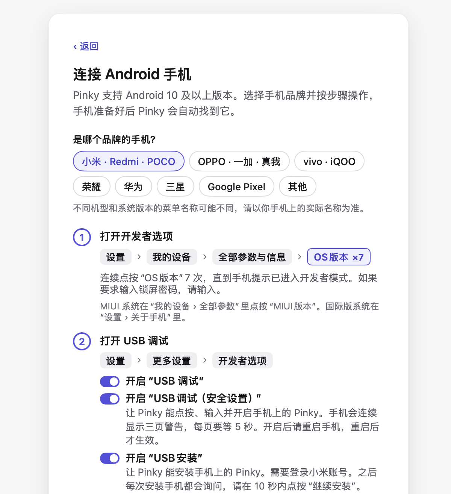
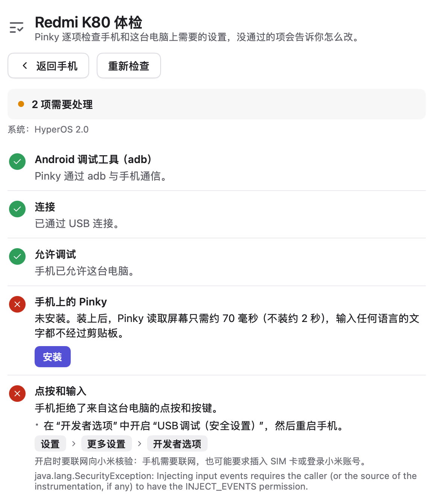

<p align="center"></p>
<h1 align="center">Pinky</h1>
<p align="center"><b>让 AI 用上你的 iPhone 和 Android 手机，关键一步你说了算：可以是 Mac、Windows、Linux 上的任何 Agent，也可以是手机上的 Pinky 自己。</b></p>
<p align="center"><a href="https://github.com/DIYgod/pinky/releases/latest">下载</a> · <a href="#开始使用">开始使用</a> · <a href="#常见问题">常见问题</a> · <a href="https://discord.gg/S27b7SHjng">Discord</a></p>
<p align="center"><a href="README.md">English</a> · 简体中文 · <a href="README.ja.md">日本語</a></p>
<p align="center"><br><sub>在 Android 16 模拟器上真实运行的 Claude Code。Pinky 默认只在付款前询问，这次还设了发消息前也要问。</sub></p>

Pinky 让任何 Agent（Claude Code、Claude Desktop、Codex、Cursor，或者一段脚本）通过 MCP 操作真实的 iPhone 或 Android 手机。你在电脑上看着它干活，有风险的步骤由你批准，随时可以接管，事后还能回看。Pinky 也能用你选的 AI 模型自己完成任务：在电脑上交给它，或者直接在手机上的 Pinky 应用里让它做，完全不用电脑。不管任务由谁来做，审批都由 Pinky 的网关执行，不靠给 Agent 的指令。

- **全平台**：一个应用，macOS（Apple 芯片和 Intel）、Windows、Linux 都能用。能操作 Android 手机（Android 10 到 17）和 iOS 17.4 及以上的 iPhone：iOS 27 及以上手机上什么都不用装；iOS 17.4 到 26 要在装有 Xcode 的 Mac 上装一次 iPhone 上的 Pinky，iOS 27 上也可以选择用它（在 iOS 27、iOS 27 以下的真机和模拟器上都试过；[详情](#手机)）。
- **小巧原生**：窗口由 [MyGo](https://github.com/egoist/mygo) 在 GPU 上绘制，没有 Electron，也没有 webview：安装包 16–22 MB，在 Mac 上空闲时内存约 70 MB，CPU 0%。
- **任何 Agent，一键接入**：在「设置 › 智能体」里点一下就能接入 Claude Code、Claude Desktop、Codex、Cursor 等；任何支持 MCP 的 Agent 都能用，在同一台电脑上或者通过 HTTP 都行。
- **手机上的 Pinky，不用电脑也能做事**：Android 和 iPhone 上的 Pinky 应用能用你选的模型自己完成任务，DeepSeek、通义千问、Kimi、智谱 GLM、Claude、GPT、Gemini 都行，也可以用 Ollama 或 LM Studio 里的本地模型。打字或说出任务，或者把内容分享给它都可以；在 Android 上，还能用悬浮按钮问它屏幕上的内容，让它在隐藏的后台屏幕上干活，你照常用手机（[怎么设置](#pinky-on-the-phone)）。
- **定时任务和记忆**：Pinky 可以在设定的时间执行任务，或者在某个条件满足时通知你，电脑和 Android 上都行。任务结束后，它可能会建议记住一些内容，比如你说过的偏好，你同意了才会保存（[详情](#交给-pinky)）。
- **手机锁着也能在电脑上解锁**：在 Pinky 里保存一次手机的 PIN 码，之后每次解锁用 Touch ID、Windows Hello 或密钥环密码确认。Agent 永远看不到 PIN 码。
- **开源免费**，Apache-2.0 协议，不用注册账号。

<table>
<tr>
<td width="50%" valign="top"><br><b>有风险的步骤由你批准。</b>付款、交易和转账会等你点头；在「设置 › 安全」里，还可以让发送、下单、删除、打电话、装 App、跳出 App 的链接和更改设置也先问你，或者每一步都问。Pinky 能认出 10 种语言里的这些按钮。规则在 Pinky 的网关里执行，Agent 没法自己批准，屏幕上的文字想说服它也没用。</td>
<td width="50%" valign="top"><br><b>默认碰不到。</b>银行、钱包和密码管理器类 App 对 Agent 隐身，Agent 也不能往密码框和验证码框里输入。Agent 在任务中需要用银行或钱包 App 时会先问你，你可以只在这次任务里放行这个 App。每个新 Agent 都要你批准，只能拿到你给的权限范围。</td>
</tr>
<tr>
<td width="50%" valign="top"><br><b>手机还是你的。</b>在 Android 13 及以上，Agent 在隐藏的第二块屏幕上干活，手机自己的屏幕照常归你用，也可以熄屏锁着。较老的 Android 手机和 iPhone 上，Agent 用的是主屏幕。</td>
<td width="50%" valign="top"><br><b>随时接管。</b>点一下投屏，Agent 就暂停，直到你交还；在 Android 上，你亲手碰一下手机也会让它暂停。「全部停止」的快捷键是 ⌥⌘.（Windows 和 Linux 上是 Ctrl+Alt+.），在哪儿都能按。</td>
</tr>
<tr>
<td width="50%" valign="top"><br><b>每次运行都有记录。</b>每一步都用大白话记下来，配上截图和录屏，录屏上每一步都有标记，还能导出成 HTML 报告。这些都只存在你的电脑上。</td>
<td width="50%" valign="top"><br><b>iPhone 也一样。</b>同样的网关、审批和记录，iOS 17.4 及以上都能用（<a href="#手机">能做什么</a>）。图里是 iOS 模拟器，设了删除前要问。</td>
</tr>
</table>

**状态**：pre-alpha。Claude Code 已经通过它在真机上完整跑通过（一台用 USB 连接的 Android 手机、一台 iOS 27 的 iPhone，和一台通过 Pinky 助手（iPhone 上的 Pinky 的前身）连接的 iOS 18.7.11 iPhone XS Max），Agent 可以通过 stdio 或 HTTP 连接。手机上的 Pinky 已经在 Mi 10 Pro（Android 17）和 iPhone 13 mini（iOS 27.0.1）上用真实模型完成过任务。从电脑解锁、Android 后台工作、录屏、导出、Wi-Fi 配对和手机文件都已经做好，其中一部分还在等人实际试用。现在哪些能用、怎么试，见 [docs/ACCEPTANCE.md](docs/ACCEPTANCE.md)。

## 开始使用

装好 Pinky，连上手机，再把 Pinky 接入你的 Agent。然后让 Agent 在手机上做点什么，在 Pinky 的窗口里看它干活。

### 需要准备什么

| | 需要 |
| --- | --- |
| **Mac** | macOS 13 或更高版本，Apple 芯片或 Intel 都行 |
| **Windows** | Windows 10 或 11，64 位（x64） |
| **Linux** | 64 位 PC（x86-64），Ubuntu 20.04、Debian 11 或更新的系统（glibc 2.29 或更高），以及 GTK 3 |
| **Android 手机** | Android 10 到 17，一根 USB 线。Pinky 自带 adb；Windows 上个别手机要装 USB 驱动，Linux 上要开放 USB 访问权限（[见下文](#windows-和-linux-上的-usb)） |
| **iPhone 或 iPad** | iOS 17.4 或更高版本，设置时需要一根 USB 线；之后也可以通过 Wi-Fi 使用（[见下文](#通过-wi-fi-使用-iphone-和-ipad)）。Pinky 会自己准备好 iPhone，用的是 Apple 的开发者磁盘映像：它随 Xcode 提供，你也可以让 Pinky 从第三方镜像下载（[见下文](#iphone)）。iOS 17.4 到 26 还要装 iPhone 上的 Pinky（[见下文](#ios-174-到-26-的-iphone)） |
| **模拟器** | 可选，代替手机或者和手机一起用：装了 Xcode 的 Mac 上的 iOS 模拟器，或者 Android Studio 的 Android 模拟器。模拟器在它们那里创建，由 Pinky 启动（[见下文](#手机)） |
| **Agent** | 任何能用 MCP 服务器的 Agent，比如 Claude Code、Claude Desktop、Codex 或 Cursor |

### 1. 下载并安装 Pinky

从[最新发布](https://github.com/DIYgod/pinky/releases/latest)下载 Pinky：

- **Mac**：Apple 芯片（M1 或更新）的 Mac 下载 `pinky-<version>-arm64.dmg`，Intel Mac 下载 `pinky-<version>-amd64.dmg`。打开后把 Pinky 拖进「应用程序」。用 [Homebrew](https://brew.sh) 的话，`brew install --cask diygod/tap/pinky` 也一样。
- **Windows**：下载 `pinky-setup-<version>-amd64.exe` 并运行。它会把 Pinky 装在你自己的账户下，不需要管理员权限。安装程序暂时还没有签名，所以 SmartScreen 可能会提示「Windows 已保护你的电脑」：点「更多信息」，再点「仍要运行」。不想安装的话，解压 `pinky-<version>-windows-amd64.zip`，打开里面的 `Pinky.exe` 就行。
- **Linux**：Debian 和 Ubuntu 下载 `pinky_<version>_amd64.deb`，用 `sudo apt install ./pinky_<version>_amd64.deb` 安装。其他系统把 `pinky-<version>-linux-amd64.tar.gz` 解压到一个单独的文件夹，运行里面的 `pinky`。

Pinky 会自己检查新版本；Mac 版、用 Windows 安装程序装的 Pinky 和从 Linux 的 `.tar.gz` 解压出来的 Pinky 还会自己装好更新（见[更新](#更新)）。

### 2. 连接手机

打开 Pinky，选「添加手机」。准备好的手机会出现在 Pinky 的窗口里；还缺什么的话，手机页面会告诉你。

#### Android

「添加手机 › Android」会按你手机的品牌给出下面这些步骤，用的是这个品牌自己的菜单名称，也会列出要额外打开的开关：小米、OPPO、vivo、荣耀、华为、三星和 Pixel，其他品牌给通用步骤。

1. 在手机上打开 USB 调试：在「设置 › 关于手机」里连续点「版本号」7 次，然后在「设置 › 系统 › 开发者选项」里打开「USB 调试」。有些品牌的菜单名称略有不同。
2. 把手机插到电脑上。手机问是否允许 USB 调试时，点「允许」。Android 11 及以上也可以在「添加手机」里改用 Wi-Fi 配对（[不成功时](#通过-wi-fi-配对不成功时)）。Android 10 没有「无线调试」：插上线后，用「改用 Wi-Fi 连接…」就能换成 Wi-Fi（[见下文](#手机)）。
3. Pinky 会提出给手机装上它的应用，也就是手机上的 Pinky（在手机上显示为 Pinky），能让读屏快很多倍，还能让 Pinky 输入任何语言。手机可能会让你允许安装一次。

每台手机都有「体检」，在投屏下方的 ··· 菜单里。它会列出哪些能用、没通过的怎么改，比如小米的「USB 调试（安全设置）」开关。

通过 Wi-Fi 时，Pinky 会确认应答的是你的手机：它在准备好的每台手机上留下一个标记，只有通过手机的调试连接才能读到，adb 每次连上手机时都会核对，网络上的其他设备没法冒充它。通过「无线调试」连着、但 Pinky 没用过的手机（比如别的工具连上的）会显示为「在 Wi-Fi 上发现」，在你选择「使用」之前 Pinky 不会碰它。如果你自己重置过手机或重新设置过它，之后手机页面显示「这可能不是 …」，就在那里选「信任这台手机…」，或者插一次线。

要带手机出门？装上 Tailscale 后，Pinky 在外面也能连到它（[怎么做](#不在家里的手机)）。

<table>
<tr>
<td width="50%" valign="top"><br><sub>「添加手机 › Android」，选了小米。</sub></td>
<td width="50%" valign="top"><br><sub>一台 Redmi 的「体检」，有两项要处理。</sub></td>
</tr>
</table>

#### Android 工具

Pinky 自带 adb，这是它连接 Android 手机用的工具，从 Android 源码构建，所以不用另装任何东西。如果电脑上已经有 Android 的 platform tools（来自 Android Studio、Homebrew 或系统的软件包），Pinky 会用它们，并和 Android Studio 等工具共用同一个 adb 服务。退出 Pinky 时，它会停止自带的 adb，除非 Android Studio 等其他应用正在使用；在「设置 › 高级 › 退出 Pinky 时停止 adb」里可以关掉。你自己安装的 adb 会继续运行。

#### Windows 和 Linux 上的 USB

- **Windows**：手机的 USB 调试需要驱动。很多手机 Windows 会自动装好驱动；没有的话，Pinky 会把这台手机标成需要设置，并告诉你装哪个驱动：Pixel 装 [Google USB 驱动](https://developer.android.com/studio/run/win-usb)，三星手机装[三星的驱动](https://developer.samsung.com/android-usb-driver)，其他手机装[手机厂商的驱动](https://developer.android.com/studio/run/oem-usb)。装好后拔下手机再插上。
- **Linux**：电脑要允许 Pinky 打开手机的 USB 设备，这需要 Android 手机的 udev 规则：Debian 和 Ubuntu 上运行 `sudo apt install android-sdk-platform-tools-common`，Arch 上装 `android-udev`，Fedora 上装 `android-tools`。可能还要把自己加进 `plugdev` 组。然后重新插一下手机。缺这些时 Pinky 会提示。

#### 通过 Wi-Fi 配对不成功时

手机插线能用，但「通过 Wi-Fi 配对」一直完成不了时，配对页面会在半分钟内说明 Pinky 看到了什么：

- 「手机还没有出现在网络上」：确认手机已开启「无线调试」，并且和电脑连着同一个 Wi-Fi。访客 Wi-Fi、开了 AP 隔离（客户端隔离）的路由器和许多办公网络会阻止设备互相发现。遇到这种情况，选「改用配对码」：在手机上点按「使用配对码配对设备」，输入它显示的 IP 地址、端口和 6 位配对码，每次打开这个对话框它们都会变。这样配对时 Pinky 不需要在网络上查找手机；如果配对后仍然找不到手机，Pinky 会让你输入「无线调试」页面顶部的 IP 地址和端口（不是配对对话框里的），再通过它连接。如果这些地址也连不上手机，说明这个网络把设备彼此隔开了：换一个设备之间能互相连通的 Wi-Fi（比如家里的主网络，而不是它的访客网络），或者用数据线。
- 「Pinky 没有权限在这个网络上查找手机」：在 Mac 上，Pinky 需要「本地网络」权限，而没有权限时 macOS 不会报错，只是什么都找不到。点「打开“本地网络”设置」，在「系统设置 › 隐私与安全性 › 本地网络」中打开 Pinky，然后重试（如果 macOS 询问是否允许 Pinky 查找本地网络上的设备，点「允许」）。在 Mac 上，手机的「体检」也会在「本地网络」一项里显示这个问题。在 Windows 和 Linux 上，防火墙也可能这样挡住查找：请允许 Pinky 使用本地网络，或者改用配对码。
- 「Pinky 无法在这个网络上查找手机」：确认电脑已连接 Wi-Fi 或以太网。
- 「已找到手机，但配对还没有完成」：如果手机显示错误或已回到「无线调试」页面，请重新扫描二维码，或者改用配对码。

配对中途报错时，页面会说明 adb 报告了什么：

- 「配对还没完成，手机就结束了」（二维码）：手机离开了扫码界面、换了 Wi-Fi，或者电脑和手机之间有东西断开了连接；adb 分辨不出是哪一种。让手机停留在扫码界面后重试，或者点提示旁边的「改用配对码」。
- 「手机没有接受这次配对」（配对码）：配对码不对，或者端口不是配对对话框里的。「无线调试」页面顶部的地址用来连接，不用来配对，而 adb 对这两种错误的回答一模一样。
- 「这个地址上没有在等待配对的设备」或「手机已不再等待配对」：配对对话框或扫码界面已经关闭，或者端口不对。重新打开，按它现在显示的内容操作。
- 「无法通过这个地址连接手机」或「Pinky 连不上它」：网络把电脑和手机隔开了，情况同上；电脑上的 VPN 或防火墙也会这样。
- 「这台电脑上运行的 adb 服务版本太旧」：别的程序启动了比 platform-tools 30 更旧的 adb。退出它或更新它，Pinky 就会启动自己的。

Pinky 会把 adb 的原话写进日志，「帮助 › 发送反馈…」会把它连同诊断信息一起附上。

通过 Wi-Fi 配对需要 Android 11 或更高版本；Android 10 的手机要先插线，再用「改用 Wi-Fi 连接…」换成 Wi-Fi（[见下文](#手机)）。在 Android 16 及更早的版本上，手机离开所连的 Wi-Fi（哪怕只是切到同一网络的另一个接入点）或重启后，「无线调试」会自己关闭：请重新打开，或在「添加手机」中重新配对。

#### iPhone

Pinky 会自己准备好 iPhone，「添加手机 › iPhone」会一步步带你操作。

1. 把 iPhone 插到电脑上，解锁，点「信任」并输入锁屏密码。在 Windows 上要先从 Microsoft Store 装「Apple 设备」（或者 iTunes）；在 Linux 上要装 `usbmuxd` 软件包。缺这些时「添加手机」会提示。
2. 在 iPhone 上打开「设置 › 隐私与安全性」里的「开发者模式」：这个开关是 Pinky 让它出现的。iPhone 会重启；解锁后点「打开」，再输入锁屏密码。
3. Pinky 把 Apple 的开发者磁盘映像挂载到 iPhone 上，然后把它列为就绪。iOS 27 的 iPhone 重启后映像还在；iOS 27 以下的 iPhone 每次重启后，只要你解锁，Pinky 都会自己重新挂载。

开发者磁盘映像随 [Xcode](https://apps.apple.com/app/xcode/id497799835)（Apple 给开发者的免费应用）提供，Pinky 不自带。在 Mac 上装一次 Xcode 并打开一次：Pinky 会用它装好的映像，之后 Xcode 不用再打开。iOS 27 及以上的 iPhone 需要 Xcode 27 或更新版本的映像：Apple 的签名服务器已不再为更早的映像签名，这时「添加手机」会写明 Pinky 用的是哪个映像，以及怎么换成新的。在 Windows 和 Linux 上，把这样一台 Mac 上的 `/Library/Developer/DeveloperDiskImages/iOS_DDI` 复制到 Pinky 的文件夹里（[放在哪](docs/notes/ios.md#preparing-a-phone-without-xcode)）。两样都没有，或者 Pinky 找到的映像（Xcode 的，或者复制到 Pinky 文件夹里的）被 Apple 拒签时，「添加手机」会提出从第三方镜像 github.com/doronz88/DeveloperDiskImage 下载映像（Xcode 27.0 beta 4，32 MB，由 pymobiledevice3 的作者维护，不是 Apple），只在你点「下载」时才下载；Pinky 会按预期的校验和核对每一个文件，之后就用它代替被 Apple 拒签的映像。iOS 27 及以上，iPhone 上不会装任何应用。

在 iPhone 13 mini（iOS 27.0.1）上验证过：映像被卸掉后 Pinky 自己挂上 Xcode 的映像（约 1.5 秒），沿用手机上已有的映像，以及 iPhone 重启后映像还在。还没在真机上试过：下载的映像、开发者模式开关、iOS 27 以下的 iPhone，以及在 Windows 上配对 iPhone。贡献者已经在 Linux（Arch Linux）上用 iOS 27.2 的 iPhone 和 iPad、在 Windows 11 上用 iOS 27.2 的 iPhone 跑通了有线和 Wi-Fi 连接，当时手机上已经有映像。

#### 通过 Wi-Fi 使用 iPhone 和 iPad

iPhone 或 iPad 和电脑在同一个 Wi-Fi 下，并且电脑在 Wi-Fi 上列出了它时，Pinky 也会通过 Wi-Fi 使用它。手机的 Wi-Fi 连接打开后，电脑就会列出它。你插上手机并让它信任这台电脑后，Pinky 会自己打开它的 Wi-Fi 连接：这和在「访达」里勾选在 Wi-Fi 上显示这台 iPhone 的选项（英文为 Show this iPhone when on Wi-Fi）是同一个设置，已经这样设置过的手机保持不变。这项功能默认打开；在「设置 › 手机 › 通过 Wi-Fi 使用 iPhone 和 iPad」里可以关掉，关掉不会改动手机上的这个设置。如果拔掉线后手机没有出现在 Wi-Fi 上，它的「体检」会在「Wi-Fi」一项里说明卡在哪一步：Wi-Fi 连接有没有打开、是不是 Pinky 打开的、没能打开的原因，以及这台电脑在 Wi-Fi 上能不能看到它。

- Pinky 用过的 iPhone 或 iPad 拔掉线后仍可继续使用，还是同一台手机、同样的设置：Pinky 会自己把它切到 Wi-Fi，插回线时再切回有线，Agent 的任务会继续；切换期间它的调用会等几秒。
- Pinky 没用过的，比如家人和这台电脑配对过的 iPad，会显示为「在 Wi-Fi 上发现」。在你选择「使用」（Pinky 会通过 Wi-Fi 完成准备）或「忽略」（插上线之前它都不会再出现在列表里）之前，Pinky 只读取它的名字、型号和 iOS 版本，不做任何其他事，Agent 也看不到它。
- 锁定的 iPhone 或 iPad 在 Wi-Fi 上会显示为「已锁定（Wi-Fi）」，你解锁后 Pinky 才会连接它：它休眠时大约每分钟都会从网络上掉线一次，这时去连接会点亮它的屏幕。
- 通过 Wi-Fi 准备手机：信任这台电脑需要插线；开发者模式开关还没显示出来时，让它出现也需要插线（用过 Xcode 的手机上它已经显示了）。打开开发者模式是在手机上完成的，挂载开发者磁盘映像也可以通过 Wi-Fi 完成，约 9 秒（有线约 1.5 秒）。「添加手机 › iPhone」会写明哪一步需要插线。
- 通过 Wi-Fi 时，Pinky 只和配对过的那台手机通信：它会核对手机第一次信任这台电脑时拿到的证书，网络上的其他设备没法冒充它。iOS 27 以下，到 iPhone 上的 Pinky 里 WebDriverAgent 的连接不加密，那时的安全取决于 Wi-Fi 本身。

通过 Wi-Fi 时每一步都比有线慢，截图最明显。在 iPad Pro 11 英寸（第三代，iPadOS 27.0.1）上实测，Wi-Fi 对比有线：滑动后 80 到 210 毫秒画面出现变化（有线 60 到 90 毫秒），读一次主屏幕 0.6 到 2.6 秒（0.5 到 0.6 秒），截一张图 5 秒（1 秒），视频丢包 0.2%（有线为 0）。拔掉线后，正在运行的任务约 5 秒切到 Wi-Fi；插回线后 2 到 6 秒切回有线（[详情](docs/notes/ios.md#wi-fi)）。

在 Mac 上，系统的设备服务 usbmuxd 在和 Wi-Fi 上的 iPhone 的连接断过一次之后（比如手机的 Wi-Fi 关了又开），可能会把它弄丢，最长约一小时都不再找它，「访达」里也看不到。Pinky 发现你用的手机明明在网络上却不再被列出时，会显示「Wi-Fi 上找不到」，并在它的页面上提供「重启设备服务…」：你确认后，macOS 会要求输入管理员密码，所有 iPhone 和 iPad（包括插着线的）都会断开一两秒。在「终端」里运行 `sudo killall usbmuxd` 效果相同。刚拔线的手机，Pinky 大约 10 秒内就会给出提示；其他情况下会等一分钟，因为熄屏后醒来的手机会自己回来。拔线后这台电脑在 Wi-Fi 上完全看不到的手机，会显示「Wi-Fi 上看不到」，并说明可能的原因：手机熄屏了、连的是另一个网络或者网络会把设备互相隔开（访客网络、一些路由器）、开着 VPN，或者 Pinky 没有「本地网络」权限。

在 Linux 和 Windows 上，系统的设备服务不会自己列出 Wi-Fi 上的 iPhone 和 iPad：Linux 上（`usbmuxd` 软件包）只列出插着线的，Windows 上（Apple Devices 或 iTunes）只在手机同时插着线时才列出。所以在这两个系统上，Pinky 通过 Wi-Fi 使用手机时，会在系统的设备服务前面运行一个自己的小设备服务：它在网络上找到和这台电脑配对过的手机，直接连过去，插线手机的事都交给系统的设备服务。这时 Pinky 和 iPhone、iPad 之间的所有连接都经过它，插着线的也一样。除了系统自带的（Linux 上是 `usbmuxd`，Windows 上是 Apple Devices），不用另外安装或设置什么。如果你运行了一个自己就能列出 Wi-Fi 上手机的设备服务（比如 netmuxd），并带上指向它的 `USBMUXD_SOCKET_ADDRESS`（`unix:///socket/路径` 或 `tcp://127.0.0.1:端口`）启动 Pinky，Pinky 就用它，不再运行自己的。

Pinky 打开手机、或者在有线和 Wi-Fi 之间切换时，会显示「正在连接」或「正在切换到 Wi-Fi」，而不是离线。通过 Wi-Fi 时，Pinky 从实时画面识别文字，不再用截图（Wi-Fi 下截一张图约 5 秒）。没设锁屏密码的 iPhone 或 iPad 读不出“已锁定”，所以它休眠掉线后再出现时，Pinky 要等它连续在线 30 秒才连接。

#### iOS 17.4 到 26 的 iPhone

iOS 27 以下的 iPhone，只能通过手机上一个运行 WebDriverAgent 的应用接收来自电脑的点按和输入：iPhone 上的 Pinky，也就是 Pinky 自己的 App，要在装有 Xcode 的 Mac 上用你自己的 Apple ID 签名并安装一次：插上 iPhone，在 Pinky 里它的页面上点「安装 iPhone 上的 Pinky」（或者在「添加手机 › 连接旧款 iPhone」里点），或者在「终端」运行 `pinkyctl helper install`。两种方式都会构建、签名并装好；在 Pinky 窗口里装时，每一步都会显示出来，Xcode 等手机解锁时也会提醒你（[怎么装](docs/notes/ios.md#installing-pinky-for-iphone)）。电脑上的 Pinky 使用这台手机时，iPhone 上的 App 会显示出来。2026 年 11 月之前 Pinky 装的是「Pinky 助手」，它照样能用；构建不了 iPhone 上的 Pinky 时，Pinky 仍会装 Pinky 助手（`pinkyctl helper install --helper-only` 指定装它）。用免费 Apple ID 的话，每 7 天要重新安装一次：到期前两天，手机页面和体检会提醒你，点「重新安装」即可；到期后，手机会显示为「需要设置」并说明原因（[怎么重新安装](docs/notes/ios.md#when-pinky-for-iphones-signature-runs-out)）。Pinky 助手已经在 Windows 上、用一台 iOS 18.7.11 的 iPhone XS Max 试过（有线和 Wi-Fi）；iPhone 上的 Pinky 已在 iOS 27.0.1 的 iPhone 13 mini 上覆盖 Pinky 助手装好，电脑能启动和停止它的测试服务；在 iOS 17.4 到 26 上还没试过。不装它的话，Pinky 只能显示和读取屏幕（限 Mac）、打开 App，不能点按、滑动或输入。不支持 iOS 17.3 及更早版本。

### 3. 把 Pinky 接入你的 Agent

在 Pinky 里打开「设置 › 智能体」，点你的 Agent 旁边的「接入」。Pinky 会在你的电脑上找到 Claude Code、Claude Desktop、Codex、Cursor、VS Code、Copilot CLI、Windsurf（Devin Desktop）和 Gemini CLI，并用应用自身的路径把自己加进 Agent 的 MCP 服务器：Agent 有自己的命令时用它的命令（比如 `claude mcp add`），否则写进它的设置文件，写之前先备份一份，而且只改 Pinky 那一项。它还会把 Pinky 的 Agent 指南 [SKILL.md](docs/SKILL.md) 装到 Agent 读取技能的位置，并让它保持最新：Pinky 更新后，会把装好的指南改写成新版本的内容。在接入 Agent 之前，Pinky 侧栏里会有一张卡片，帮你接入，或者告诉你去哪里获取 Agent。

<p align="center"></p>

- **Claude Desktop**：「接入」会在 Claude Desktop 里打开 Pinky 的扩展，在那里点「Install」。双击[发布页](https://github.com/DIYgod/pinky/releases/latest)上的 `pinky-<version>.mcpb` 效果一样。
- **其他 Agent**：「设置 › 智能体 › 手动添加智能体」会给出适用于你这份 Pinky 的命令，旁边有复制按钮。添加一个运行这条命令的 MCP 服务器（stdio）。用 Homebrew cask 或 Linux 软件包安装时，JSON 配置写成：

  ```json
  { "mcpServers": { "pinky": { "command": "pinkyctl", "args": ["mcp"] } } }
  ```

  Claude Code 在终端里运行：`claude mcp add --scope user pinky -- pinkyctl mcp`。大多数 Agent 从 `~/.agents/skills/pinky/SKILL.md` 读取指南，Claude Code 从 `~/.claude/skills/pinky/SKILL.md` 读取。

命令是 `pinkyctl` 而不是 `pinky`：很多电脑上已经有另一个叫 `pinky` 的程序。另一台电脑上或容器里的 Agent 可以改用 HTTP 连接（[怎么连](docs/mcp.md#over-http)）。「接入」对每个 Agent 具体改了什么，见 [docs/mcp.md](docs/mcp.md#connecting-an-agent)。

### 4. 试一试

让 Agent 在你的手机上做点什么，比如「打开手机上的短信，告诉 Sam 我要晚点到」。Agent 第一次连接时，Pinky 会问你是否允许，以及允许它做什么。付款会在 Pinky 的窗口里等你点头；在「设置 › 安全」里，还可以让发送、删除等操作也先问你。

手边没有手机？在「添加手机 › 虚拟手机」里启动一台 iOS 模拟器或 Android 模拟器（[见下文](#手机)）。也可以退出 Pinky，再用两台脚本模拟的演示手机启动它（有一笔待批准的付款、一个被屏蔽的银行 App 和一个密码框）：Mac 上运行 `/Applications/Pinky.app/Contents/MacOS/Pinky --fake`，Linux 上运行 `pinkyctl --fake`，Windows 上在 PowerShell 里运行 `& "$env:LOCALAPPDATA\Programs\Pinky\Pinky.exe" --fake`。

## 使用 Pinky

### 手机

- **Android**：通过 USB 或 Wi-Fi 连接（[见上文](#android)）。Pinky 通过 adb 和内置的 scrcpy server 工作。手机上的 Pinky 是它在手机上的应用，随 Pinky 一起提供，读一次屏约 70 毫秒（不装要 2 秒），输入任何语言都不经过剪贴板：手机页面会提出帮你安装（手机可能会让你允许一次）。它的无障碍服务只在 Agent 操作手机时开启，因为银行 App 不肯和这样的服务一起运行（[原因](#常见问题)）。在 Android 13 及以上，Agent 在后台显示器上工作，手机自己的屏幕可以熄屏锁着。App 画在屏幕上、却没有告诉无障碍树的文字（比如超级 App 里的小程序和其他网页、游戏、地图），在 macOS 和 Windows 上会从屏幕画面里识别出来（OCR），Agent 一样能读到、点到。已屏蔽的应用只有在你为这次任务放行后才会这样识别，锁着的手机从不识别，画面也不会保留。
- **Android 10 的 Wi-Fi 连接**：Android 10 没有「无线调试」。插上手机后，在手机画面下方的 ⋯ 菜单（或「设置 › 手机」）里选「改用 Wi-Fi 连接…」：Pinky 会让手机的 adb 在网络上监听（`adb tcpip`，5555 端口），再通过手机的 Wi-Fi 地址连上它，并告诉你什么时候可以拔线。手机回到这个网络时会自动重连，地址变了也能找到。开着时，同一个网络里的任何电脑都可以尝试连接这台手机：如果不是你自己在连接时手机弹出「允许 USB 调试吗？」，请点「取消」；只在你信任的 Wi-Fi 上使用。这会持续到手机重启；重启后插一次线，再点「重新启用 Wi-Fi 连接」。同一个菜单里的「停止 Wi-Fi 连接」可以关掉它（[详情](docs/away-from-home.md#wi-fi-without-wireless-debugging)）。
- **iPhone**：通过 USB 或 Wi-Fi 连接（[见上文](#通过-wi-fi-使用-iphone-和-ipad)），由 Pinky 准备好（[见上文](#iphone)）；iPad 也一样。Pinky 能做什么，取决于 iOS 版本和连接方式；连接方式可以在「设置 › 手机」里为每台 iPhone 单独选（「自动」按版本选，见下表）：

  | iOS | 方式 | 能做什么 | 测试过的设备 |
  | --- | --- | --- | --- |
  | 27 及以上 | Xcode 的 Device Hub 协议；手机上什么都不装 | 除双指缩放外的全部功能。输入文字时会先粘贴，再把你的剪贴板恢复原样 | iPhone 13 mini，iOS 27.0.1 |
  | 17.4 及以上，装了 iPhone 上的 Pinky | 内含 WebDriverAgent 的 iPhone 上的 Pinky（或以前装的 Pinky 助手），在装有 Xcode 的 Mac 上从 Pinky 窗口或用 `pinkyctl helper install` 装一次（[怎么装](docs/notes/ios.md#installing-pinky-for-iphone)）：iOS 17.4 到 26 自动使用，iOS 27 上由你选 | 全部功能，而且手机不共享屏幕，所以拒绝屏幕共享的银行 App 照常能用（测试中有星展银行 digibank 和招商银行）。比 Device Hub 慢：读一次主屏幕约 7 秒（Device Hub 不到 0.5 秒），点一下要 0.5 到 0.8 秒。它启动前，iOS 偶尔会要求在手机上输入锁屏密码。实时画面在 macOS 和 Windows 上都能用 | 用 iPhone 上的 Pinky：iPhone 13 mini，iOS 27.0.1，已装好，电脑能启动和停止它的测试服务。用 Pinky 助手：iPhone 13 mini，iOS 27.0.1，选了它；iPhone XS Max，iOS 18.7.11，在 Windows 上试过实时画面（有线和 Wi-Fi），以及它的按键和滑动；iOS 18.5 和 26.5 模拟器 |
  | 17.4 到 26，不装 iPhone 上的 Pinky | 只用开发者服务；什么都不装 | 看画面（每秒几帧，限 macOS 和 Windows）、读屏幕（位置靠 OCR，限 macOS）、打开 App 和链接。不能点按、滑动、输入或回到主屏幕：没有 iPhone 上的 Pinky，手机不接受输入 | 同样的服务在 iOS 27.0.1 上测过；还没在 iOS 27 以下的真机上试过 |
  | 17.3 及更早 | | 不支持：17.4 之前的连接需要管理员权限，iOS 16 及更早还需要当前 Xcode 已不再包含的开发者磁盘映像 | |

  iPhone 上的 Pinky 内含 Appium 的 WebDriverAgent，用你自己的 Apple ID 签名。用免费 Apple ID 签名可以用 7 天，付费开发者账户可以用一年。Pinky 会在 iPhone 上读取签名的到期时间：到期前两天，手机页面和体检会提醒你重新安装（在装有 Xcode 的 Mac 上点 Pinky 里的「重新安装」，或运行 `pinkyctl helper install`）；到期后，手机会显示为「需要设置」并说明原因，而不是启动失败（[怎么重新安装](docs/notes/ios.md#when-pinky-for-iphones-signature-runs-out)）。
- **iPhone 的屏幕共享**：Pinky 串流 iPhone 的画面时，iOS 会告诉各个 App 屏幕正在共享，有些银行 App（比如星展银行 digibank 和招商银行）会拒绝运行或者发出警告。这时 iOS 也不让 App 使用相机和麦克风，所以相机里是黑的，扫不了码。反过来也一样：有 App 正在使用相机或麦克风时（比如通话、FaceTime、相机、语音备忘录），iOS 27 不让 Pinky 通过 Device Hub 显示这台 iPhone。这时它的页面会显示「相机或麦克风正在使用中」和处理方法，通话结束或那个 App 关掉后，Pinky 会自动连接。Pinky 只在这些时候串流：手机页面或卡片在 Pinky 里打开着、有 Agent 在操作它，以及之后的 30 秒；过后这些 App 就恢复正常。通过 CoreDevice 连接时，Agent 用不了这些 App。再装上 iPhone 上的 Pinky，连接方式保持「自动」（「设置 › 手机」）：任务平时走 CoreDevice，打开星展银行 digibank 或招商银行时，或者 Agent 要求时，Pinky 会把这个任务临时切到不共享屏幕的 iPhone 上的 Pinky，任务结束后再切回 CoreDevice。也可以让这台 iPhone 的所有任务都通过 iPhone 上的 Pinky 连接。
- **模拟器**：iOS 模拟器（Mac 上要装 Xcode）和 Android 模拟器（来自 Android Studio）也能当手机用。「添加手机 › 虚拟手机」列出这台电脑上的模拟器：点「启动」启动一台，运行起来后它就作为手机出现，标着「模拟器」；点「关闭」关掉它。Pinky 启动的 Android 模拟器没有声音，这样蓝牙耳机不会被切到麦克风模式。只有你能启动模拟器，Agent 没有这个工具。实时画面、录屏、审批和规则都和真机一样。Pinky 像 Android Studio 那样找 Android SDK（先看 `ANDROID_HOME`，再看 `ANDROID_SDK_ROOT`，最后是 Android Studio 默认的安装位置），找到后 Android 模拟器用起来就像一台插着线的 Android 手机。iOS 模拟器第一次用时，Pinky 会用你的 Xcode 构建 Appium 的 WebDriverAgent：源码来自固定的一个版本，构建前先校验文件，不签名，也不需要 Apple ID。这需要 20 秒到几分钟，构建结果一直沿用到 Xcode 更新。Pinky 不会创建模拟器，也不会下载系统映像：请在 Xcode（Window › Devices and Simulators）或 Android Studio 的 Device Manager 里创建（[详情](docs/notes/ios.md#ios-simulators)）。
- **锁着的手机**：Pinky 从不让手机一直亮着，只在每一步之前唤醒屏幕。在「设置 › 手机」里保存手机的 PIN 码，就能在电脑上用 Touch ID 解锁。Agent 永远看不到 PIN 码。Android 上，这在 AOSP 风格的锁屏上验证过（Mi 10 Pro 上的 LineageOS，Android 10、16 和 17 模拟器）；小米、三星、OPPO、一加、vivo、荣耀和华为的锁屏只有根据已知信息写的测试覆盖，Pinky 读不准 PIN 码键盘时什么都不会输入（[详情](docs/notes/integration.md#unlocking-other-android-phones)）。
- **双指缩放**：Agent 可以用两根手指放大、缩小地图、照片和网页，也可以双指旋转它们。你在 Pinky 的手机画面上也可以：在触控板上双指捏合（Linux 上仅限 Wayland），或者像 Xcode 的 Simulator 那样按住 Option（Windows 和 Linux 上是 Alt）拖动，第二根手指会出现在屏幕中心另一侧、和指针相对的位置。和你的其他触摸一样，这会让 Agent 暂停。iPhone 通过 iPhone 上的 Pinky 双指缩放。iOS 27 选「自动」时，无论是 Agent 还是你双指缩放，Pinky 都会换到 iPhone 上的 Pinky（你的第一次捏合只会触发切换，要等几秒），用完再换回来；没装 iPhone 上的 Pinky 时不能双指缩放，Agent 会收到说明。
- **拖动**：Agent 可以用 `phone_drag` 拖动：先按住把东西拿起来，经过它指定的几个点移动，需要时停一停，再松手。这样就能把 App 图标移到主屏幕的其他页面（在屏幕边缘停一下就会翻页）或文件夹里，也能调整列表顺序、拖动滑块。规则和审批把拖动当作滑动来判断，手指碰到的每个点下面的东西都会检查，审批里的截图会画出整条路线。Android 和 iPhone（通过 Device Hub 或 iPhone 上的 Pinky）都能拖动。已在 Android 模拟器和 iOS 模拟器上试过，还没在真机上试过。
- **文件**：在 Android 上，Agent 可以在手机的 Pinky 文件夹（`/sdcard/Pinky`，手机上它们唯一能碰到的地方）和电脑上的一个文件夹之间拷贝文件，往手机上拷贝之前会先问你。拷到那里的图片会出现在手机的相册和图片选择器里，Agent 可以在聊天应用里把它发出去。另一台电脑上的 Agent 碰不到电脑上的那个文件夹，所以它会先把文件发给 Pinky：小文件直接放在调用里，大一些的发到 Pinky 给它的一次性链接。之后把文件拷到手机上，照样要你同意（[详情](docs/mcp.md#uploading-a-file)）。iPhone 上没有这个功能。
- **用于 bug 报告的截图和报告**：测试 App 的 Agent 可以把截图存成文件，也可以在任务结束时保存任务报告（带截图的步骤，HTML 和 JSON 各一份），放进 bug 报告或 pull request。这些文件存在电脑上这台手机的文件夹里，iPhone 也可以；保存不会问你，因为手机上什么都没变。里面只有 Agent 本来就能看到的内容：验证码被遮住，手机锁着或开着被屏蔽的 App 时（包括你在这次任务里允许过的）不会保存。任务的录屏既不遮验证码，也不遮被屏蔽的 App，所以只有你允许，Agent 才拿得到：Agent 导出录过屏的任务时，Pinky 每次都会问你要不要把录屏（报告旁边的一个 MP4）也给它，任何预设和「始终允许」都不会替你答应。你拒绝或没回应，Agent 就只拿到报告。另一台电脑上的 Agent 会为每个文件拿到一个一次性下载链接（[详情](docs/mcp.md#saving-screenshots-and-reports)）。
- **链接**：Agent 可以用 `phone_launch` 打开链接：网页、App 自己的链接（`myapp://…`），以及打电话、发短信和写邮件的链接。打开之前，Pinky 先找出手机会用哪个 App 打开这个链接，再把它当作打开那个 App、并点了链接所代表的东西来判断：被屏蔽的 App 的链接照样被拦下，任务范围外的 App 的链接会被拒绝，付款链接和付款按钮一样要等你点头。读取手机上的文件、运行代码或运行快捷指令的链接（`file:`、`content:`、`intent:`、`javascript:`、`data:`、快捷指令）一律拒绝，手机会让你挑选用哪个 App 打开的链接也会拒绝。审批和「活动」里会写明链接和打开它的 App。iPhone 上，网页链接在 Safari 里打开；通过 iPhone 上的 Pinky 连接时，需要 WebDriverAgent 4.11 或更新版本（[详情](docs/mcp.md#opening-a-link)）。
- **你开发的应用**：Agent 可以从电脑上这台手机的文件夹安装应用（Android 上是一个 APK，或同一个应用的一组拆分 APK；iPhone 上是为这台 iPhone 做了开发签名的 `.ipa` 或 `.app`），也可以更新、卸载和强行停止它，写代码的 Agent 就能把自己的构建装到手机上、打开、检查。安装和卸载都会先问你，并写明应用的名称、ID、版本和签名者；选「在此任务中允许」后，同一个应用、同样签名的后续构建会直接安装，不再问你；选「更多选项 › 始终允许」后，这个 Agent 在这台手机上以后的任务里也不再问，直到你在「设置 › 安全」里撤销。换了签名者或换了应用仍会询问，卸载每次都会问。Pinky 自己的应用、系统应用、金融应用、密码管理器和你屏蔽的应用，都不能被覆盖安装、卸载或停止（[详情](docs/mcp.md#phone_app)）。
- **应用日志**：Agent 在测试某个应用时，可以读这个应用自己的日志和崩溃报告，看看它为什么出错。每个任务里第一次读时，Pinky 会先问你（选「在此任务中允许」，这个任务剩下的时间就不再问；选「更多选项 › 始终允许」，这个 Agent 在这台手机上读这个应用的日志就不再问，直到你在「设置 › 安全」里收回）；如果是开发版（Android 上的 debug 版，iPhone 上用 Xcode 装的应用），就不问。Agent 只拿得到这个应用自己的日志，拿不到别的应用和系统的，也永远读不到被屏蔽的应用、银行和钱包应用、密码管理器、手机自带的应用和 Pinky 自己的日志。历史记录只记下读了多少行，不留日志内容。iPhone 不保留 Pinky 能读到的日志记录，所以在 iPhone 上，Pinky 从 Agent 第一次读开始监听，直到任务结束（[详情](docs/mcp.md#phone_logs)）。
- **测试 App**：Agent 可以拨动开发者测试时用的开关：旋转屏幕、切换浅色和深色外观、模拟位置，以及用另一种语言和地区打开某个 App。这些都会改动手机的设置，所以在真机上要你先同意（选「在此任务中允许」，这次任务后面的改动就不再问；选「更多选项 › 始终允许」，这个 Agent 在这台手机上改设置就不再问，直到你在「设置 › 安全」里收回）；在模拟器上会直接进行，除非你选了不只在付款前询问。任务结束时 Pinky 会把它们都改回来，期间你自己改过的则保持不动。屏幕方向和外观在 Android 和装了 iPhone 上的 Pinky 的 iPhone 上可用；模拟位置在 Android 模拟器、iOS 模拟器和装了 iPhone 上的 Pinky 的 iPhone 上可用；换语言在 Android 13 及以上和 iPhone 上可用（[详情](docs/mcp.md#phone_device)）。你也可以自己旋转屏幕：手机画面下方 ⋯ 菜单里的「旋转」（iPhone 和 iPad 要装好 iPhone 上的 Pinky：在 iOS 27 上 Pinky 会为这次旋转换到它，Agent 旋转屏幕和双指缩放时也会把任务换过去）。它和在画面上触摸一样，会让正在手机屏幕上工作的 Agent 暂停，在隐藏的第二块屏幕上工作的则不受影响。屏幕方向已在三星 Galaxy A12（Android 13）、Pixel 9a（Android 17）、iPhone 12 Pro Max（iOS 18）、iPhone Air（iOS 27）和 iPad mini（iPadOS 27）上试过，其余的已在 Android 模拟器和 iOS 模拟器上试过，还没在真机上试过。
- **移除手机**：手机 ⋯ 菜单里的「移除这台手机…」（手机离线时它的页面上、「所有手机」里它的卡片上、侧栏里它的右键菜单和「设置 › 手机」里也有）会把它从列表里去掉，并删除它保存的 PIN 码和设置。它的任务、截图和录屏会留在「活动」里，除非你勾选把它们也删掉；正在这台手机上运行的任务会停止。插着线的手机会立刻作为一台新手机回来，直到你拔掉它。通过 Wi-Fi 连接的手机会断开，并且不再出现在列表里，即使 adb 自己又连上了它；要加回来，就在「添加手机」里重新配对，或者插上线。通过 Wi-Fi 连接的 iPhone 或 iPad，在你插上线之前都不会再出现在列表里。Pinky 不会解除手机和电脑的配对：它的 USB 调试或无线调试配对，以及 iPhone 的信任，都会留给其他应用使用（[详情](docs/notes/gateway.md#removing-a-phone)）。
- **暂停手机**：手机 ⋯ 菜单里的「暂停连接」（侧栏里它的右键菜单和「所有手机」里它的卡片上也有）会把手机留在 Pinky 里，但停止它的屏幕串流和 Pinky 与它的连接：iPhone 的隧道和 WebDriverAgent，Android 手机的 scrcpy 和与手机上的 Pinky 的连接。手机上正在运行的任务会结束，智能体会被告知它已暂停，Pinky 也不会再通过 Wi-Fi 重新连接它。重启 Pinky 后它仍然是暂停状态。在它的页面上点「恢复」，或在右键菜单里选「恢复连接」，或者用数据线连上，就能恢复。插着线时暂停的手机会一直暂停，直到你拔掉再插上，这样给充电中的手机暂停就不会马上自己恢复。手机页面顶部会显示手机是否正在向 Pinky 串流屏幕；iPhone 在你最后一次查看或操作 30 秒后停止串流。没有任务在运行的 iPhone，在「所有手机」里显示的是最后一帧画面而不是实时画面，所以 Pinky 停在这一页也不会让 iPhone 一直亮屏或保持屏幕共享（[详情](docs/notes/gateway.md#pausing-a-phone)）。
- **离开电脑时处理审批**：网页投屏通过 Tailscale 提供后（「设置 › 手机 › 网页投屏」），打开「在浏览器中处理审批」，点「添加手机」旁的「生成链接」，在你自己的手机上打开这个链接。手机会为这台电脑创建一个通行密钥并显示一串数字；「设置」里显示同样的数字时，选好这个浏览器在哪台手机上，再点「允许」。Agent 使用那台手机时以及用完后的 30 秒内，它上面的网页不能回答任何审批，因为操作手机的一方也能点「允许」。之后网页会列出等你处理的步骤，附带截图和 Agent 想点的位置，在网页上「允许」或「拒绝」要点两次，第二次会要求用面容 ID、指纹或手机密码确认。网页只能对付款、发送或 Agent 的提问回答「允许」（只算这一步）或「拒绝」；新 Agent、被屏蔽的 App 和交接仍在 Pinky 窗口里处理。60 秒内没有回答仍然算拒绝，电脑和手机上谁先回答就以谁为准。Pinky 退出后会忘记你添加的手机（[详情](docs/notes/remote-approvals.md)）。已用模拟手机试过，还没在 iPhone 的 Safari 上试过。

### 不在家里的手机

Android 手机不必和电脑在同一个网络里。电脑和手机都装上 [Tailscale](https://tailscale.com) 并登录同一个账号后，Pinky 就能经它连到手机：电脑留在家里，手机带出门，用移动数据或别的 Wi-Fi 都行。Android 同一时间只能开一个 VPN，所以手机上别的 VPN 和代理应用要关着：它们一开，Tailscale 就会关闭。

1. 趁手机在电脑旁（插线或连同一个 Wi-Fi）设置一次：「设置 › 手机 › 离家时使用 › 打开…」。「添加手机 › Android › 手机不在这个网络里？用 Tailscale」会带你在两边装好 Tailscale，并列出你 tailnet 里的手机。
2. Pinky 会让手机的 adb 在网络上监听（`adb tcpip`，5555 端口），再通过手机的 Tailscale 地址连接它。手机在电脑所在的网络里没有连接时，Pinky 就用这条连接，所以出门时手机会一直留在列表里。
3. 之后手机的 adb 会在它连上的每个网络上接受连接，只放行它已经信任的电脑，其他电脑连过来时手机会询问你。只有经 Tailscale 的那条连接是加密的。这会持续到手机重启，点「关闭」可以立即停止。Pinky 只读取 Tailscale 的状态，不会更改它的设置。
4. 「为离家的手机保持电脑唤醒」（「设置 › 手机」，默认开启）会在有手机通过 Tailscale 连接时阻止电脑空闲睡眠。合上 MacBook 的盖子它仍会睡眠。

在家时经 Tailscale 和直接走 Wi-Fi 一样快；在外面时，画面靠手机的上行带宽传回来，所以经 Tailscale 时 Pinky 会降低画面码率（1 Mbit/s），信号不好的 4G 热点上每一步都要等几秒。详情、实测数据、流量和连不上时怎么办：[docs/away-from-home.md](docs/away-from-home.md)。Agent 也可以不在这台电脑上：见[远程 Agent](docs/mcp.md#over-http)。

### 交给 Pinky

自己没有 Agent？Pinky 可以自己在一台手机上把任务做完。在「设置 › 智能体」的「交给 Pinky」里选一个服务，填上它的 API 密钥。DeepSeek、通义千问、Kimi、智谱 GLM、硅基流动、火山方舟、OpenRouter、Anthropic、OpenAI、Gemini、Ollama 和 LM Studio 都有现成的设置；其他兼容 Anthropic 或 OpenAI API 的服务，填上服务地址和模型名称也能用。保存时会马上检查模型，出了问题会说清楚是什么问题。密钥和手机的 PIN 码一样，保存在 Mac 的钥匙串、Windows 凭据管理器或你的密钥环里，只发送给这个服务。「用量」里可以看到 Pinky 自己的智能体今天、最近 7 天和最近 30 天用了多少 token，按服务和模型分开列，知道价格的还会显示费用；这些数据只存在你的电脑上。

然后在手机页面「任务」顶部写下任务，比如「定一个 7:00 的闹钟」，点「开始」（或按 ⌘↩，Windows 和 Linux 上是 Ctrl+Enter）；在「所有手机」里要先选手机。点「询问屏幕」会开始一个关于手机当前画面的任务。Pinky 会以「Pinky」这个 Agent 的身份一步步操作，和其他 Agent 走同一条路：你的规则、审批、已屏蔽的应用、「接管」、「全部停止」和录屏对它都有效，它的任务也会记在「活动」里。它从不输入密码和一次性验证码（除非你允许了在虚拟手机上输入，而且任务里给了），遇到时会把手机交给你。点「停止」会立刻结束任务。它工作时，你可以在任务框里给它发消息，Pinky 读到之前都可以修改或撤回；任务结束后，点「继续」可以发一条新消息让它接着做。

每个任务做到 100 步、20 分钟或 2 美元就会停下，以先到者为准；这些上限可以在「设置 › 智能体」里改，等你操作的时间不算在内。费用按 Anthropic 的价格计算；Pinky 不知道价格的模型，按每百万 token 1 美元计算。「交给 Pinky」一次只用一台手机：更复杂的事，还是接入一个 Agent（[详情](docs/notes/builtin-agent.md)）。

**记忆**：任务结束后，Pinky 可能会建议记住一些内容供以后的任务使用，比如你说过的偏好，或者在某个 App 里更快的操作方法；只有你点了「记住」才会保存。在「设置 › 智能体 › 记忆」里可以查看、编辑、删除这些记忆，也可以关掉记忆。记忆从不保存密码、验证码、卡号、账号、证件号、电话号码或地址，每台设备各存各的。Pinky 还熟悉微信、支付宝、美团、淘宝、小红书、高德地图、Google 地图、Apple 地图、时钟、计算器和设置：打开它们时会先读一份简短的使用指南（[详情](docs/notes/builtin-agent.md#memory-and-app-guides)）。

**定时任务**：在手机页面的「定时任务」下点「新建定时任务…」，可以让任务只执行一次，或者每天、每个工作日、每周、每隔几小时执行，也可以只在某个条件满足时通知你。定时任务在电脑和 Android 上运行（iPhone 上不行）。没人看着的时候，它从不付款，需要审批时会发通知问你；手机锁着、正在用或者关机时会跳过这一次，并留下说明。

你的 Agent 也可以把整个任务交给 Pinky，不用自己一步步操作手机：`phone_task_run` 用你在这里设好的模型和上限开始任务，`phone_task_wait`、`phone_task_status`、`phone_task_list` 用来跟进，`phone_task_steer` 用来补充要求或让它接着做，`phone_task_cancel` 用来取消。这样的任务以那个 Agent 的身份进行，而不是以 Pinky 的身份：它第一次连接时会问你，「设置 › 智能体」里给它的权限和你的规则照样有效，审批也只有你能回答。「任务」顶部的框会显示这个任务和交来它的 Agent：你也可以在那里给它发消息、点「继续」让它接着做，任务仍以那个 Agent 的身份进行；点「停止」就会结束，之后 Agent 不能再让它继续。Pinky 的窗口开着时才能用，`pinky daemon` 里不行（[详情](docs/mcp.md#phone_task_run)）。脚本也可以在终端里这样做：`pinkyctl task run "设一个 7:00 的闹钟"` 会等任务做完并显示结果，它以名为「Pinky CLI」的 Agent 身份进行（也可以用 `-as "Nightly tests"` 另起名字），`pinkyctl task status|steer|cancel|list` 用来跟进（[详情](docs/mcp.md#from-a-shell-pinkyctl-task)）。

<a id="pinky-on-the-phone"></a>

### 手机上的 Pinky

手机上的 Pinky 应用（在手机上就叫 Pinky）也能自己在这台手机上完成简单的任务，不需要电脑。它和「交给 Pinky」一样，用你选的 AI 模型和 API 密钥：在手机上的 Pinky 里写下任务，点「开始」，Pinky 就离开自己的界面，到其他 App 里操作，你在旁边看着。Pinky 的规则在手机上同样有效：有风险的步骤会先问你（「设置 › Pinky 应在何时询问你？」），遇到密码和验证码会把手机交给你，到了上限或你点「停止」就停下，做过的任务都在它的「活动」里。密钥只保存在手机上，也只发给那个服务。手机上的 Pinky 和电脑上的一样，提供同样的模型服务、保存时的检查和用量统计。你可以用说的代替打字，在它工作时给它发消息，任务结束后点「继续」让它接着做；你同意保存的记忆在它自己的「设置 › 记忆」里。电脑上的 Pinky 正在使用这台手机时，应用会告诉你，等它用完就可以在手机上开始任务。电脑上的 Pinky 会在手机页面上提示一次，「设置 › 手机」里的「在手机上做任务」也有说明和设置方法。

- **Android**：在 Pinky 的手机页面上点「安装」装上 Pinky 的应用；不用电脑也行：在手机上打开最新版本的 [`pinky-android.apk`](https://github.com/DIYgod/pinky/releases/latest/download/pinky-android.apk) 并安装（[详见](#install-companion-by-hand)）。在手机上打开 Pinky，按它的步骤来：先在 Android 的无障碍设置里打开 Pinky（Android 13 起，系统可能要你先在 Pinky 的应用信息里允许受限设置，应用里有说明），再选择 AI 模型并添加 API 密钥。之后 Pinky 会提出让自己保持运行，因为 Android 和一些手机厂商会在后台停掉应用。任务进行时，其他 App 上方会浮着一个小胶囊显示 Pinky 在做什么，需要你处理时会弹出卡片。Android 上的 Pinky 还能：
  - 在隐藏的「后台屏幕」上执行任务，并用一个小悬浮窗显示进度，你可以同时照常用手机（「设置 › 后台屏幕」；需要 Android 13 及以上，并打开无线调试）；
  - 在其他 App 上方显示「悬浮按钮」，用来问 Pinky 屏幕上的内容：双击打字提问，长按说话（「设置 › 这台手机」，或者用它的快捷设置图块）；
  - 从其他 App 把文字、链接和图片分享给 Pinky 来开始任务，或者用快捷设置图块新建任务；
  - 像电脑上一样执行定时任务（见上文）。

  已在 Mi 10 Pro（LineageOS，Android 17）上用真实模型试过。
- **iPhone**：在装有 Xcode 的 Mac 上安装 Pinky 的应用：在手机页面或「设置 › 手机」里点「安装 iPhone 上的 Pinky」，或者运行 `pinkyctl helper install`（[怎么装](docs/notes/ios.md#installing-pinky-for-iphone)）。在 iPhone 上打开 Pinky，按它的步骤来：先「让 Pinky 与这台 iPhone 配对」（iOS 27 上在 iPhone 的「设置」里输入 Pinky 显示的配对码；iOS 27 以下要在装有 Pinky 的 Mac 上配对一次），再「打开 Pinky 的 VPN」（它让 Pinky 在手机上就能连到这台手机），最后选择 AI 模型并添加 API 密钥。需要你确认的事会在 Pinky 里等你，也会发通知；实时活动会显示任务和「停止」按钮。「在 Pinky 中新建任务」快捷指令会打开 Pinky，带上任务，以及从共享表单传来的文字或链接，直接就能开始。带自己 VPN 的应用需要付费的 Apple 开发者账号；用免费 Apple ID 时，Pinky 会构建一个轻量版应用，它要配合 App Store 上的 LocalDevVPN 使用（[详情](docs/notes/iphone-app.md)）。已在 iPhone 13 mini（iOS 27.0.1）上用真实模型试过一个简单任务，任务由调试版启动（[这次运行](docs/notes/iphone-app.md#a-real-model-on-the-phone-run)）。

### 更新

Pinky 在启动时和之后每隔几小时检查一次新版本，有新版本时会显示一张卡片，写着更新了什么，附「立即更新」和「以后再说」。打开「设置 › 高级 › 自动更新」时（默认打开），它会在没有 Agent 在干活、你也有十分钟没用 Pinky 时自己装好，还会更新空闲手机上的 Pinky 应用，更新后它的无障碍服务保持关闭，直到下一个任务。截至 2026 年 11 月 8 日的版本都用公开的密钥签名，遇到这样的手机上的 Pinky，Pinky 会卸载它，重新安装用 Pinky 私有密钥签名的版本，并告诉你；如果手机在通过 USB 安装应用前会询问，手机页面会说明原因，等你点「更新」；手机不让通过 USB 安装应用时，每个新版本侧栏都会有一张卡片告诉你一次，由你手动安装（[怎么装](#install-companion-by-hand)）。更新之后，「新功能」会列出自你原来的版本以来的变化（Pinky 显示中文时来自 [CHANGELOG.zh-CN.md](CHANGELOG.zh-CN.md)，否则来自英文的 [CHANGELOG.md](CHANGELOG.md)）。

- **macOS**：Pinky.app 会先核对下载文件的校验和、确认它由 Pinky 的开发者签名并经过 Apple 公证，再替换自己；新版本启动不了就退回旧版本。Homebrew cask 装的那份也会这样自己更新，它已经是最新时 `brew upgrade` 不会动它。直接从磁盘映像里运行的、或者放在你没有写权限的文件夹里的 Pinky，会告诉你怎么更新。
- **Windows**：用安装程序装的 Pinky 会在核对校验和后静默运行新的安装程序，启动新版本，新版本启动不了就退回旧版本。免安装版会帮你下载安装程序。
- **Linux**：从 `.tar.gz` 解压到单独文件夹的 Pinky 会先核对下载的校验和，再用新版本的文件替换自己的文件，启动新版本，新版本起不来就换回旧版本。`.deb` 由包管理器更新；其他方式运行的 Pinky 会把新版本下载好，由你来安装。
- **终端**：Pinky 没在运行时，`pinkyctl update` 会安装更新；`pinkyctl daemon` 只会在日志里提示有新版本。

详情见 [docs/notes/updates.md](docs/notes/updates.md)。

### 使用统计、崩溃报告和反馈

Pinky 会发送匿名的使用统计（只有计数，比如跑了几个任务、调用了哪些工具、连了几台手机，大约一天一次，带一个随机的安装 ID）和崩溃报告；可以在「设置 › 隐私」里把两者都关掉，或者设置 `DO_NOT_TRACK=1`。屏幕内容、输入的文字、App 名、手机名和标识、PIN 码和文件名都不会发送。「帮助 › 发送反馈…」会帮你打开一个 GitHub issue，填好你的留言和诊断信息，你看过后自己提交。完整清单见 [docs/TELEMETRY.md](docs/TELEMETRY.md)。

## 常见问题

<details>
<summary><b>哪些 Agent 能用 Pinky？</b></summary>

任何能用 MCP 服务器的 Agent：通过 stdio 运行 `pinkyctl mcp`，或者用智能体令牌通过 HTTP 连接（[怎么连](docs/mcp.md#over-http)）。「设置 › 智能体」能一键接入 Claude Code、Claude Desktop、Codex、Cursor，以及它在你电脑上找到的其他 Agent。目前在真机上完整跑通的是 Claude Code。动脑子的是你的 Agent；没有 Agent 时，简单的任务可以用你自己的 API 密钥[交给 Pinky](#交给-pinky)。

</details>

<details>
<summary><b>Pinky 把文件放在哪里，能换个位置吗？</b></summary>

Pinky 的设置、历史记录，以及 Agent 用来连接它的 socket，都放在你的用户目录里：Mac 上是 `~/Library/Application Support/Pinky`；Windows 上是 `%APPDATA%\Pinky` 和 `%LOCALAPPDATA%\Pinky`；Linux 上是 `~/.config/pinky`、`~/.local/share/pinky` 和 `$XDG_RUNTIME_DIR/pinky`。想把它们都放到你自己选的一个文件夹里，就把环境变量 `PINKY_HOME` 设成那个文件夹，Pinky 会用其中的 `config`、`data` 和 `run`。要让 Pinky 和 Agent 都能看到这个变量，比如在 Windows 上设成用户环境变量，或者同时写进 Agent 的 MCP 设置（`"env": { "PINKY_HOME": "…" }`）：没带这个变量启动的 Pinky 会用默认位置，也就找不到另一个。macOS 和 Linux 上 socket 的路径不能太长（大约 100 个字符），`PINKY_HOME` 让它超长时 Pinky 会直接说明。

Windows 上 Agent 通过命名管道连接 Pinky，Claude、Codex 桌面版这类打包（MSIX）的应用里也能连上。旧版 Pinky 用的是 AppData 里的 socket 文件，这些应用看不到它；如果其中的 Agent 连不上 Pinky，请先更新 Pinky。

</details>

<details>
<summary><b>Agent 能自己批准有风险的操作，或者被人骗着批准吗？</b></summary>

不能。规则在 Pinky 的网关里执行，网关挡在 Agent 和手机之间。需要你批准的步骤会以 `approval_pending` 返回给 Agent，你在 Pinky 里点「允许」之前，手机上什么都不会发生；Agent 也没有任何东西可以发来替你确认。真正执行前，Pinky 还会核对按钮是否还在原处，60 秒内没回应就当作拒绝。Pinky 靠按钮上的文字认出这些按钮，支持 10 种语言，长得特别的按钮可能会漏掉：想更严格，「设置 › 安全」里有「在每个操作前都询问」和「只读模式」。

</details>

<details>
<summary><b>哪些东西 Agent 看不到？</b></summary>

银行、钱包和密码管理器类 App（Pinky 自带一份名单，可以在「设置 › 安全」里从手机上的应用中挑选添加）：Agent 拿不到它们的画面，它们的通知也会被藏起来，下拉通知栏和锁屏上也一样。别的界面上出现被屏蔽的 App 时，比如通知栏或横幅里它的通知、最近任务里它的卡片，Agent 只会读到那里有东西被隐藏了，Agent 拿到的截图和「活动」里的截图也会用灰块遮住（录屏里保持原样，所以录屏留在你的电脑上：只有你在某次导出时允许，Agent 才拿得到）。Agent 不能往密码框和验证码框里输入。想在模拟器上用测试账号测试登录时，可以在「设置 › 安全 › 允许在虚拟手机上输入密码」里放开（默认关闭），真机上始终不行。Agent 在任务中需要用银行或钱包 App 时，Pinky 会先问你。你允许的话，Agent 在这次任务剩下的时间里可以打开和读取这个 App，你的规则在那里照样会问，Pinky 也不会留下它的截图和录屏：只有画面上才有的文字，Pinky 在内存里看一眼画面识别出来，只把文字交给 Agent，不给图。密码管理器不会提供这个选项。

一次性验证码会在 Agent 读到之前被打码：不管是在短信、邮件、通知里还是屏幕上别的地方，「您的验证码为 482913」到 Agent 那里都是「您的验证码为 ••••••」，Agent 拿到的截图和「活动」里的截图也会用灰块把验证码遮住。价格、电话号码、日期和跟验证码无关的文字里的数字都保持原样。录屏里的验证码保持原样，所以录屏留在你的电脑上：只有你在 Agent 导出某次任务报告时允许，它才拿得到。可以在「设置 › 安全 › 对智能体隐藏验证码」里关掉。

</details>

<details>
<summary><b>手机屏幕会被传到云端吗？</b></summary>

Pinky 不会传。截图、录屏和记录都存在你的电脑上，默认保留 30 天，可以在「设置 › 隐私」里修改，也可以在那里删除。Agent 读到的内容、它保存的截图和报告，以及你在某次导出时允许给它的录屏，会发给你选的那个 Agent，这和你给它用任何工具一样。Pinky 的匿名使用统计从不包含屏幕内容、输入的文字或 App 名（[见上文](#使用统计崩溃报告和反馈)）。

</details>

<details>
<summary><b>Pinky 会在手机上装什么？</b></summary>

Android 上，你点「安装」后会装上手机上的 Pinky，它在手机上显示为 Pinky（2026 年 11 月之前叫 Pinky Companion）。之后 Pinky 会帮它保持最新，并且只在 Agent 工作时开启它的无障碍服务（[原因](#常见问题)）。iPhone 上，iOS 27 及以上不装任何应用：Pinky 只是像 Xcode 那样挂载 Apple 的开发者磁盘映像。iOS 17.4 到 26 上是内含 WebDriverAgent 的 iPhone 上的 Pinky，要你在装有 Xcode 的 Mac 上装一次（在 Pinky 里点「安装 iPhone 上的 Pinky」，或运行 `pinkyctl helper install`，[怎么装](docs/notes/ios.md#installing-pinky-for-iphone)），手机上显示为 Pinky（2026 年 11 月之前是「Pinky 助手」）。

</details>

<a id="install-companion-by-hand"></a>
<details>
<summary><b>怎么手动安装手机上的 Pinky？</b></summary>

有的手机不让电脑通过 USB 安装应用，比如没插 SIM 卡的小米手机打不开「USB安装」，这时可以自己安装手机上的 Pinky。它的安装包 `pinky-android.apk` 就在 Pinky 里：

- **macOS：** 在应用里面，路径是 `Pinky.app/Contents/Resources/pinky-android.apk`：在「应用程序」里右键 Pinky，选「显示包内容」。
- **Windows：** 在 Pinky 所在的文件夹里，和 `Pinky.exe` 放在一起。
- **Linux：** 在 `.tar.gz` 解压出来的文件夹里，和 `pinky` 放在一起；用 `.deb` 安装的在 `/opt/pinky/` 里。

通过 USB 安装失败时，手机页面上的「显示 pinky-android.apk」会帮你找到这个文件。把它拷到手机上（用数据线或聊天软件发过去都行），在手机上打开安装；手机可能会先让你允许用来打开它的应用安装应用。装好后 Pinky 会认出它，因为应用和签名都一样，就不会再提示安装了。

在小米、Redmi 和 POCO 手机上，Pinky 点按、输入和开启手机上的 Pinky 的无障碍服务，还需要打开「开发者选项」里的「USB调试（安全设置）」，打开后要重启手机才生效。这个开关和「USB安装」一样要联网向小米核验，也可能要求插 SIM 卡。没有它，手机上的 Pinky 装上了也开不起来，Pinky 在这台手机上也没法点按和输入。

只有手机上的 Pinky 自己的代码改了，它才会出新版本，不是 Pinky 每次更新都有。打开「自动更新」时，Pinky 会通过 USB 试着装一次新版本；手机拒绝的话，侧栏会有一张卡片告诉你，附「显示 pinky-android.apk」，这个版本 Pinky 也不会再试。按上面的方法装上新的 `pinky-android.apk` 就行。关掉「自动更新」时，打开手机页面就能看到新版本。

</details>

<details>
<summary><b>银行等 App 会发现手机上的 Pinky 吗？</b></summary>

无障碍服务开着的时候，它们能发现。恶意软件常常滥用无障碍服务，所以很多银行 App 在发现某个不是从应用商店装的 App 开着无障碍服务时，会拒绝登录：马来西亚的银行（Maybank、CIMB、HSBC 以及马来西亚银行公会的其他成员，2024 年起）和新加坡的银行（DBS、OCBC、UOB，2023 年起）都是这样，其他地方也有。手机上的 Pinky 就是这样的 App，因为它是 Pinky 通过 USB 装上的。微信、抖音、小红书这类 App 也能看到这个服务，并且会留意自动化操作；我们还没听说它们因为手机上的 Pinky 采取过措施，但让 Agent 操作它们可能违反它们的用户协议。

App 也能看到手机开着 USB 调试或无线调试，Pinky 在每台安卓手机上都需要它；有些 App（包括一些银行 App）在它开着时会提醒你，或者不让你用。只要这台手机还在用 Pinky，它就一直开着。

所以 Pinky 只在 Agent 操作手机时才开启这个服务：任务开始时开启，任务结束或你接管手机后几秒关闭，Agent 一分钟没有操作也会关闭。其余时间它都是关着的，这些 App 照常能用。Agent 工作期间（哪怕是在手机的后台显示器上），它们能看到这个服务：这时要用它们，先在 Pinky 里点「接管」，或者结束任务。

如果完全不想让 Pinky 开启这个服务，从手机上卸载 Pinky（Android 的「设置 › 应用 › Pinky」）。没有它 Pinky 照样能用，只是慢一些：读一次屏约 2 秒而不是 70 毫秒，输入英文以外的文字要经过手机的剪贴板。手机页面上的「以后再说」可以收起 Pinky 重新安装它的提示。

</details>

<details>
<summary><b>Pinky 和其他给 Agent 用的手机工具有什么不同？</b></summary>

做 Pinky 之前，我们看了十几个同类方案。没有一个开源项目能同时做到：iPhone 和 Android 都支持，macOS、Windows、Linux 都能跑，能接任意 Agent，并且让人在回路里。多数方案要么靠 Agent 自觉先问你，要么只能整类拦截；Pinky 在 Agent 之外扣住有风险的那一下点按，并且记录每一次运行。

</details>

<details>
<summary><b>把手机交给能执行命令的 Agent 安全吗？</b></summary>

能以你的身份执行命令的 Agent，可以绕开 Pinky 直接接触手机（比如调用 adb），从而跳过它的规则。这类 Agent 请放在接触不到手机的沙盒里运行，或者把手机插到另一台电脑上，让 Agent 通过 HTTP 连接那台电脑上的 Pinky（[怎么连](docs/mcp.md#over-http)）。

</details>

## 参与开发

用 Pinky 的话，装发布版就行（见[开始使用](#开始使用)）。自己构建需要 Go 1.27.3 或更高版本，Mac 上还要 Xcode 命令行工具。

```sh
make check   # 构建（CGO_ENABLED=0）、vet、测试
make app     # macOS：带 FFmpeg 和手机上的 Pinky 的 Pinky.app，以及 .dmg
```

各系统的构建步骤、FFmpeg 和 adb 的打包方式、测试和代码结构，见英文版的 [Build from source](README.md#build-from-source)、[Build and test](README.md#build-and-test) 和 [Code layout](README.md#code-layout)。开发文档都是英文的：

- [验收清单](docs/ACCEPTANCE.md)
- [设计](docs/DESIGN.md)
- [Agent 指南（SKILL.md）](docs/SKILL.md)和 [MCP 参考](docs/mcp.md)
- [不在家里的手机](docs/away-from-home.md)
- [参与开发须知](docs/WORKING.md)
- [使用统计、崩溃报告和反馈](docs/TELEMETRY.md)
- [更新日志](CHANGELOG.zh-CN.md)

## 社区

欢迎来 [Discord](https://discord.gg/S27b7SHjng) 提问、分享你的 Agent 在手机上做了什么、关注开发进展。Bug 和功能建议也欢迎在 GitHub 提 issue；Pinky 里的「帮助 › 发送反馈…」会帮你填好诊断信息。

## 许可证

Apache-2.0
